---
## Author
author:
  name:  Цыкунова Екатерина Михайловна
  email: 1132246732@rudn.ru
  affiliation:
    - name: Российский университет дружбы народов
      country: Российская Федерация
      postal-code: 117198
      city: Москва
      address: ул. Миклухо-Маклая, д. 6

## Title
title: "Отчёт по лабораторной работе №5"
subtitle: "Адресация IPv4 и IPv6. Настройка DHCP"
license: "CC BY"
---

# Цель работы

Получение навыков настройки службы DHCP на сетевом оборудовании для распределения адресов IPv4 и IPv6.

# Выполнение лабораторной работы

## Настройка DHCP для IPv4 и IPv6

### Настройка DHCP в сети IPv4

Запускаю GNS3 VM и GNS3, создаю новый проект для исследования работы протоколов DHCP и DHCPv6. В рабочей области размещаю маршрутизатор VyOS, коммутатор Ethernet и оконечное устройство VPCS. Переименовываю устройства в соответствии с используемой учётной записью: `VyOS-emcikunova-gw-01`, `emcikunova-sw-01` и `PC1-emcikunova`. Соединяю компьютер с коммутатором, а коммутатор — с интерфейсом маршрутизатора. На соединении между коммутатором и маршрутизатором включаю захват сетевого трафика для последующего исследования DHCP-пакетов в Wireshark (см. рис. [@fig-001]).

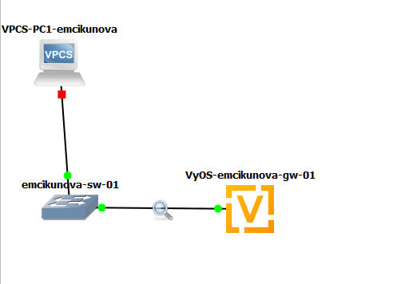{ #fig-001 width=70% }

Перехожу к первоначальной настройке маршрутизатора VyOS. Вхожу в режим конфигурирования командой `configure` и изменяю системное имя устройства командой `set system host-name emcikunova-gw-01`. Затем задаю доменное имя `emcikunova.net` командой `set system domain-name emcikunova.net`.

Создаю системного пользователя `emcikunova` с помощью команды `set system login user emcikunova authentication plaintext-password`, указывая пароль для доступа к маршрутизатору. После этого удаляю автоматическое получение IPv4-адреса на интерфейсе `eth0` командой `delete interfaces ethernet eth0 address dhcp`, поскольку далее для интерфейса будет задан статический адрес (см. рис. [@fig-002]).

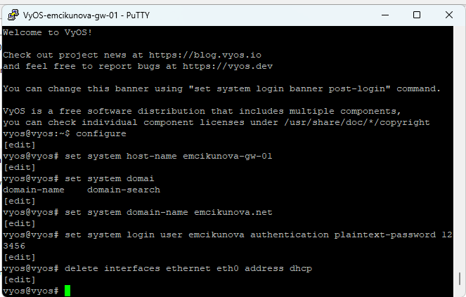{ #fig-002 width=70% }

Применяю изменения командой `commit` и сохраняю конфигурацию командой `save`. Затем выхожу из текущего сеанса и подключаюсь к маршрутизатору под созданной учётной записью `emcikunova`. Повторно перехожу в режим конфигурирования и удаляю стандартного пользователя `vyos` командой `delete system login user vyos`. Для применения настроек выполняю `commit`, после чего сохраняю конфигурацию командой `save`. В терминале появляется сообщение `Saving configuration to '/config/config.boot'... Done`, подтверждающее успешное сохранение изменений (см. рис. [@fig-003]).

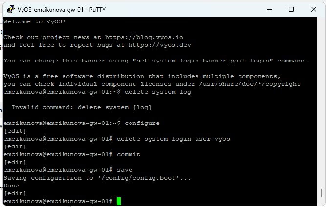{ #fig-003 width=70% }

Перехожу к настройке IPv4-адресации и DHCP-сервера. На интерфейсе `eth0` маршрутизатора назначаю статический IPv4-адрес `10.0.0.1/24` командой `set interfaces ethernet eth0 address 10.0.0.1/24`. Этот адрес будет использоваться оконечными устройствами в качестве шлюза по умолчанию и адреса DNS-сервера, передаваемого через DHCP.

Создаю разделяемую сеть DHCP с именем `emcikunova` и задаю доменное имя командой `set service dhcp-server shared-network-name emcikunova domain-name emcikunova.net`. Затем указываю адрес DNS-сервера `10.0.0.1` командой `set service dhcp-server shared-network-name emcikunova name-server 10.0.0.1`.

Для подсети `10.0.0.0/24` задаю шлюз по умолчанию `10.0.0.1` командой `set service dhcp-server shared-network-name emcikunova subnet 10.0.0.0/24 default-router 10.0.0.1`. Создаю диапазон выдаваемых адресов с именем `hosts`, указав его начало `10.0.0.2` и конец `10.0.0.253` командами `set service dhcp-server shared-network-name emcikunova subnet 10.0.0.0/24 range hosts start 10.0.0.2` и `set service dhcp-server shared-network-name emcikunova subnet 10.0.0.0/24 range hosts stop 10.0.0.253`.

После завершения настройки применяю конфигурацию командой `commit` и сохраняю её командой `save`. В результате DHCP-сервер настроен на распределение 252 IPv4-адресов из указанного диапазона (см. рис. [@fig-004]).

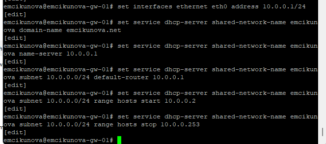{ #fig-004 width=70% }

Для первоначальной проверки работы DHCP-сервера выполняю команды `show dhcp server statistics` и `show dhcp server leases`. Первая команда отображает статистику использования пула IPv4-адресов, вторая — сведения об адресах, выданных клиентам.

В таблице статистики отображается пул `emcikunova`, содержащий 252 адреса. Все 252 адреса находятся в состоянии `Available`, а использование пула составляет `0%`. Таблица выданных адресов пустая, поскольку оконечное устройство ещё не обращалось к DHCP-серверу. Убеждаюсь, что DHCP-сервер доступен для обслуживания запросов клиентов и адреса пока не распределены (см. рис. [@fig-005]).

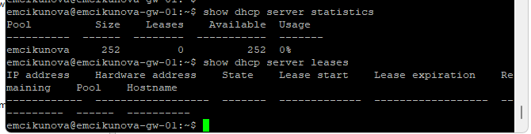{ #fig-005 width=70% }

Перехожу к настройке оконечного устройства `PC1-emcikunova`. Для получения IPv4-адреса автоматически выполняю команду `ip dhcp -d`. Параметр `-d` включает подробный вывод сообщений протокола DHCP, позволяя наблюдать информацию, полученную от сервера в процессе назначения адреса.

В ответе DHCP-сервера отображаются параметры сетевой конфигурации. Поле `Opcode: 2 (REPLY)` указывает на ответ сервера, а поле `Your IP Address` содержит выделенный компьютеру IPv4-адрес `10.0.0.2`. В параметре `Option 54` указан идентификатор DHCP-сервера `10.0.0.1`. Параметр `Option 51` задаёт время аренды адреса `86400` секунд, что соответствует 24 часам. В `Option 1` передаётся маска подсети `255.255.255.0`, в `Option 3` — шлюз `10.0.0.1`, в `Option 6` — DNS-сервер `10.0.0.1`, а в `Option 15` — доменное имя `emcikunova.net`.

После завершения обмена сообщениями устройство получает конфигурацию `IP 10.0.0.2/24 GW 10.0.0.1`. Сохраняю полученные параметры командой `save`. Сообщение `Saving startup configuration to startup.vpc` с последующим подтверждением `done` свидетельствует об успешном сохранении конфигурации VPCS (см. рис. [@fig-006]).

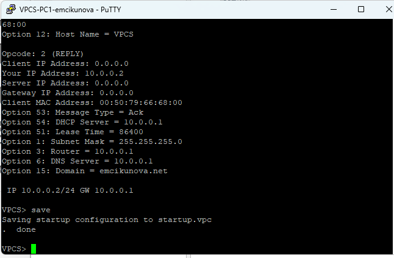{ #fig-006 width=70% }

Для проверки полученной конфигурации выполняю команду `show ip` на компьютере `PC1-emcikunova`. В выводе отображается адрес `10.0.0.2/24`, шлюз по умолчанию `10.0.0.1`, DNS-сервер `10.0.0.1`, адрес DHCP-сервера `10.0.0.1` и доменное имя `emcikunova.net`. Дополнительно отображаются сведения о времени аренды IPv4-адреса и MAC-адрес сетевого интерфейса `00:50:79:66:68:00`.

Проверяю доступность маршрутизатора командой `ping 10.0.0.1 -c 2`. Компьютер отправляет два ICMP Echo Request и получает два ответа от адреса `10.0.0.1`. Время получения ответов составляет приблизительно `1.130` и `1.456` мс. Отсутствие потерь подтверждает работоспособность IPv4-соединения между клиентом и маршрутизатором после получения сетевых параметров по DHCP (см. рис. [@fig-007]).

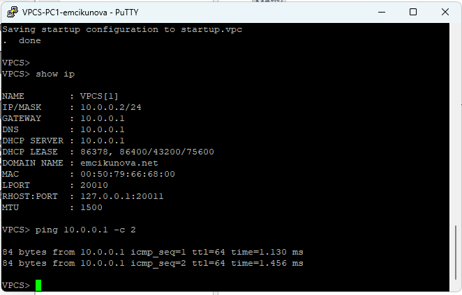{ #fig-007 width=70% }

Возвращаюсь к маршрутизатору `emcikunova-gw-01` и повторно выполняю команды `show dhcp server statistics` и `show dhcp server leases`. В статистике DHCP-сервера количество доступных адресов уменьшается с 252 до 251, что свидетельствует о выделении одного IPv4-адреса клиенту. Значение использования пула по-прежнему отображается как `0%` вследствие округления небольшого процента занятых адресов.

В таблице аренды появляется запись об адресе `10.0.0.2`, связанном с MAC-адресом клиента `00:50:79:66:68:00`. Для записи указано состояние `active`, имя клиента `VPCS`, а также время начала и окончания аренды. Сопоставляю эти сведения с результатом команды `show ip` на компьютере и убеждаюсь, что DHCP-сервер зарегистрировал выданный адрес (см. рис. [@fig-008]).

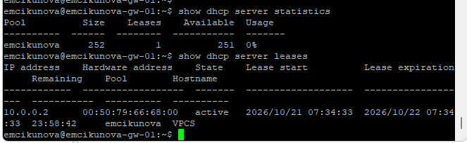{ #fig-008 width=70% }

Для дополнительного исследования работы DHCP-сервера просматриваю системный журнал маршрутизатора командой `show log | grep dhcp`. В начале журнала присутствуют сообщения об отсутствии описания подсети на интерфейсе `eth1` и игнорировании запросов на этом интерфейсе, поскольку он не имеет соответствующей IPv4-конфигурации. Затем отображается сообщение `Server starting service`, подтверждающее запуск DHCP-сервера.

Далее в журнале наблюдаю последовательность обработки запроса клиента. Сообщение `DHCPDISCOVER from 00:50:79:66:68:00 via eth0` соответствует поиску DHCP-сервера. В ответ маршрутизатор отправляет `DHCPOFFER on 10.0.0.2`, предлагая свободный адрес. После получения сообщения `DHCPREQUEST for 10.0.0.2` сервер подтверждает назначение адреса сообщением `DHCPACK on 10.0.0.2`. Все сообщения относятся к одному клиенту VPCS и подтверждают успешное выполнение процедуры автоматической IPv4-адресации (см. рис. [@fig-009]).

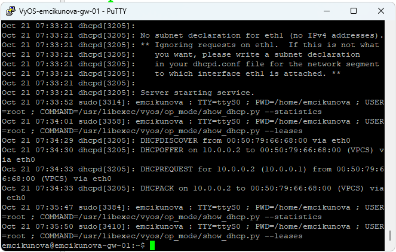{ #fig-009 width=70% }

Перехожу к анализу сетевого трафика в Wireshark. Для отображения только сообщений протокола DHCP применяю фильтр `dhcp`. В списке захваченных пакетов обнаруживаю сообщения `DHCP Discover`, `DHCP Offer`, `DHCP Request` и `DHCP ACK`, относящиеся к процессу получения IPv4-адреса.

Сначала рассматриваю пакет `DHCP Discover`, отправленный оконечным устройством. Поскольку компьютер ещё не получил IPv4-адрес, источником пакета выступает адрес `0.0.0.0`, а назначением является широковещательный адрес `255.255.255.255`. Передача выполняется по UDP с порта `68` на порт `67`. В заголовке BOOTP указан тип сообщения `Boot Request (1)` и MAC-адрес клиента `00:50:79:66:68:00`. В поле параметров DHCP присутствует `Option 53: DHCP Message Type (Discover)`, идентифицирующий сообщение поиска сервера. Также передаются идентификатор клиента и имя узла `VPCS` (см. рис. [@fig-010]).

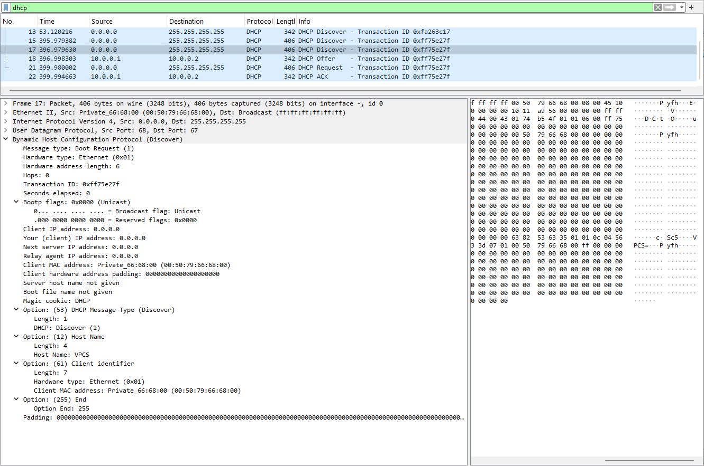{ #fig-010 width=70% }

Следующим рассматриваю пакет `DHCP Offer`, отправленный маршрутизатором `10.0.0.1` клиенту. В заголовке BOOTP поле `Your (client) IP address` содержит предлагаемый адрес `10.0.0.2`. В параметрах пакета указано `Option 53: DHCP Message Type (Offer)`, а `Option 54` определяет сервер DHCP с адресом `10.0.0.1`.

Дополнительно сервер передаёт время аренды `86400` секунд, маску `255.255.255.0`, шлюз по умолчанию `10.0.0.1`, DNS-сервер `10.0.0.1` и доменное имя `emcikunova.net`. Убеждаюсь, что содержимое предложения соответствует конфигурации DHCP-сервера, заданной на маршрутизаторе. На этом этапе адрес предлагается клиенту, но окончательное подтверждение аренды ещё не выполнено (см. рис. [@fig-011]).

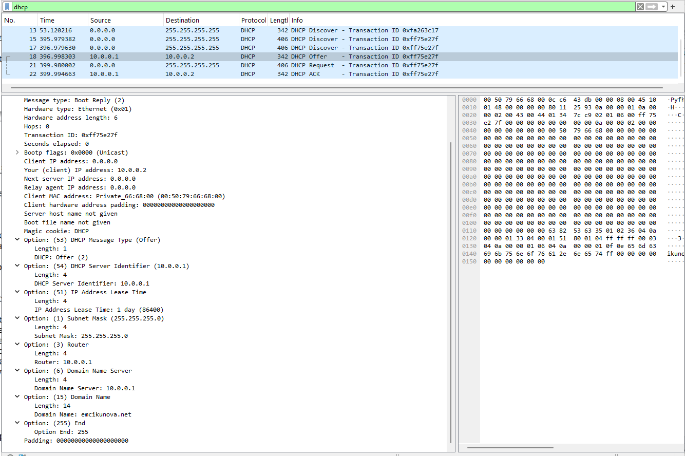{ #fig-011 width=70% }

Далее анализирую сообщение `DHCP Request`, отправленное компьютером после получения предложения сервера. В параметрах пакета присутствует `Option 53: DHCP Message Type (Request)`. Параметр `Option 54` содержит идентификатор выбранного DHCP-сервера `10.0.0.1`, а параметр `Option 50` — запрашиваемый IPv4-адрес `10.0.0.2`.

В сообщении также присутствует `Option 55: Parameter Request List`, через который клиент запрашивает дополнительные сведения о сети, включая маску подсети, шлюз, DNS-сервер и доменное имя. Пакет передаётся широковещательно с адреса `0.0.0.0` на `255.255.255.255`, поскольку процесс назначения IPv4-адреса ещё не завершён (см. рис. [@fig-012]).

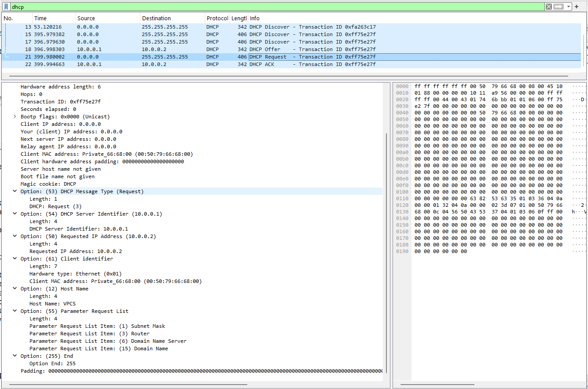{ #fig-012 width=70% }

Завершаю анализ IPv4-адресации просмотром сообщения `DHCP ACK`. В параметрах пакета указан тип `Option 53: DHCP Message Type (ACK)`, подтверждающий успешную выдачу адреса. DHCP-сервер `10.0.0.1` подтверждает клиенту назначение адреса `10.0.0.2` и повторно передаёт время аренды `86400` секунд, маску подсети `255.255.255.0`, шлюз `10.0.0.1`, DNS-сервер `10.0.0.1` и доменное имя `emcikunova.net`.

В результате анализа захваченных пакетов устанавливаю, что процесс получения IPv4-адреса проходит по последовательности `Discover → Offer → Request → ACK`. Обмен сообщениями соответствует работе DHCP, а выданные параметры совпадают со сведениями, отображаемыми на компьютере `PC1-emcikunova` и маршрутизаторе VyOS (см. рис. [@fig-013]).

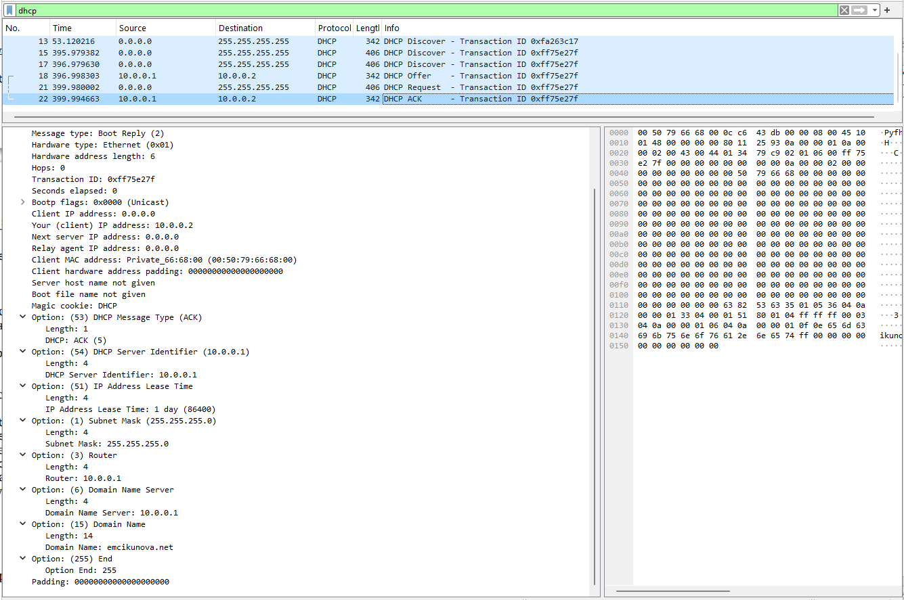{ #fig-013 width=70% }

### Настройка DHCPv6 без отслеживания состояния

Перехожу к исследованию автоматической настройки IPv6-адресации. Дополняю существующую топологию сети двумя коммутаторами Ethernet и четырьмя оконечными устройствами на базе AlmaLinux и Alpine Linux Virt. Переименовываю новые коммутаторы в `emcikunova-sw-02` и `emcikunova-sw-03`, а оконечные устройства — в `AlmaLinux-emcikunova-02`, `AlpineLinuxVirt-emcikunova-02`, `AlmaLinux-emcikunova-03` и `AlpineLinuxVirt-emcikunova-03`.

Подключаю устройства с индексом `02` к коммутатору `emcikunova-sw-02`, а устройства с индексом `03` — к коммутатору `emcikunova-sw-03`. Первый коммутатор соединяю с интерфейсом `eth1` маршрутизатора VyOS, второй — с интерфейсом `eth2`. Ранее созданную подсеть IPv4 с компьютером `PC1-emcikunova` сохраняю без изменений.

Для исследования протокола DHCPv6 включаю захват трафика на соединениях маршрутизатора с коммутаторами `emcikunova-sw-02` и `emcikunova-sw-03`. Полученная топология позволяет исследовать два режима DHCPv6: без отслеживания состояния на интерфейсе `eth1` и с отслеживанием состояния на интерфейсе `eth2` (см. рис. [@fig-014]).

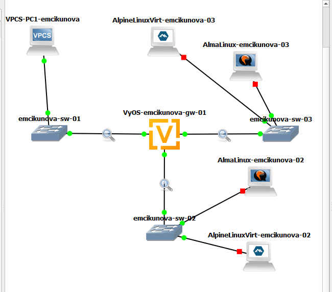{ #fig-014 width=70% }

Перехожу к настройке IPv6-адресации на маршрутизаторе `emcikunova-gw-01`. Вхожу в режим конфигурирования командой `configure` и назначаю интерфейсу `eth1` адрес `2000::1/64` командой `set interfaces ethernet eth1 address 2000::1/64`. Затем для интерфейса `eth2` задаю адрес `2001::1/64` командой `set interfaces ethernet eth2 address 2001::1/64`.

Выполняю команду `show interfaces` для просмотра конфигурации интерфейсов. В выводе отображается ранее назначенный IPv4-адрес `10.0.0.1/24` на интерфейсе `eth0`, IPv6-адрес `2000::1/64` на `eth1` и IPv6-адрес `2001::1/64` на `eth2`. Убеждаюсь, что все адреса соответствуют заданной схеме сети. Применяю изменения командой `commit` и сохраняю конфигурацию командой `save` (см. рис. [@fig-015]).

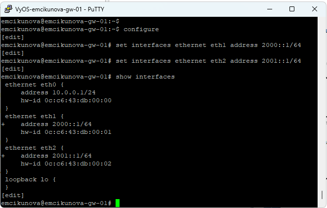{ #fig-015 width=70% }

Приступаю к настройке DHCPv6 без отслеживания состояния, или `Stateless DHCPv6`, для подсети `2000::/64`. В данном режиме IPv6-адреса формируются оконечными устройствами самостоятельно с использованием механизма SLAAC, а DHCPv6 передаёт дополнительные параметры, в частности адрес DNS-сервера и доменное имя.

Сначала настраиваю отправку объявлений маршрутизатора на интерфейсе `eth1` командой `set service router-advert interface eth1 prefix 2000::/64`. Затем устанавливаю флаг `other-config-flag` командой `set service router-advert interface eth1 other-config-flag`. Этот флаг сообщает клиентам, что дополнительные параметры сети могут быть получены через DHCPv6.

Создаю разделяемую сеть `emcikunova-stateless` командой `set service dhcpv6-server shared-network-name emcikunova-stateless` и указываю подсеть `2000::0/64` командой `set service dhcpv6-server shared-network-name emcikunova-stateless subnet 2000::0/64`.

Задаю дополнительные параметры DHCPv6: адрес DNS-сервера `2000::1` командой `set service dhcpv6-server shared-network-name emcikunova-stateless common-options name-server 2000::1` и доменное имя `emcikunova.net` командой `set service dhcpv6-server shared-network-name emcikunova-stateless common-options domain-search emcikunova.net`. Для Stateless DHCPv6 диапазон выдачи IPv6-адресов не задаю, поскольку адреса формируются на клиентских устройствах с использованием SLAAC (см. рис. [@fig-016]).

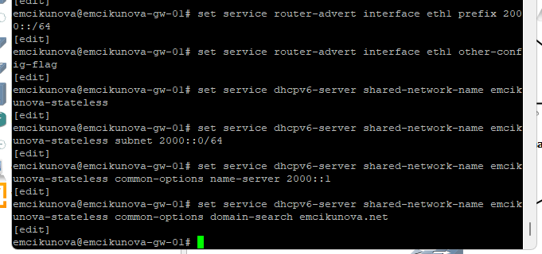{ #fig-016 width=70% }

После настройки Stateless DHCPv6 применяю изменения командой `commit`, сохраняю их с помощью `save` и выполняю `run show configuration` для просмотра действующей конфигурации маршрутизатора.

В выводе нахожу раздел `dhcp-server`, содержащий ранее созданную сеть IPv4 `emcikunova`, её подсеть `10.0.0.0/24`, шлюз `10.0.0.1` и диапазон `10.0.0.2–10.0.0.253`. Ниже отображается раздел `dhcpv6-server` с сетью `emcikunova-stateless`, в котором присутствуют параметры `domain-search emcikunova.net` и `name-server 2000::1`. Это подтверждает наличие конфигурации IPv4 DHCP и DHCPv6 на одном маршрутизаторе (см. рис. [@fig-017]).

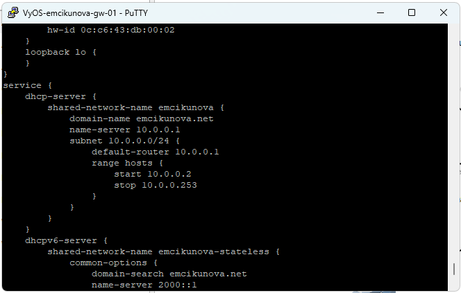{ #fig-017 width=70% }

Продолжаю просмотр конфигурации маршрутизатора. В разделе `dhcpv6-server` отображается подсеть `2000::0/64`, относящаяся к разделяемой сети `emcikunova-stateless`. В разделе `router-advert` для интерфейса `eth1` указаны параметры `other-config-flag` и `prefix 2000::/64`.

Убеждаюсь, что маршрутизатор настроен на отправку объявлений RA с IPv6-префиксом `2000::/64` и указанием на возможность получения дополнительных параметров через DHCPv6. Это позволяет совместно использовать механизмы SLAAC для формирования адреса и Stateless DHCPv6 для передачи DNS-параметров (см. рис. [@fig-018]).

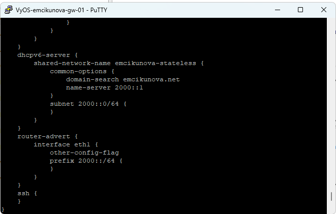{ #fig-018 width=70% }

Перехожу к оконечному устройству `AlpineLinuxVirt-emcikunova-02`. В терминале выполняю команды `ip address` и `ip -6 route show` для проверки IPv6-адресации и таблицы маршрутизации.

В выводе команды `ip address` на интерфейсе `eth0` отображается глобальный IPv6-адрес `2000::e94:8bff:fe80:0/64` с пометкой `dynamic`, а также локальный адрес канального уровня `fe80::e94:8bff:fe80:0/64`. Наличие глобального адреса с префиксом `2000::/64` подтверждает работу механизма SLAAC.

В таблице маршрутизации присутствует маршрут для сети `2000::/64` и маршрут по умолчанию через локальный IPv6-адрес маршрутизатора. Проверяю доступность маршрутизатора командой `ping 2000::1 -c 2`. Получаю два ответа, потери пакетов составляют `0%`.

Затем выполняю команду `cat /etc/resolv.conf`. В файле указан DNS-сервер `10.0.2.3`, а не ожидаемый `2000::1`. Это показывает, что глобальная IPv6-адресация и маршрутизация работают, но DNS-конфигурация данного клиента на момент проверки не соответствует параметрам Stateless DHCPv6, заданным на маршрутизаторе (см. рис. [@fig-019]).

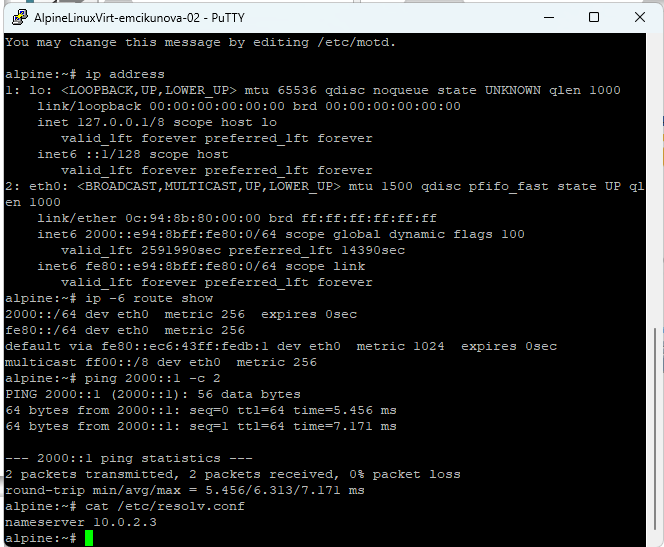{ #fig-019 width=70% }

Аналогично проверяю настройки устройства `AlmaLinux-emcikunova-02`. После входа в систему выполняю команду `ip address`. На интерфейсе `eth0` отображается автоматически сформированный глобальный IPv6-адрес `2000::eca:64ff:fecd:0/64` и локальный адрес канального уровня `fe80::eca:64ff:fecd:0/64`.

Командой `ip -6 route show` проверяю наличие маршрута для сети `2000::/64` и маршрута по умолчанию через локальный адрес маршрутизатора. Затем отправляю два ICMPv6 Echo Request командой `ping 2000::1 -c 2`. Оба пакета получают ответы, потери составляют `0%`, что подтверждает доступность маршрутизатора по IPv6.

Для проверки DNS выполняю `cat /etc/resolv.conf`. В отличие от клиента Alpine Linux, на AlmaLinux отображаются домен поиска `emcikunova.net` и DNS-сервер `2000::1`. Эти параметры соответствуют настройкам Stateless DHCPv6, выполненным на маршрутизаторе (см. рис. [@fig-020]).

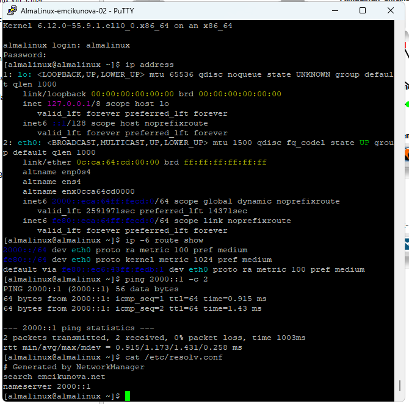{ #fig-020 width=70% }

Возвращаюсь к маршрутизатору VyOS и выполняю команду `run show dhcpv6 server leases` для проверки выданных IPv6-адресов. В выводе появляется таблица с полями `IPv6 address`, `State`, `Last communication`, `Lease expiration`, `Remaining` и `IAID_DUID`, однако записи об аренде адресов отсутствуют.

Пустая таблица соответствует принципу работы Stateless DHCPv6. В этом режиме сервер передаёт дополнительные параметры конфигурации, но не назначает IPv6-адреса клиентам и не ведёт учёт их аренды. Глобальные IPv6-адреса оконечных устройств формируются механизмом SLAAC на основе префикса, полученного из объявлений маршрутизатора (см. рис. [@fig-021]).

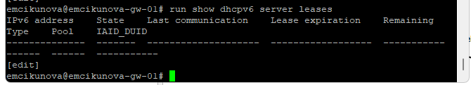{ #fig-021 width=70% }

Перехожу к анализу захваченного трафика DHCPv6 в Wireshark. Для отображения сообщений протокола применяю фильтр `dhcpv6`. В списке пакетов обнаруживаю сообщение `Information-request` от клиента и ответное сообщение `Reply` от сервера.

Выбираю пакет `Information-request`. В его заголовке указан тип сообщения `11`, соответствующий запросу дополнительных параметров сети. Пакет отправлен клиентом с локального IPv6-адреса канального уровня на многоадресный адрес `ff02::1:2`, предназначенный для DHCPv6-серверов и ретрансляторов. Обмен выполняется с использованием UDP-портов `546` и `547`.

В параметрах запроса присутствует `Option Request (6)`, где перечислены запрашиваемые сведения, включая `DNS recursive name server (23)` и `Domain Search List (24)`. Также передаются идентификатор клиента `Client Identifier` и время, прошедшее с начала обмена, `Elapsed time`. Отсутствие запроса на назначение IPv6-адреса соответствует работе Stateless DHCPv6 (см. рис. [@fig-022]).

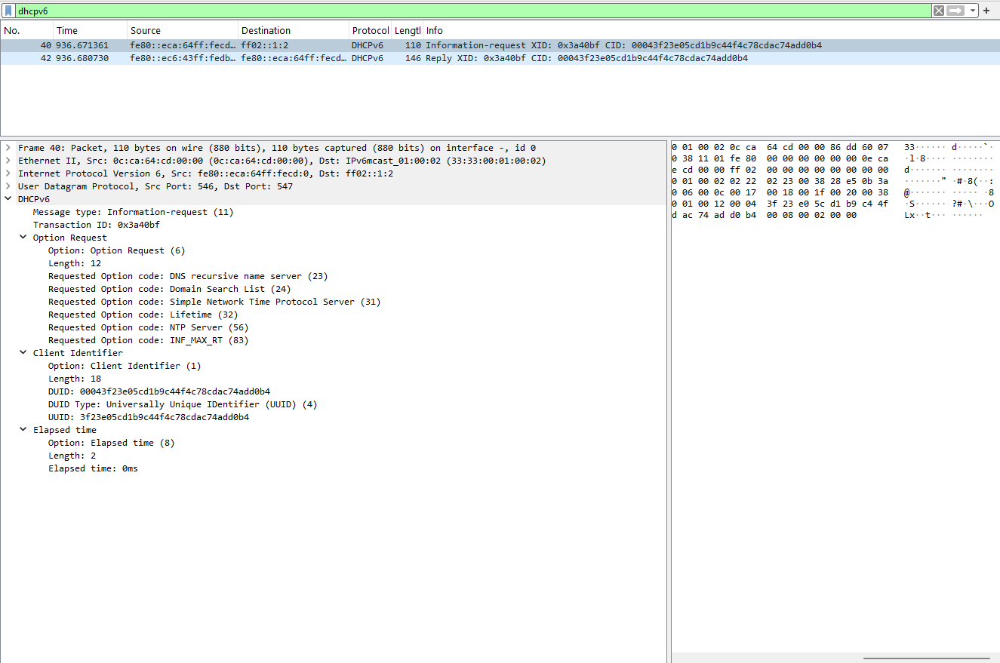{ #fig-022 width=70% }

Рассматриваю ответное сообщение `DHCPv6 Reply`, поступившее от маршрутизатора. В заголовке пакета указан тип сообщения `7`, а значение `Transaction ID` совпадает с идентификатором исходного запроса. Это позволяет установить принадлежность ответа к ранее отправленному сообщению `Information-request`.

В параметрах ответа присутствуют `Client Identifier` и `Server Identifier`, определяющие участников обмена. В опции `DNS recursive name server (23)` сервер передаёт IPv6-адрес DNS `2000::1`, а в опции `Domain Search List (24)` — доменное имя `emcikunova.net`.

Убеждаюсь, что DHCPv6-сервер передаёт клиенту дополнительные параметры без выделения IPv6-адреса. Захваченный обмен `Information-request → Reply` подтверждает работу Stateless DHCPv6 в исследуемой сети (см. рис. [@fig-023]).

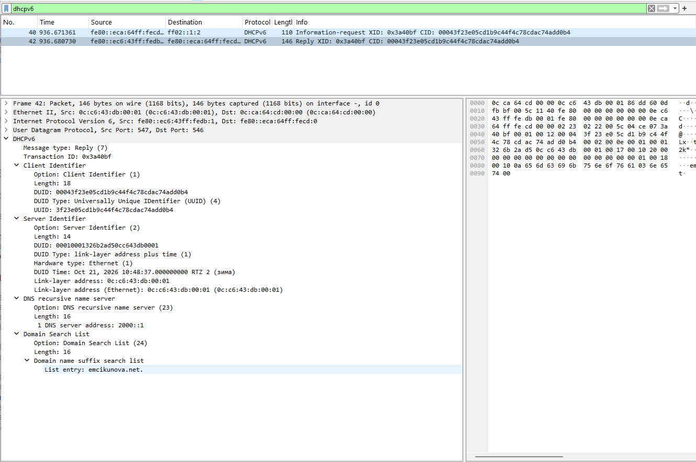{ #fig-023 width=70% }

### Настройка DHCPv6 с отслеживанием состояния

Перехожу к настройке DHCPv6 с отслеживанием состояния, или `Stateful DHCPv6`, для подсети `2001::/64`. В этом режиме сервер не только передаёт дополнительные сетевые параметры, но и выделяет IPv6-адреса из заранее настроенного диапазона с учётом информации об аренде.

На маршрутизаторе VyOS в режиме конфигурирования устанавливаю флаг `managed-flag` для интерфейса `eth2` командой `set service router-advert interface eth2 managed-flag`. Этот флаг в объявлениях маршрутизатора сообщает клиентам о необходимости использовать DHCPv6 для получения управляемой IPv6-адресации.

Создаю разделяемую сеть `emcikunova-stateful` командой `set service dhcpv6-server shared-network-name emcikunova-stateful`. Затем задаю подсеть `2001::0/64` командой `set service dhcpv6-server shared-network-name emcikunova-stateful subnet 2001::0/64`.

Указываю адрес DNS-сервера `2001::1` командой `set service dhcpv6-server shared-network-name emcikunova-stateful subnet 2001::0/64 name-server 2001::1` и доменное имя `emcikunova.net` командой `set service dhcpv6-server shared-network-name emcikunova-stateful subnet 2001::0/64 domain-search emcikunova.net`.

Настраиваю диапазон IPv6-адресов для выдачи клиентам командой `set service dhcpv6-server shared-network-name emcikunova-stateful subnet 2001::0/64 address-range start 2001::100 stop 2001::199`. В результате сервер получает пул адресов от `2001::100` до `2001::199`. После завершения настройки применяю изменения командой `commit` и сохраняю конфигурацию командой `save` (см. рис. [@fig-024]).

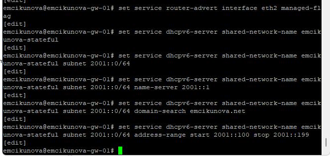{ #fig-024 width=70% }

Для первоначальной проверки списка выданных IPv6-адресов выполняю команду `run show dhcpv6 server leases`. В выводе отображаются заголовки таблицы аренды адресов, однако записи о клиентах отсутствуют.

Это свидетельствует о том, что на момент проверки в таблице не зарегистрированы активные аренды IPv6-адресов. Поскольку запросы на получение адресов ещё не выполнялись с клиентских устройств, отсутствие записей является ожидаемым результатом. Далее перехожу к настройке оконечных устройств и проверке работы Stateful DHCPv6 (см. рис. [@fig-025]).

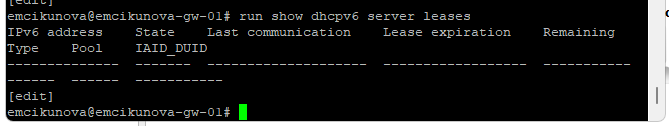{ #fig-025 width=70% }

Подключаюсь к оконечному устройству `AlpineLinuxVirt-emcikunova-03`. Сначала выполняю команды `ip address` и `ip -6 route show` для просмотра исходных параметров сети. На интерфейсе `eth0` отображается локальный IPv6-адрес канального уровня `fe80::e45:b9ff:fe9c:0/64`. Глобальный IPv6-адрес в выводе пока отсутствует.

В таблице маршрутизации присутствует маршрут по умолчанию через локальный адрес маршрутизатора, полученный посредством Router Advertisements. Затем проверяю содержимое `/etc/resolv.conf` командой `cat /etc/resolv.conf`. Первоначально в файле указан DNS-сервер `10.0.2.3`.

Для получения IPv6-адреса от DHCPv6-сервера запускаю команду `udhcpc6 -i eth0`. В терминале появляются сообщения `udhcpc6: sending discover` и `udhcpc6: sending select`, отражающие поиск сервера и выбор предложенной конфигурации. После завершения обмена выводится сообщение `udhcpc6: IPv6 obtained, lease time 43200`. Значение `43200` означает время аренды 12 часов и подтверждает получение клиентом положительного ответа от DHCPv6-сервера (см. рис. [@fig-026]).

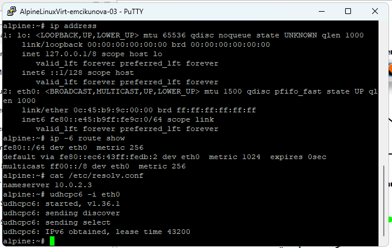{ #fig-026 width=70% }

После выполнения `udhcpc6 -i eth0` повторно проверяю конфигурацию устройства `AlpineLinuxVirt-emcikunova-03` командами `ip address` и `ip -6 route show`. Несмотря на сообщение клиента об успешном получении DHCPv6-аренды, в представленном выводе `ip address` на интерфейсе `eth0` отображается только локальный IPv6-адрес канального уровня `fe80::e45:b9ff:fe9c:0/64`. Глобальный адрес из пула Stateful DHCPv6 в списке адресов интерфейса не показан.

Проверяю связность с маршрутизатором командой `ping 2001::1 -c 2`. Устройство успешно получает два ICMPv6-ответа от маршрутизатора, потери пакетов составляют `0%`. Это подтверждает доступность маршрутизатора по IPv6, но само по себе не доказывает назначение глобального адреса интерфейсу.

Затем выполняю команду `cat /etc/resolv.conf`. В файле появляется строка `search emcikunova.net` и адрес DNS-сервера `2001::1` в полной IPv6-записи. Полученные параметры соответствуют конфигурации Stateful DHCPv6. Следовательно, клиент успешно получает дополнительные сетевые параметры, хотя назначение глобального IPv6-адреса на интерфейс требует отдельной проверки (см. рис. [@fig-027]).

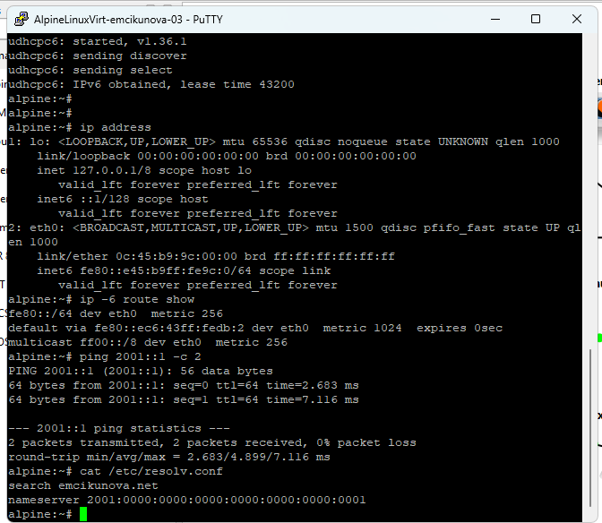{ #fig-027 width=70% }

Перехожу к проверке второго оконечного устройства в подсети `2001::/64` — `AlmaLinux-emcikunova-03`. После входа в систему выполняю команду `ip address`. На интерфейсе `eth0` отображается глобальный IPv6-адрес `2001::198/128` с пометками `global dynamic`, а также локальный IPv6-адрес `fe80::e16:62ff:fe64:0/64`. Адрес `2001::198` входит в настроенный диапазон DHCPv6 `2001::100–2001::199`, что подтверждает получение глобального адреса из серверного пула.

Далее выполняю команду `ip -6 route show`. В таблице маршрутизации отображается маршрут по умолчанию через локальный IPv6-адрес интерфейса маршрутизатора, полученный посредством Router Advertisements.

Проверяю доступность маршрутизатора командой `ping 2001::1 -c 2`. Получаю два ответа без потерь пакетов. После этого выполняю `cat /etc/resolv.conf` и убеждаюсь, что в настройках DNS указаны домен поиска `emcikunova.net` и сервер `2001::1`. Полученные сведения подтверждают работоспособность IPv6-связности и передачу параметров DNS по DHCPv6 (см. рис. [@fig-028]).

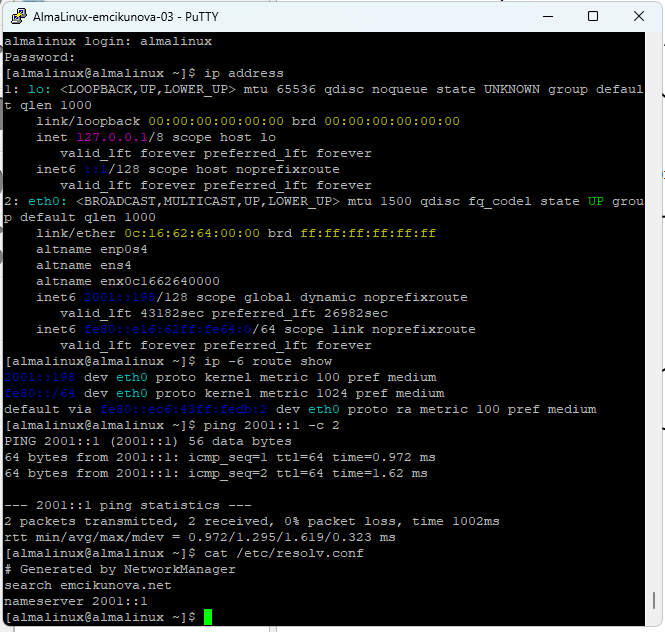{ #fig-028 width=70% }

Для подробного исследования процедуры Stateful DHCPv6 открываю захваченный сетевой трафик в Wireshark и применяю фильтр `dhcpv6`. В списке пакетов наблюдаю сообщения `Solicit`, `Advertise`, `Request` и `Reply`, составляющие стандартную последовательность выделения IPv6-адреса сервером.

Также в захвате присутствуют ответы DHCPv6, содержащие адреса `2001::199` и `2001::198`, что свидетельствует об обработке запросов различных клиентов подсети. Для подробного анализа выбираю обмен, в котором сервер предлагает адрес `2001::198`.

Рассматриваю начальное сообщение `Solicit`, отправленное клиентом. В заголовке DHCPv6 указан тип сообщения `1`. Пакет передаётся с локального адреса канального уровня клиента на многоадресный адрес `ff02::1:2` с использованием UDP-портов `546` и `547`.

В параметрах сообщения присутствует `Identity Association for Non-temporary Address (IA_NA)`, используемый для запроса управляемого IPv6-адреса. Также отображаются идентификатор клиента `Client Identifier`, параметр `Rapid Commit`, имя клиента `almalinux` и список запрашиваемых дополнительных опций, включая DNS-сервер и домен поиска. Сообщение `Solicit` начинает процедуру поиска DHCPv6-сервера, способного выделить клиенту IPv6-адрес (см. рис. [@fig-029]).

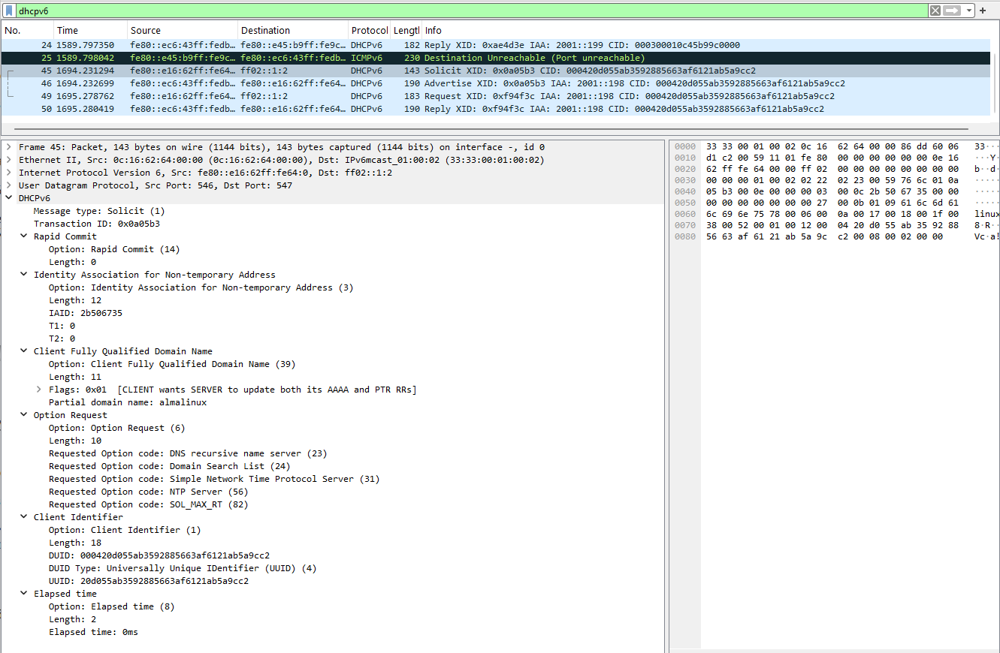{ #fig-029 width=70% }

Следующим анализирую сообщение `Advertise`, отправленное сервером в ответ на `Solicit`. В заголовке указан тип сообщения `2`, соответствующий предложению сетевой конфигурации.

В параметре `Identity Association for Non-temporary Address` находится вложенная опция `IA Address`, содержащая предлагаемый IPv6-адрес `2001::198`. Для адреса указаны значения времени использования: `Preferred lifetime: 27000` секунд и `Valid lifetime: 43200` секунд. Первый параметр определяет период предпочтительного использования адреса, второй — общее время его действительности.

Дополнительно сервер передаёт идентификаторы клиента и сервера, адрес DNS `2001::1` в опции `DNS recursive name server (23)` и домен поиска `emcikunova.net` в опции `Domain Search List (24)`. Проверяю соответствие предложенного адреса заданному диапазону `2001::100–2001::199` и убеждаюсь, что параметры ответа соответствуют настройкам DHCPv6-сервера (см. рис. [@fig-030]).

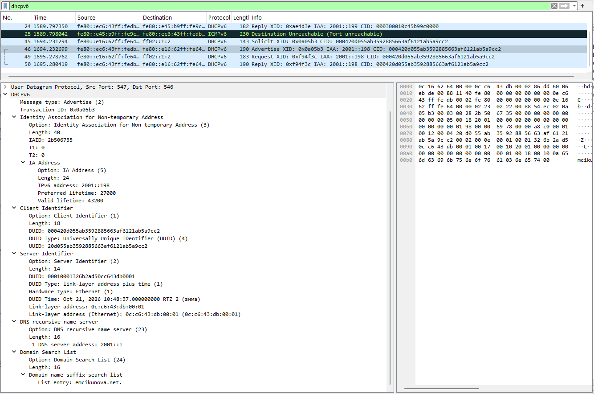{ #fig-030 width=70% }

Далее рассматриваю сообщение `DHCPv6 Request`, отправленное клиентом после получения предложения. В заголовке пакета указан тип сообщения `3`. Сообщение содержит идентификатор выбранного DHCPv6-сервера `Server Identifier` и идентификатор клиента `Client Identifier`, позволяющие связать запрос с конкретными участниками обмена.

В параметре `Identity Association for Non-temporary Address` присутствует опция `IA Address`, в которой указан запрашиваемый IPv6-адрес `2001::198`. Через `Option Request` клиент также запрашивает дополнительные параметры, включая DNS-сервер и домен поиска.

На этом этапе клиент подтверждает выбор предложения сервера и запрашивает предоставление адреса `2001::198` для дальнейшего использования. Наличие сообщения `Request` после `Advertise` соответствует стандартной процедуре Stateful DHCPv6 (см. рис. [@fig-031]).

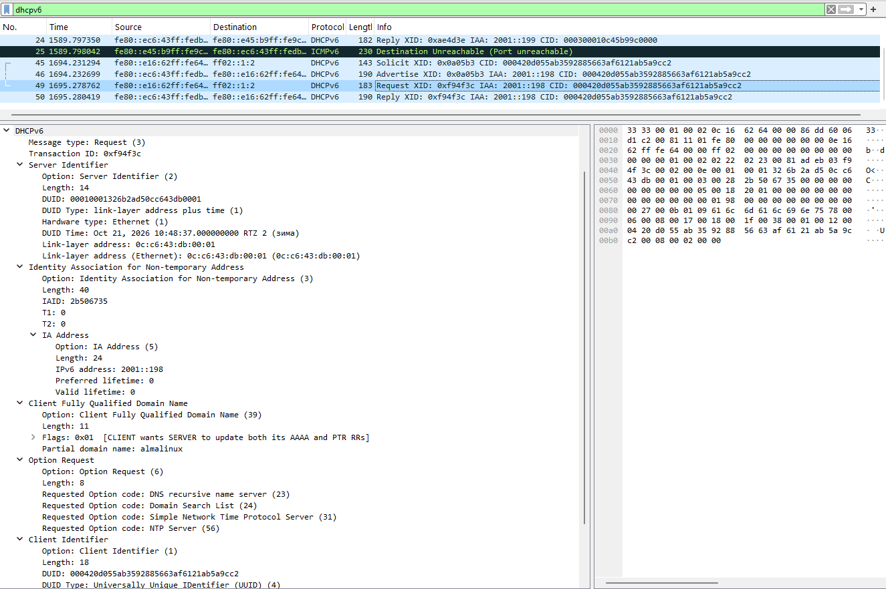{ #fig-031 width=70% }

Завершаю исследование Stateful DHCPv6 анализом сообщения `Reply`. В заголовке пакета указан тип сообщения `7`, соответствующий ответу DHCPv6-сервера. В параметре `IA Address` отображается IPv6-адрес `2001::198`, а также значения `Preferred lifetime: 27000` и `Valid lifetime: 43200`.

В ответе присутствуют идентификаторы клиента и сервера, адрес DNS-сервера `2001::1` и домен поиска `emcikunova.net`. Полученный ответ подтверждает выделение адреса `2001::198` клиенту. Этот адрес также отображается на интерфейсе `eth0` устройства `AlmaLinux-emcikunova-03`, что позволяет сопоставить сетевой трафик с фактической конфигурацией оконечного устройства.

В результате анализа устанавливаю, что Stateful DHCPv6 использует последовательность сообщений `Solicit → Advertise → Request → Reply`. В отличие от Stateless DHCPv6, сервер передаёт клиенту не только параметры DNS, но и управляемый IPv6-адрес с заданными сроками действия. Проверка сетевых параметров и анализ пакетов подтверждают успешное получение адреса `2001::198` устройством AlmaLinux, а также работу DHCPv6-сервера в подсети `2001::/64` (см. рис. [@fig-032]).

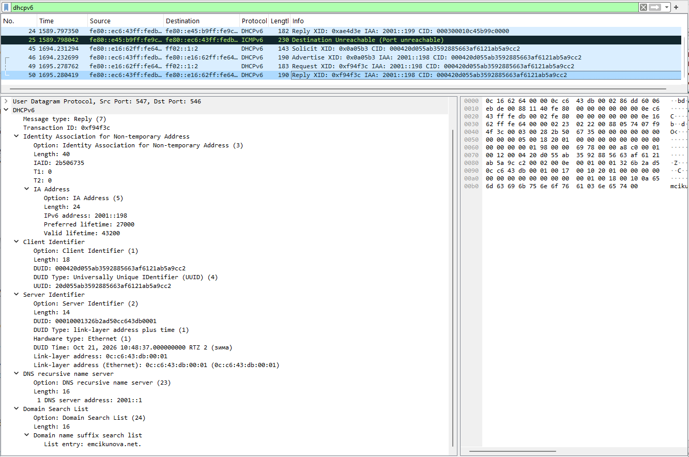{ #fig-032 width=70% }

# Вывод

В ходе лабораторной работы была создана и настроена сеть в GNS3 для исследования работы протоколов DHCP и DHCPv6. На маршрутизаторе VyOS выполнена настройка DHCP-сервера для автоматической выдачи IPv4-адресов и двух режимов DHCPv6: без отслеживания состояния (Stateless) и с отслеживанием состояния (Stateful). На оконечных устройствах VPCS, AlmaLinux и Alpine Linux проверены получение сетевых параметров, IPv4- и IPv6-адресация, настройки DNS и доступность маршрутизатора с помощью команды `ping`. В Wireshark проведён анализ обмена сообщениями DHCP Discover, Offer, Request, ACK, а также DHCPv6 Solicit, Advertise, Request, Reply и Information-request. Результаты проверок подтвердили работоспособность DHCP-сервера, успешное автоматическое назначение IPv4-адресов, формирование IPv6-адресов с помощью SLAAC и получение управляемых IPv6-адресов через Stateful DHCPv6.

# Список литературы

1. [Королькова А. В., Кулябов Д. С. Сетевые технологии. Лабораторные работы: учебное пособие. — М.: РУДН, 2014. — 106 с.](https://repository.rudn.ru/ru/records/manual/record/56143/)

2. [GNS3 Documentation. Getting Started with GNS3 — официальная документация по созданию и моделированию компьютерных сетей в GNS3](https://docs.gns3.com/docs)

3. [VyOS Documentation. DHCP Server — настройка DHCP-серверов для IPv4 и IPv6, диапазонов выдаваемых адресов, параметров DNS и времени аренды](https://docs.vyos.io/en/rolling/configuration/service/dhcp-server.html)

4. [VyOS Documentation. Router Advertisements — настройка объявлений маршрутизатора, IPv6-префиксов и флагов managed-flag и other-config-flag](https://docs.vyos.io/en/rolling/configuration/service/router-advert.html)

5. [Wireshark Foundation. Wireshark User's Guide — руководство по захвату, фильтрации и анализу сетевого трафика DHCP и DHCPv6](https://www.wireshark.org/docs/wsug_html/)

6. [RFC 2131. Droms R. Dynamic Host Configuration Protocol (DHCP). — IETF, 1997. — Спецификация автоматической настройки IPv4 и обмена сообщениями Discover, Offer, Request, ACK](https://www.rfc-editor.org/info/rfc2131/)

7. [RFC 9915. Mrugalski T., Volz B., Richardson M. и др. Dynamic Host Configuration Protocol for IPv6 (DHCPv6). — IETF, 2026. — Спецификация протокола DHCPv6 и режимов Stateful и Stateless](https://www.rfc-editor.org/info/rfc9915/)

8. [RFC 4862. Thomson S., Narten T., Jinmei T. IPv6 Stateless Address Autoconfiguration. — IETF, 2007. — Механизм автоматического формирования IPv6-адресов SLAAC](https://www.rfc-editor.org/info/rfc4862/)

9. [RFC 4861. Narten T., Nordmark E., Simpson W., Soliman H. Neighbor Discovery for IP Version 6 (IPv6). — IETF, 2007. — Обнаружение маршрутизаторов, объявления Router Advertisement и получение параметров IPv6-сети](https://www.rfc-editor.org/info/rfc4861/)
