---
## Author
author:
  name:  Цыкунова Екатерина Михайловна
  email: 1132246732@rudn.ru
  affiliation:
    - name: Российский университет дружбы народов
      country: Российская Федерация
      postal-code: 117198
      city: Москва
      address: ул. Миклухо-Маклая, д. 6

## Title
title: Лабораторная работа №6
subtitle: Адресация IPv4 и IPv6. Настройка маршрутизации по протоколу RIP
license: CC BY
date: today
date-format: "YYYY-MM-DD"
---

# Цели и задачи работы

## Цель лабораторной работы

Изучение принципов динамической маршрутизации по протоколам RIPv2 и RIPng в сетях IPv4 и IPv6, настройка маршрутизаторов FRRouting и исследование изменения маршрутов при нарушении сетевых соединений в среде GNS3.

## Задачи лабораторной работы

- создать топологию сети в GNS3 с использованием маршрутизаторов FRRouting и оконечных устройств VPCS;
- настроить IPv4- и IPv6-адресацию на сетевых интерфейсах;
- настроить динамическую маршрутизацию по протоколам RIPv2 и RIPng;
- проверить таблицы маршрутизации, метрики и доступность удалённых сетей;
- исследовать изменение маршрутов при отключении сетевого интерфейса;

# Создание топологии и настройка адресации

## Создаю топологию сети в GNS3

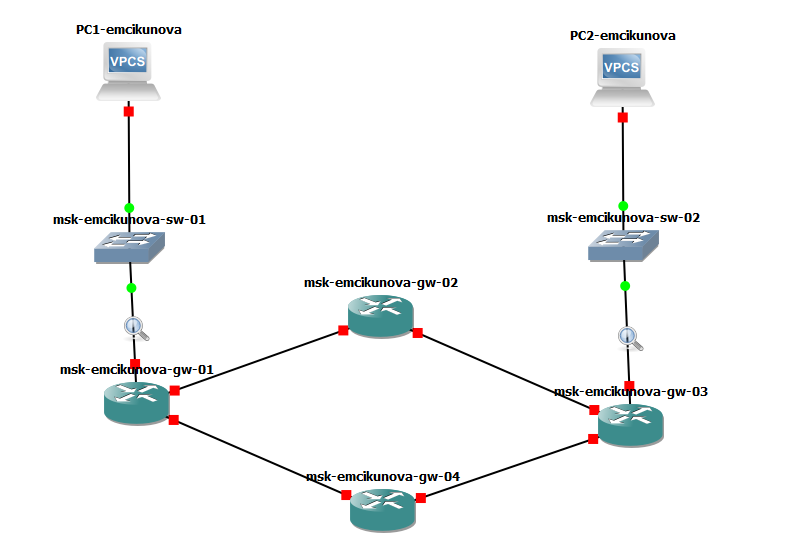{ #fig:001 width=80% height=70% }

## Настраиваю IPv4-адресацию маршрутизаторов

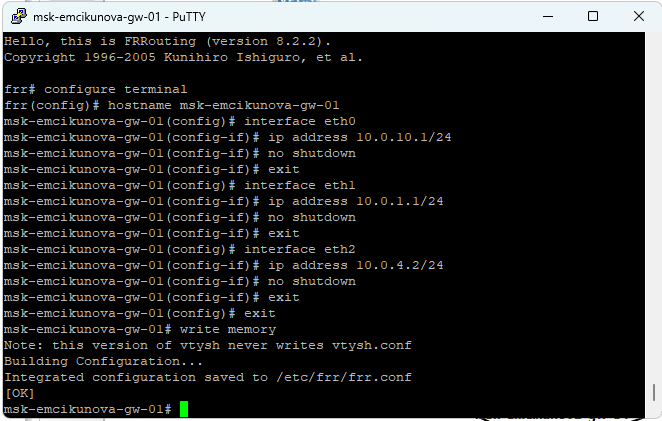{ #fig:002 width=80% height=70% }

## Настраиваю IPv6-адресацию и пересылку пакетов

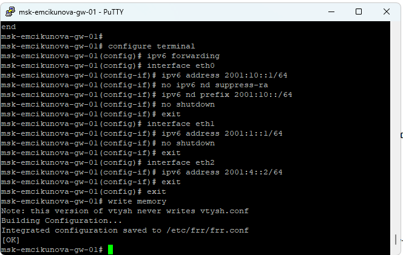{ #fig:003 width=80% height=70% }

# Настройка динамической маршрутизации RIPv2

## Включаю протокол RIPv2 на маршрутизаторах

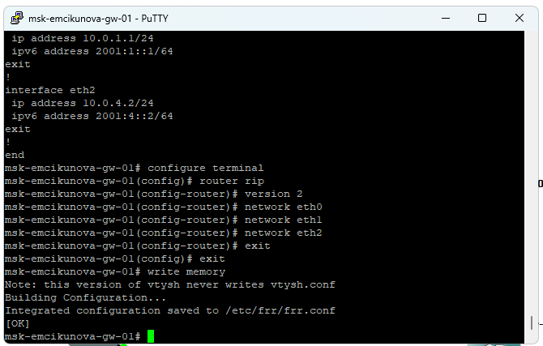{ #fig:004 width=80% height=70% }

## Проверяю таблицы маршрутизации и метрики RIPv2

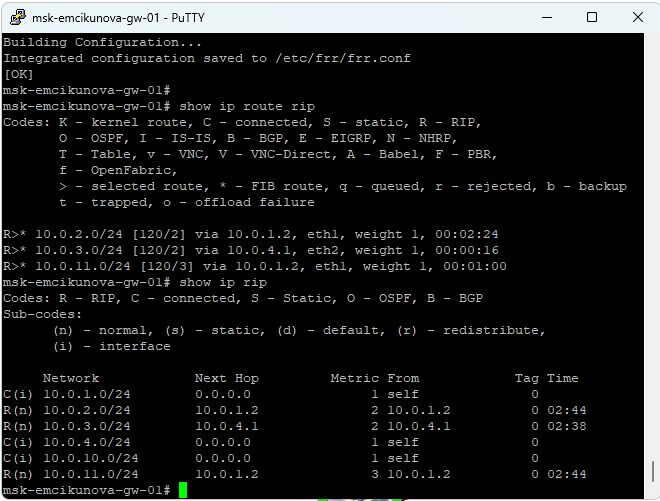{ #fig:005 width=80% height=70% }

## Проверяю IPv4-соединение и путь прохождения пакетов

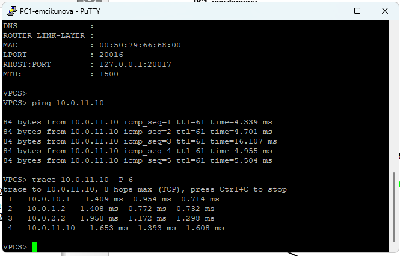{ #fig:006 width=80% height=70% }

# Исследование изменения маршрутов RIPv2

## Отключаю интерфейс маршрутизатора gw-02

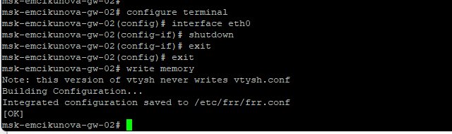{ #fig:007 width=80% height=70% }

## Проверяю переключение на альтернативный IPv4-маршрут

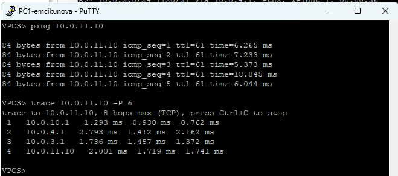{ #fig:008 width=80% height=70% }

# Анализ RIPv2 в Wireshark

## Анализирую служебные сообщения RIPv2

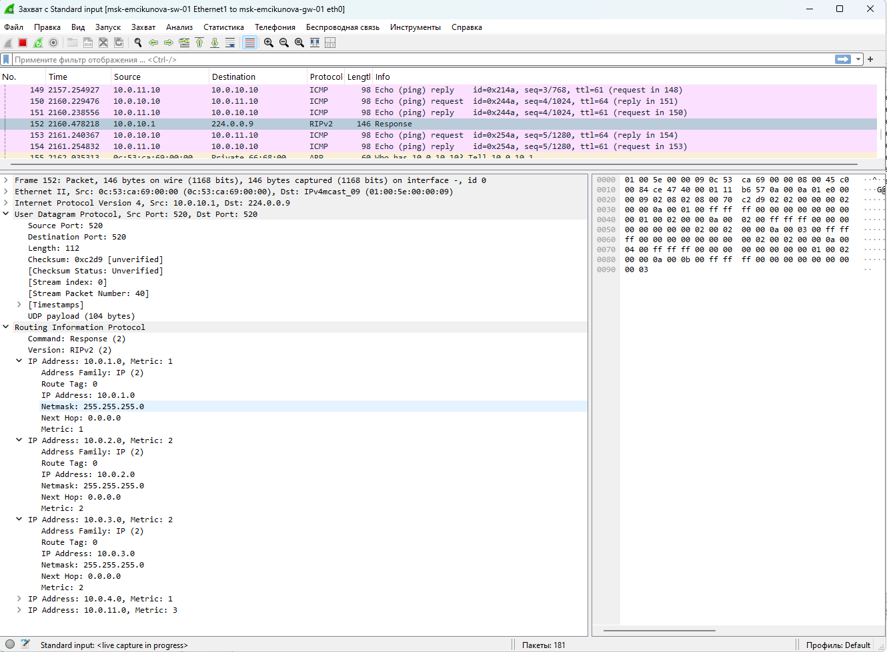{ #fig:009 width=90% height=70% }

# Настройка динамической маршрутизации RIPng

## Включаю протокол RIPng на маршрутизаторах

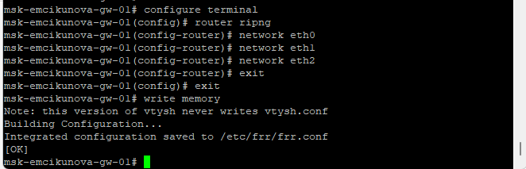{ #fig:010 width=80% height=70% }

## Проверяю IPv6-соединение и маршрут передачи пакетов

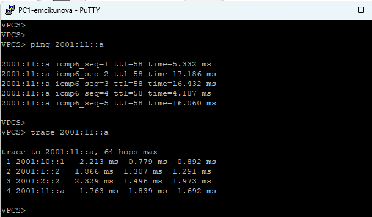{ #fig:011 width=80% height=70% }

# Исследование изменения маршрутов RIPng

## Проверяю изменение таблицы RIPng при отказе соединения

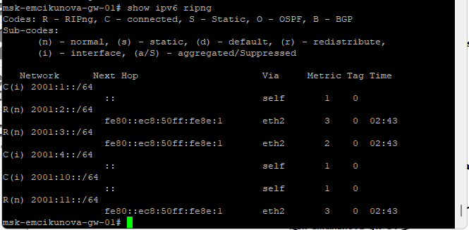{ #fig:012 width=80% height=70% }

## Проверяю альтернативный маршрут IPv6

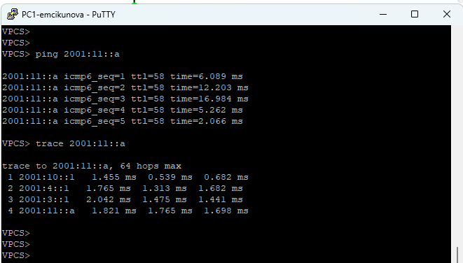{ #fig:013 width=80% height=70% }

# Анализ RIPng в Wireshark

## Анализирую служебные пакеты RIPng

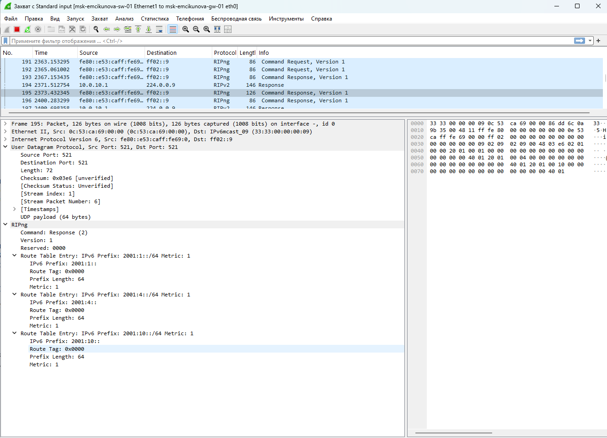{ #fig:014 width=90% height=70% }

# Самостоятельное задание

## Создаю дополнительную топологию сети

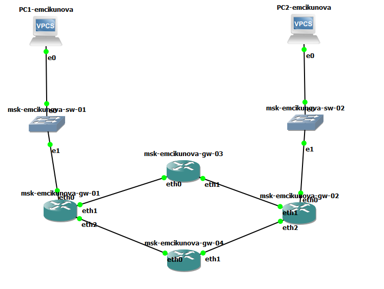{ #fig:015 width=80% height=70% }

## Проверяю соединения между PC1 и PC2 по IPv4 и IPv6

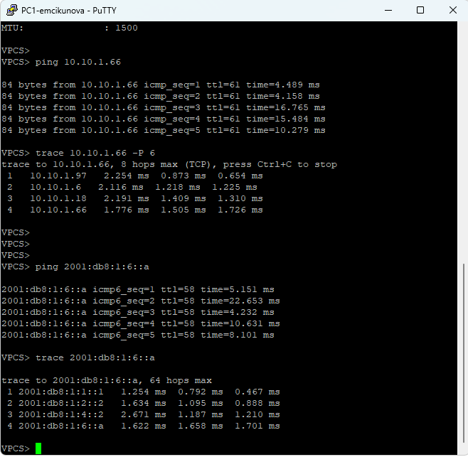{ #fig:016 width=80% height=70% }

## Проверяю таблицы маршрутизации RIPv2 и RIPng

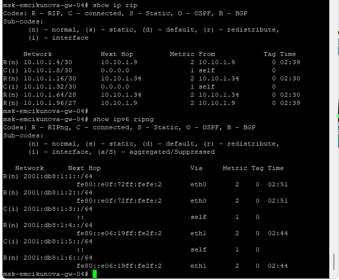{ #fig:017 width=80% height=70% }

# Вывод

## Результаты лабораторной работы

В GNS3 создана и настроена сеть с четырьмя маршрутизаторами FRRouting, коммутаторами Ethernet и оконечными устройствами VPCS. Настроена адресация IPv4 и IPv6, а также динамическая маршрутизация по протоколам RIPv2 и RIPng.

С помощью команд `show ip route rip`, `show ip rip`, `show ip rip status` и `show ipv6 ripng` проверены таблицы маршрутизации, метрики и источники маршрутной информации. Командами `ping` и `trace` подтверждены доступность удалённых сетей и корректность прохождения пакетов.

При отключении интерфейса маршрутизатора исследовано автоматическое переключение на альтернативный маршрут. В Wireshark проанализированы служебные сообщения RIPv2 и RIPng, содержащие сетевые префиксы и метрики.

В самостоятельной части работы настроена дополнительная сеть с двойным стеком IPv4 и IPv6. Проверены соединения между оконечными устройствами и таблицы маршрутизации, что подтвердило работоспособность протоколов RIPv2 и RIPng.
