---
## Author
author:
  name:  Цыкунова Екатерина Михайловна
  email: 1132246732@rudn.ru
  affiliation:
    - name: Российский университет дружбы народов
      country: Российская Федерация
      postal-code: 117198
      city: Москва
      address: ул. Миклухо-Маклая, д. 6

## Title
title: "Отчёт по лабораторной работе №6"
subtitle: "Адресация IPv4 и IPv6. Настройка маршрутизации по протоколу RIP"
license: "CC BY"
---

# Цель работы

Изучение принципов маршрутизации по протоколу RIP в IPv4- и IPv6-сетях и принципов настройки сетевого оборудования.

# Выполнение лабораторной работы № 6

## Адресация IPv4 и IPv6. Настройка маршрутизации по протоколу RIP

### Настройка динамической маршрутизации в сетях IPv4 и IPv6

Целью лабораторной работы является изучение принципов динамической маршрутизации по протоколу RIP в сетях IPv4 и IPv6, настройка сетевого оборудования и исследование изменения маршрутов при нарушении соединений между маршрутизаторами.

Для выполнения работы использую программный комплекс GNS3, виртуальные маршрутизаторы FRRouting (FRR), коммутаторы Ethernet и оконечные устройства VPCS. Настраиваю адресацию IPv4 и IPv6, протоколы RIPv2 и RIPng, проверяю доступность удалённых узлов и исследую служебный трафик с помощью Wireshark.

### Документирование моделируемой сети

Перед созданием проекта определяю топологию моделируемой сети и распределяю адресное пространство между её сегментами. В соответствии с заданием сеть состоит из четырёх маршрутизаторов `gw-01`, `gw-02`, `gw-03`, `gw-04`, двух коммутаторов `sw-01`, `sw-02` и двух оконечных устройств `PC1` и `PC2`.

Маршрутизаторы образуют кольцевую топологию, в которой между `gw-01` и `gw-03` существуют два пути передачи пакетов: через `gw-02` и через `gw-04`. Наличие альтернативных путей позволяет исследовать работу динамической маршрутизации при отключении одного из соединений.

Для сети использую следующие IPv4- и IPv6-подсети.

| Сегмент сети | Сеть IPv4 | Сеть IPv6 |
|---|---|---|
| PC1 — gw-01 | `10.0.10.0/24` | `2001:10::/64` |
| PC2 — gw-03 | `10.0.11.0/24` | `2001:11::/64` |
| gw-01 — gw-02 | `10.0.1.0/24` | `2001:1::/64` |
| gw-02 — gw-03 | `10.0.2.0/24` | `2001:2::/64` |
| gw-03 — gw-04 | `10.0.3.0/24` | `2001:3::/64` |
| gw-04 — gw-01 | `10.0.4.0/24` | `2001:4::/64` |

На основании распределения подсетей составляю таблицу адресации интерфейсов устройств.

| Устройство | Интерфейс | IPv4-адрес | IPv6-адрес | Следующее устройство |
|---|---|---|---|---|
| gw-01 | eth0 | `10.0.10.1/24` | `2001:10::1/64` | PC1 |
| gw-01 | eth1 | `10.0.1.1/24` | `2001:1::1/64` | gw-02 |
| gw-01 | eth2 | `10.0.4.2/24` | `2001:4::2/64` | gw-04 |
| gw-02 | eth0 | `10.0.1.2/24` | `2001:1::2/64` | gw-01 |
| gw-02 | eth1 | `10.0.2.1/24` | `2001:2::1/64` | gw-03 |
| gw-03 | eth0 | `10.0.11.1/24` | `2001:11::1/64` | PC2 |
| gw-03 | eth1 | `10.0.2.2/24` | `2001:2::2/64` | gw-02 |
| gw-03 | eth2 | `10.0.3.1/24` | `2001:3::1/64` | gw-04 |
| gw-04 | eth0 | `10.0.3.2/24` | `2001:3::2/64` | gw-03 |
| gw-04 | eth1 | `10.0.4.1/24` | `2001:4::1/64` | gw-01 |
| PC1 | NIC | `10.0.10.10/24` | `2001:10::a/64` | gw-01 |
| PC2 | NIC | `10.0.11.10/24` | `2001:11::a/64` | gw-03 |

Для оконечного устройства `PC1` задаю IPv4-шлюз по умолчанию `10.0.10.1`, а для `PC2` — `10.0.11.1`. Эти адреса принадлежат интерфейсам маршрутизаторов, непосредственно подключённых к локальным сегментам.

Разрабатываю схему физической топологии уровня L1, на которой отображаю устройства, соединения и используемые сетевые интерфейсы.

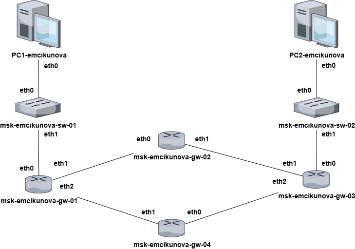{ #fig-l1 width=70% }

Затем разрабатываю схему уровня L3, дополнительно указывая IPv4- и IPv6-подсети всех соединений. На схеме выделяю локальные сети оконечных устройств и транзитные сети, используемые для взаимодействия маршрутизаторов.

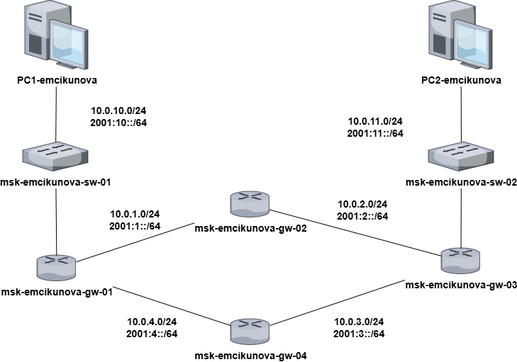{ #fig-l3 width=70% }

### Создание топологии сети в GNS3

Запускаю GNS3 VM и GNS3, создаю новый проект для исследования динамической маршрутизации по протоколам RIPv2 и RIPng. В рабочей области размещаю четыре маршрутизатора FRRouting, два коммутатора Ethernet и два оконечных устройства VPCS.

Переименовываю маршрутизаторы в `msk-emcikunova-gw-01`, `msk-emcikunova-gw-02`, `msk-emcikunova-gw-03` и `msk-emcikunova-gw-04`. Коммутаторам присваиваю имена `msk-emcikunova-sw-01` и `msk-emcikunova-sw-02`, а оконечным устройствам — `PC1-emcikunova` и `PC2-emcikunova`.

Соединяю `PC1-emcikunova` с коммутатором `msk-emcikunova-sw-01`, который подключаю к маршрутизатору `msk-emcikunova-gw-01`. Аналогично соединяю `PC2-emcikunova` с коммутатором `msk-emcikunova-sw-02`, подключённым к маршрутизатору `msk-emcikunova-gw-03`.

Между маршрутизаторами создаю соединения `gw-01 — gw-02`, `gw-02 — gw-03`, `gw-03 — gw-04` и `gw-04 — gw-01`. На соединениях между коммутаторами и маршрутизаторами `gw-01` и `gw-03` включаю захват трафика для последующего анализа обмена маршрутной информацией в Wireshark (см. рис. [@fig-001]).

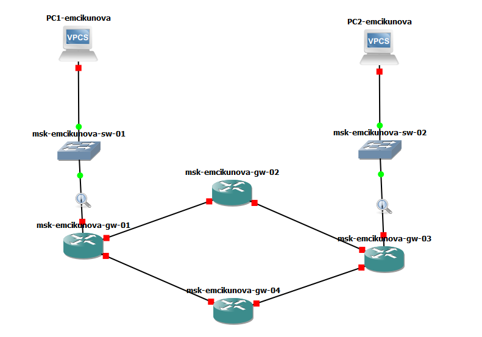{ #fig-001 width=70% }

### Настройка IPv4-адресов оконечных устройств

Перехожу к настройке компьютера `PC1-emcikunova`. В терминале VPCS назначаю IPv4-адрес `10.0.10.10/24` и шлюз по умолчанию `10.0.10.1` командой `ip 10.0.10.10/24 10.0.10.1`.

После назначения адреса выполняю команду `save`, чтобы сохранить параметры устройства в файле `startup.vpc`. Для проверки введённой конфигурации использую команду `show ip`.

В выводе отображаются IPv4-адрес `10.0.10.10/24`, шлюз `10.0.10.1` и MAC-адрес сетевого интерфейса `00:50:79:66:68:00`. Сообщение `Saving startup configuration to startup.vpc` и подтверждение `done` свидетельствуют об успешном сохранении конфигурации (см. рис. [@fig-002]).

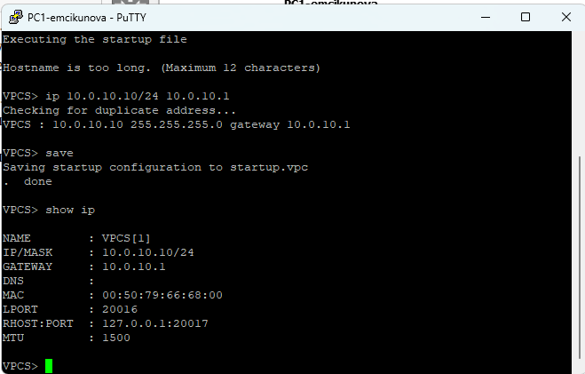{ #fig-002 width=70% }

Аналогично настраиваю оконечное устройство `PC2-emcikunova`. Выполняю команду `ip 10.0.11.10/24 10.0.11.1`, назначая компьютеру IPv4-адрес `10.0.11.10` с маской `255.255.255.0` и шлюзом по умолчанию `10.0.11.1`.

Сохраняю параметры командой `save` и проверяю их с помощью `show ip`. В таблице конфигурации отображаются назначенный адрес `10.0.11.10/24`, шлюз `10.0.11.1` и MAC-адрес `00:50:79:66:68:01`. Убеждаюсь, что оба оконечных устройства получили статическую IPv4-конфигурацию в соответствии с таблицей адресации (см. рис. [@fig-003]).

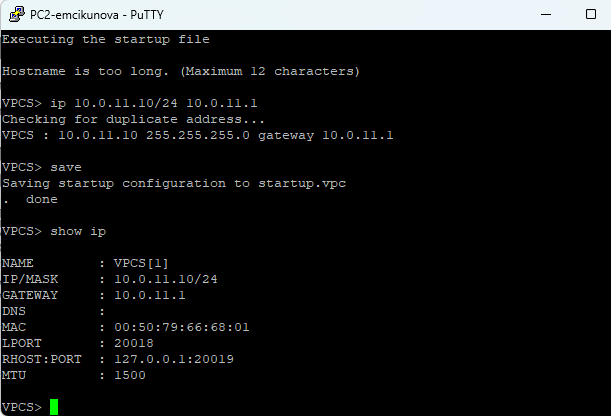{ #fig-003 width=70% }

### Настройка IPv4-адресации маршрутизаторов FRR

Перехожу к конфигурированию маршрутизатора `msk-emcikunova-gw-01`. Открываю терминал устройства и в командной оболочке FRR выполняю команду `configure terminal` для перехода в режим глобальной конфигурации.

Изменяю системное имя командой `hostname msk-emcikunova-gw-01`. Затем последовательно настраиваю интерфейсы маршрутизатора.

На интерфейсе `eth0` задаю адрес `10.0.10.1/24`, который используется для подключения локального сегмента `PC1`. На интерфейсе `eth1` назначаю `10.0.1.1/24` для соединения с маршрутизатором `gw-02`. Интерфейсу `eth2`, подключённому к `gw-04`, присваиваю `10.0.4.2/24`.

Для назначения адресов использую команды `interface eth0`, `interface eth1`, `interface eth2` и `ip address`, а для включения интерфейсов выполняю `no shutdown`. После завершения настройки выхожу из режима конфигурирования командами `exit` и сохраняю изменения командой `write memory`.

В терминале появляется сообщение `Integrated configuration saved to /etc/frr/frr.conf`, за которым следует подтверждение `[OK]`. Это указывает на сохранение настроек FRR (см. рис. [@fig-004]).

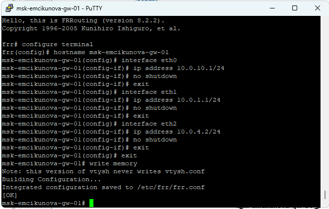{ #fig-004 width=70% }

Для проверки настроек маршрутизатора `msk-emcikunova-gw-01` выполняю команду `show running-config`.

В выводе отображается текущая конфигурация FRRouting версии `8.2.2`, системное имя `msk-emcikunova-gw-01` и адреса всех трёх интерфейсов: `10.0.10.1/24` на `eth0`, `10.0.1.1/24` на `eth1` и `10.0.4.2/24` на `eth2`.

Сопоставляю значения с подготовленной таблицей адресации и убеждаюсь в правильности настроенных параметров (см. рис. [@fig-005]).

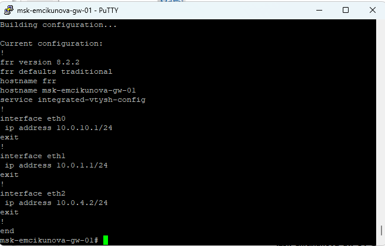{ #fig-005 width=70% }

Перехожу к маршрутизатору `msk-emcikunova-gw-02`. С помощью команды `configure terminal` вхожу в режим конфигурирования и изменяю имя устройства командой `hostname msk-emcikunova-gw-02`.

На интерфейсе `eth0` задаю адрес `10.0.1.2/24`, относящийся к сети соединения с `gw-01`. На интерфейсе `eth1` назначаю адрес `10.0.2.1/24`, который используется для взаимодействия с маршрутизатором `gw-03`.

На обоих интерфейсах выполняю `no shutdown`, затем сохраняю конфигурацию командой `write memory`. Сообщения `Integrated configuration saved to /etc/frr/frr.conf` и `[OK]` подтверждают сохранение изменений (см. рис. [@fig-006]).

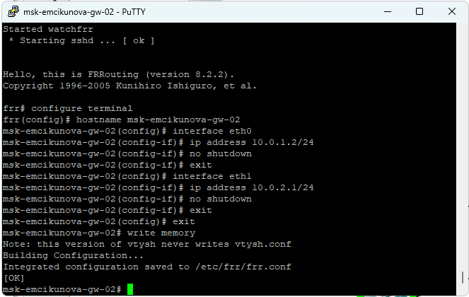{ #fig-006 width=70% }

Проверяю текущую конфигурацию маршрутизатора `msk-emcikunova-gw-02` командой `show running-config`.

В выводе присутствуют два настроенных сетевых интерфейса: `eth0` с IPv4-адресом `10.0.1.2/24` и `eth1` с адресом `10.0.2.1/24`. Указанные значения соответствуют соединениям `gw-01 — gw-02` и `gw-02 — gw-03` (см. рис. [@fig-007]).

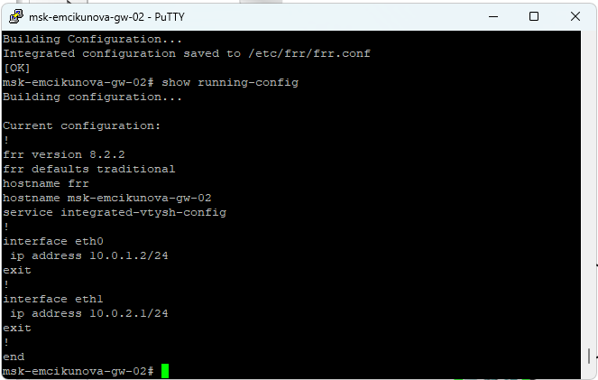{ #fig-007 width=70% }

Далее настраиваю маршрутизатор `msk-emcikunova-gw-03`. Перехожу в режим конфигурирования командой `configure terminal`, после чего присваиваю системное имя `msk-emcikunova-gw-03`.

Интерфейсу `eth0` назначаю адрес `10.0.11.1/24`, используемый в качестве шлюза для оконечного устройства `PC2`. На интерфейсе `eth1` устанавливаю адрес `10.0.2.2/24` для соединения с маршрутизатором `gw-02`, а на интерфейсе `eth2` — `10.0.3.1/24` для соединения с `gw-04`.

Активирую интерфейсы командой `no shutdown`, завершаю конфигурирование и сохраняю параметры командой `write memory` (см. рис. [@fig-008]).

{ #fig-008 width=70% }

Для проверки настроенной IPv4-адресации выполняю на маршрутизаторе `msk-emcikunova-gw-03` команду `show running-config`.

В текущей конфигурации отображаются адреса `10.0.11.1/24`, `10.0.2.2/24` и `10.0.3.1/24` на интерфейсах `eth0`, `eth1` и `eth2` соответственно. Убеждаюсь, что адреса всех соединений заданы в соответствии с планом сети (см. рис. [@fig-009]).

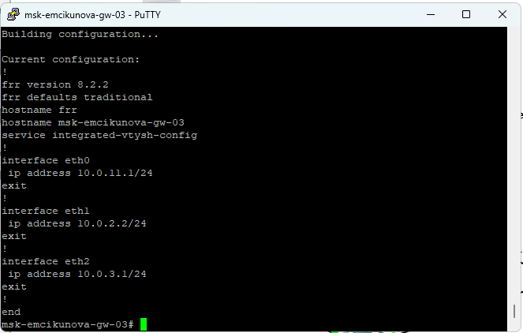{ #fig-009 width=70% }

Настраиваю последний маршрутизатор `msk-emcikunova-gw-04`. После входа в режим конфигурирования устанавливаю имя устройства командой `hostname msk-emcikunova-gw-04`.

Для интерфейса `eth0`, соединённого с `gw-03`, задаю IPv4-адрес `10.0.3.2/24`. Интерфейсу `eth1`, подключённому к `gw-01`, назначаю адрес `10.0.4.1/24`.

Включаю оба интерфейса командой `no shutdown`, выхожу из режима конфигурирования и выполняю `write memory`. Получаю подтверждение сохранения конфигурации в файле `/etc/frr/frr.conf` (см. рис. [@fig-010]).

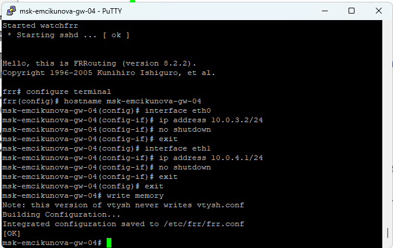{ #fig-010 width=70% }

Проверяю параметры маршрутизатора `msk-emcikunova-gw-04` командой `show running-config`.

В выводе отображаются интерфейс `eth0` с адресом `10.0.3.2/24` и интерфейс `eth1` с адресом `10.0.4.1/24`. На этом завершаю первоначальную IPv4-адресацию всех маршрутизаторов моделируемой сети (см. рис. [@fig-011]).

{ #fig-011 width=70% }

### Настройка IPv6-адресов оконечных устройств

Перехожу к настройке IPv6 на оконечном устройстве `PC1-emcikunova`. В терминале VPCS выполняю команду `ip 2001:10::a/64`, назначая глобальный IPv6-адрес `2001:10::a` с длиной префикса `64`.

Сохраняю конфигурацию командой `save` и проверяю параметры с помощью `show ipv6`.

В выводе отображается глобальный адрес `2001:10::a/64` и автоматически сформированный локальный адрес канального уровня `fe80::250:79ff:fe66:6800/64`. Также указан MAC-адрес интерфейса `00:50:79:66:68:00`.

В поле `ROUTER LINK-LAYER` на данном этапе отсутствуют сведения о маршрутизаторе, поскольку его IPv6-настройка ещё не завершена (см. рис. [@fig-012]).

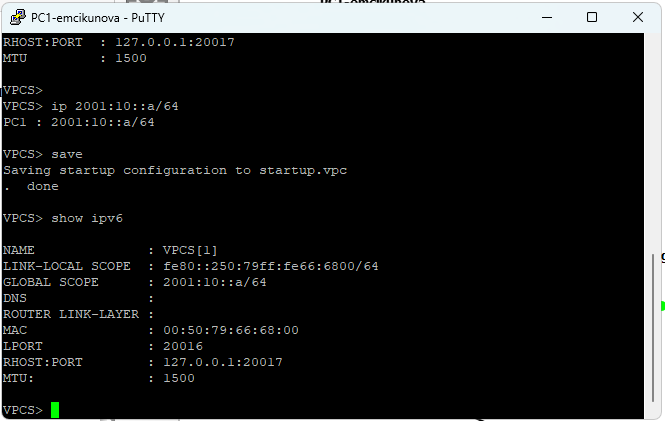{ #fig-012 width=70% }

На оконечном устройстве `PC2-emcikunova` выполняю команду `ip 2001:11::a/64`, назначая адрес из подсети `2001:11::/64`.

Сохраняю конфигурацию командой `save`, после чего выполняю `show ipv6`. В выводе отображаются глобальный адрес `2001:11::a/64`, локальный IPv6-адрес `fe80::250:79ff:fe66:6801/64` и MAC-адрес `00:50:79:66:68:01`.

Убеждаюсь, что IPv6-адреса обоих компьютеров принадлежат различным локальным сетям, соединение между которыми далее будет обеспечиваться маршрутизаторами FRR (см. рис. [@fig-013]).

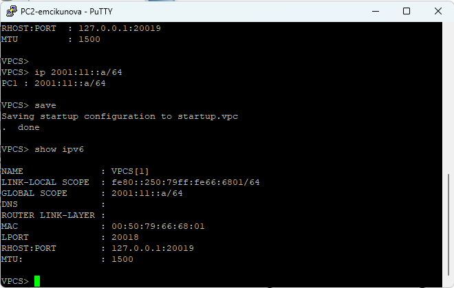{ #fig-013 width=70% }

### Настройка IPv6-адресации маршрутизаторов

Возвращаюсь к маршрутизатору `msk-emcikunova-gw-01` и перехожу в режим конфигурирования командой `configure terminal`. Для включения пересылки IPv6-пакетов выполняю команду `ipv6 forwarding`.

Настраиваю интерфейс `eth0`, задавая ему глобальный IPv6-адрес `2001:10::1/64` командой `ipv6 address 2001:10::1/64`.

Для передачи оконечному устройству информации о локальной IPv6-подсети использую команды `no ipv6 nd suppress-ra` и `ipv6 nd prefix 2001:10::/64`. Первая команда разрешает отправку сообщений Router Advertisement, вторая задаёт префикс, который маршрутизатор объявляет в локальном сегменте.

На интерфейсе `eth1` назначаю адрес `2001:1::1/64`, а на интерфейсе `eth2` — `2001:4::2/64`. После настройки каждого интерфейса выполняю `no shutdown`.

Сохраняю изменения командой `write memory`, получая подтверждение `[OK]` (см. рис. [@fig-014]).

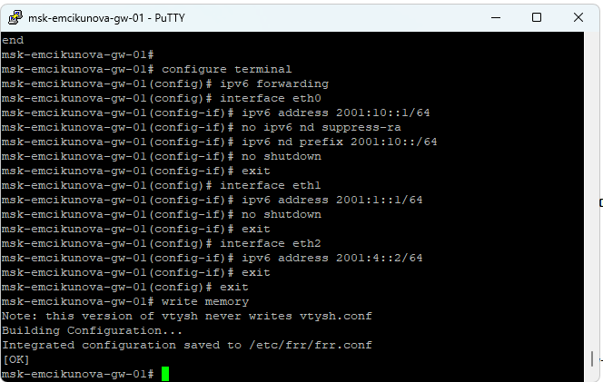{ #fig-014 width=70% }

Проверяю конфигурацию маршрутизатора `msk-emcikunova-gw-01` командой `show running-config`.

В выводе одновременно отображаются IPv4- и IPv6-адреса всех интерфейсов. Интерфейс `eth0` содержит адреса `10.0.10.1/24` и `2001:10::1/64`, интерфейс `eth1` — `10.0.1.1/24` и `2001:1::1/64`, а интерфейс `eth2` — `10.0.4.2/24` и `2001:4::2/64`.

Дополнительно в конфигурации интерфейса `eth0` присутствуют команды `ipv6 nd prefix 2001:10::/64` и `no ipv6 nd suppress-ra`. Наличие адресов двух версий IP подтверждает настройку двойного стека на маршрутизаторе (см. рис. [@fig-015]).

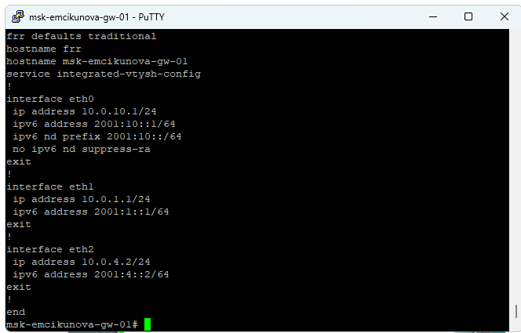{ #fig-015 width=70% }

Далее настраиваю IPv6 на маршрутизаторе `msk-emcikunova-gw-02`. В режиме глобальной конфигурации выполняю `ipv6 forwarding`.

Интерфейсу `eth0` назначаю IPv6-адрес `2001:1::2/64`, а интерфейсу `eth1` — `2001:2::1/64`. Эти адреса принадлежат транзитным сетям `2001:1::/64` и `2001:2::/64`, соединяющим маршрутизатор с соседними узлами.

Для активации интерфейсов выполняю `no shutdown`, после чего сохраняю настройки командой `write memory` (см. рис. [@fig-016]).

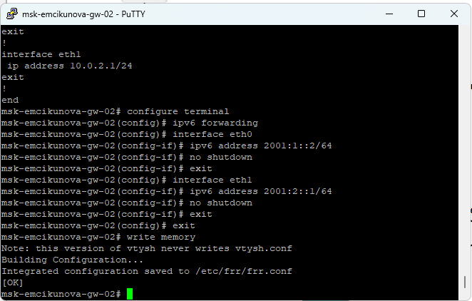{ #fig-016 width=70% }

Выполняю команду `show running-config` на маршрутизаторе `msk-emcikunova-gw-02` и проверяю сохранённые настройки.

В конфигурации отображаются адреса `10.0.1.2/24` и `2001:1::2/64` на интерфейсе `eth0`, а также `10.0.2.1/24` и `2001:2::1/64` на интерфейсе `eth1`.

Убеждаюсь, что маршрутизатор настроен для работы с обеими версиями IP-протокола и может участвовать в маршрутизации IPv4- и IPv6-трафика (см. рис. [@fig-017]).

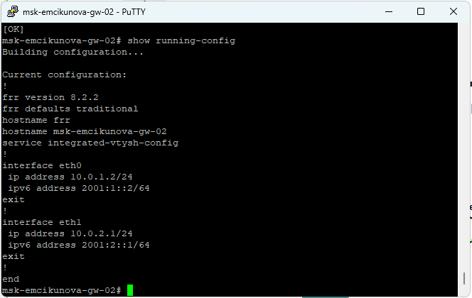{ #fig-017 width=70% }

Перехожу к маршрутизатору `msk-emcikunova-gw-03`. Включаю пересылку IPv6-пакетов командой `ipv6 forwarding`.

На интерфейсе `eth0`, подключённом к локальной сети `PC2`, назначаю адрес `2001:11::1/64`. Для отправки Router Advertisement выполняю команды `no ipv6 nd suppress-ra` и `ipv6 nd prefix 2001:11::/64`.

На интерфейсе `eth1` задаю адрес `2001:2::2/64`, а на интерфейсе `eth2` — `2001:3::1/64`. Включаю интерфейсы командой `no shutdown`.

Применённые параметры сохраняю командой `write memory`. В результате маршрутизатор получает IPv6-адреса для всех трёх подключённых сетевых сегментов (см. рис. [@fig-018]).

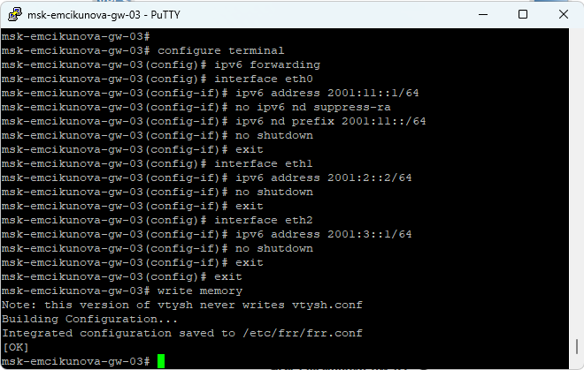{ #fig-018 width=70% }

Проверяю конфигурацию `msk-emcikunova-gw-03` командой `show running-config`.

В выводе присутствуют IPv4-адреса `10.0.11.1/24`, `10.0.2.2/24` и `10.0.3.1/24`, а также IPv6-адреса `2001:11::1/64`, `2001:2::2/64` и `2001:3::1/64`.

На интерфейсе `eth0` отображаются параметры анонсирования IPv6-префикса `2001:11::/64`, необходимые для работы оконечного устройства `PC2` с IPv6-шлюзом (см. рис. [@fig-019]).

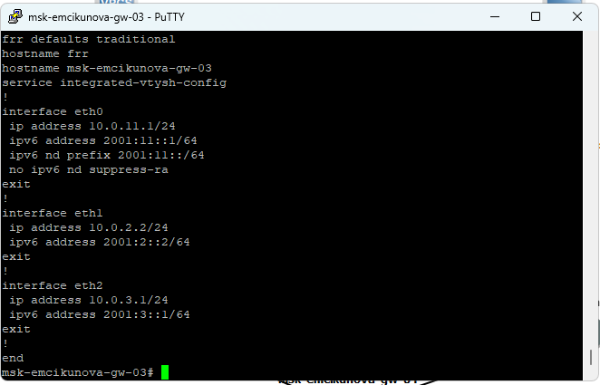{ #fig-019 width=70% }

Завершаю настройку IPv6 на маршрутизаторе `msk-emcikunova-gw-04`. В режиме конфигурирования включаю `ipv6 forwarding`, после чего задаю адреса интерфейсов.

Интерфейсу `eth0`, соединённому с маршрутизатором `gw-03`, назначаю IPv6-адрес `2001:3::2/64`. Интерфейсу `eth1`, соединённому с `gw-01`, назначаю адрес `2001:4::1/64`.

Выполняю `no shutdown` для обоих интерфейсов и сохраняю изменения командой `write memory`. В терминале отображается сообщение об успешном сохранении конфигурации (см. рис. [@fig-020]).

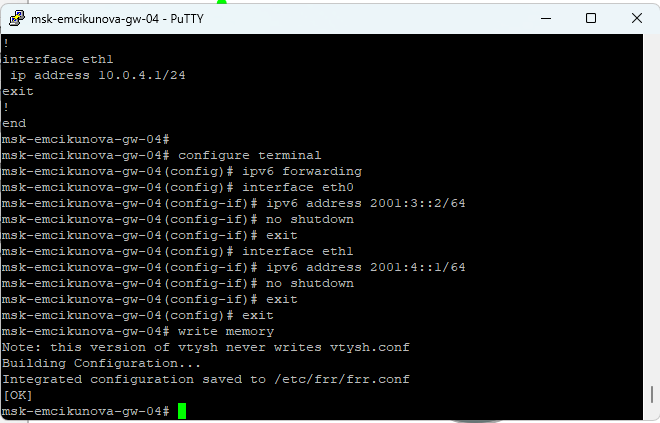{ #fig-020 width=70% }

Проверяю настроенные параметры командой `show running-config`.

Интерфейс `eth0` содержит IPv4-адрес `10.0.3.2/24` и IPv6-адрес `2001:3::2/64`, а интерфейс `eth1` — `10.0.4.1/24` и `2001:4::1/64`.

Убеждаюсь, что все четыре маршрутизатора имеют настроенные IPv4- и IPv6-адреса на используемых интерфейсах. Перехожу к включению динамической маршрутизации (см. рис. [@fig-021]).

{ #fig-021 width=70% }

### Настройка динамической маршрутизации RIPv2

Для автоматического обмена маршрутной информацией между маршрутизаторами использую протокол RIPv2. Протокол относится к дистанционно-векторным и выбирает маршруты на основании количества переходов через маршрутизаторы. Максимально допустимая метрика RIP составляет `15`, а значение `16` обозначает недоступный маршрут.

Начинаю настройку с маршрутизатора `msk-emcikunova-gw-01`. Выполняю команду `configure terminal`, после чего перехожу в режим настройки протокола командой `router rip`.

Командой `version 2` включаю использование второй версии RIP. Затем добавляю в процесс маршрутизации интерфейсы `eth0`, `eth1` и `eth2` командами `network eth0`, `network eth1` и `network eth2`.

В результате в процесс RIP включаются локальная подсеть `10.0.10.0/24` и транзитные сети `10.0.1.0/24` и `10.0.4.0/24`. После завершения конфигурирования выполняю `write memory` (см. рис. [@fig-022]).

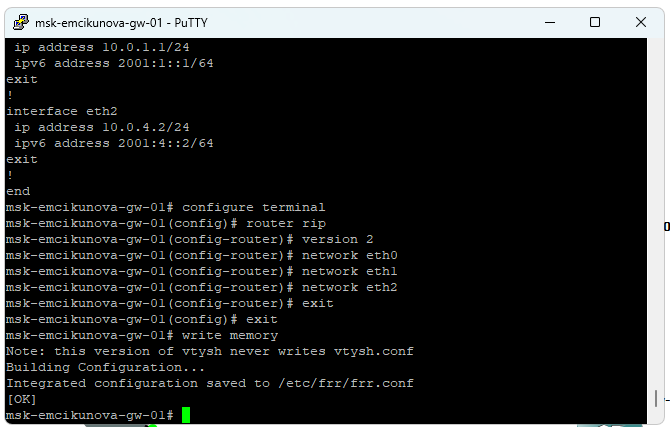{ #fig-022 width=70% }

На маршрутизаторе `msk-emcikunova-gw-02` перехожу в режим конфигурирования и выполняю `router rip`.

Задаю версию протокола командой `version 2`, после чего активирую маршрутизацию на интерфейсах `eth0` и `eth1` командами `network eth0` и `network eth1`.

Через эти интерфейсы маршрутизатор взаимодействует с `gw-01` и `gw-03`, получая сведения об удалённых IPv4-подсетях. Сохраняю конфигурацию командой `write memory` (см. рис. [@fig-023]).

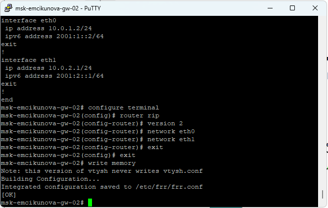{ #fig-023 width=70% }

Перехожу к маршрутизатору `msk-emcikunova-gw-03`. В режиме настройки `router rip` указываю `version 2` и добавляю интерфейсы `eth0`, `eth1` и `eth2`.

Интерфейс `eth0` обеспечивает подключение локальной сети `10.0.11.0/24`, а интерфейсы `eth1` и `eth2` используются для обмена маршрутной информацией с маршрутизаторами `gw-02` и `gw-04`.

После настройки выполняю `write memory`, сохраняя параметры протокола RIPv2 (см. рис. [@fig-024]).

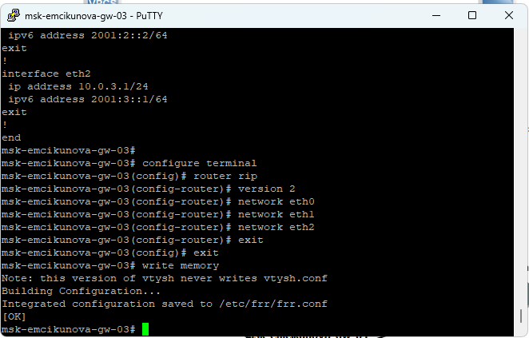{ #fig-024 width=70% }

Настраиваю RIPv2 на маршрутизаторе `msk-emcikunova-gw-04`. Перехожу в режим конфигурирования командами `configure terminal` и `router rip`.

Устанавливаю `version 2` и указываю сетевые интерфейсы `eth0` и `eth1`, которые соединяют маршрутизатор с устройствами `gw-03` и `gw-01`.

Завершаю настройку и сохраняю конфигурацию командой `write memory`. На этом протокол RIPv2 включён на всех четырёх маршрутизаторах, что позволяет им обмениваться сведениями о достижимых IPv4-сетях (см. рис. [@fig-025]).

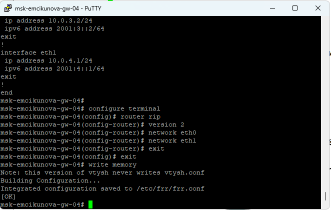{ #fig-025 width=70% }

### Проверка работы протокола RIPv2

После включения RIP на всех маршрутизаторах перехожу к проверке полученных таблиц маршрутизации. На маршрутизаторе `msk-emcikunova-gw-01` выполняю команды `show ip route rip` и `show ip rip`.

Команда `show ip route rip` отображает маршруты, полученные посредством RIP и установленные в таблицу IPv4-маршрутизации. В выводе присутствуют сети `10.0.2.0/24`, `10.0.3.0/24` и `10.0.11.0/24`.

Для сети `10.0.11.0/24`, в которой находится оконечное устройство `PC2`, используется следующий переход `10.0.1.2` через интерфейс `eth1`. Запись содержит значение `[120/3]`, где `120` — административная дистанция RIP, а `3` — метрика маршрута.

Команда `show ip rip` дополнительно отображает непосредственно подключённые сети с обозначением `C(i)` и маршруты, полученные от соседних маршрутизаторов, с обозначением `R(n)`. Для удалённой сети `10.0.11.0/24` указан следующий переход `10.0.1.2` с метрикой `3`, что соответствует маршруту через `gw-02` и `gw-03` (см. рис. [@fig-026]).

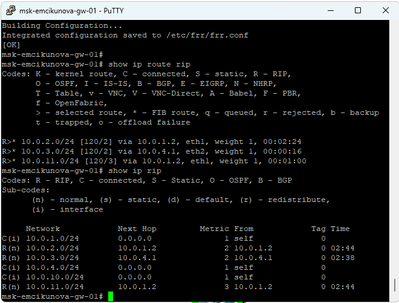{ #fig-026 width=70% }

Для получения дополнительных сведений о работе протокола выполняю команду `show ip rip status`.

В выводе отображается активный процесс маршрутизации `rip`, а также параметры отправки обновлений. Поле `Sending updates every 30 seconds with +/-50%` указывает на базовый интервал отправки периодических обновлений `30` секунд с предусмотренным изменением интервала.

Для маршрутов указано время устаревания `180` секунд и последующий период удаления `120` секунд. В разделе `Default version control` отображаются параметры отправки и приёма второй версии RIP на интерфейсах `eth0`, `eth1` и `eth2`.

В разделе `Routing Information Sources` присутствуют соседние маршрутизаторы с адресами `10.0.1.2` и `10.0.4.1`. Для них отображается административная дистанция `120` и время последнего полученного обновления. Это подтверждает, что маршрутизатор получает маршрутную информацию от обоих соседних устройств (см. рис. [@fig-027]).

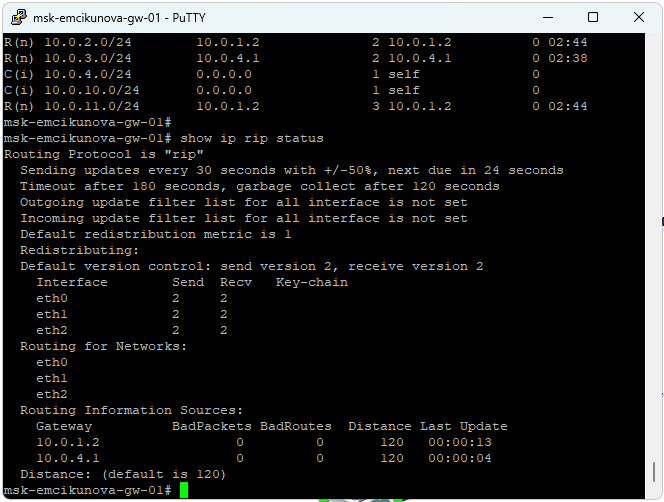{ #fig-027 width=70% }

Перехожу к маршрутизатору `msk-emcikunova-gw-02` и проверяю таблицу маршрутизации командами `show ip route rip` и `show ip rip`.

В таблице маршрутизации присутствуют удалённые подсети `10.0.3.0/24`, `10.0.4.0/24`, `10.0.10.0/24` и `10.0.11.0/24`. Маршруты к сетям `10.0.3.0/24` и `10.0.11.0/24` проходят через следующий переход `10.0.2.2`, соответствующий маршрутизатору `gw-03`.

Для сети `10.0.10.0/24` используется следующий переход `10.0.1.1`, соответствующий маршрутизатору `gw-01`.

В таблице `show ip rip` отображаются локальные сети с метрикой `1` и удалённые сети, полученные от соседних маршрутизаторов. Убеждаюсь, что `gw-02` знает маршруты к обоим оконечным сегментам (см. рис. [@fig-028]).

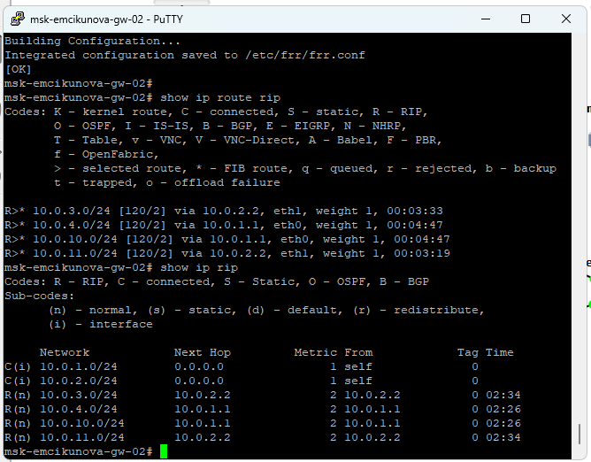{ #fig-028 width=70% }

Для проверки состояния процесса RIP на `msk-emcikunova-gw-02` выполняю команду `show ip rip status`.

В выводе указано, что маршрутизатор отправляет и принимает обновления RIP версии `2` через интерфейсы `eth0` и `eth1`.

В разделе `Routing Information Sources` отображаются два соседних маршрутизатора: `10.0.1.1` и `10.0.2.2`. Для каждого источника указаны счётчики ошибочных пакетов, административная дистанция и время последнего обновления.

Проверяю отсутствие ошибочных пакетов в отображаемой статистике и убеждаюсь, что обмен маршрутной информацией между соседними маршрутизаторами выполняется (см. рис. [@fig-029]).

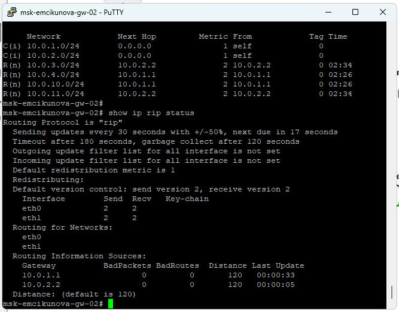{ #fig-029 width=70% }

Далее проверяю таблицы маршрутизации маршрутизатора `msk-emcikunova-gw-03`. Выполняю команды `show ip route rip` и `show ip rip`.

В таблице присутствуют маршруты к сетям `10.0.1.0/24`, `10.0.4.0/24` и `10.0.10.0/24`. Для достижения подсети `10.0.10.0/24`, к которой подключён `PC1`, используется следующий переход `10.0.2.1` через интерфейс `eth1`.

Метрика маршрута к сети `10.0.10.0/24` составляет `3`. Это соответствует пути через маршрутизаторы `gw-02` и `gw-01`.

Непосредственно подключённые сети `10.0.2.0/24`, `10.0.3.0/24` и `10.0.11.0/24` отображаются отдельно с метрикой `1` (см. рис. [@fig-030]).

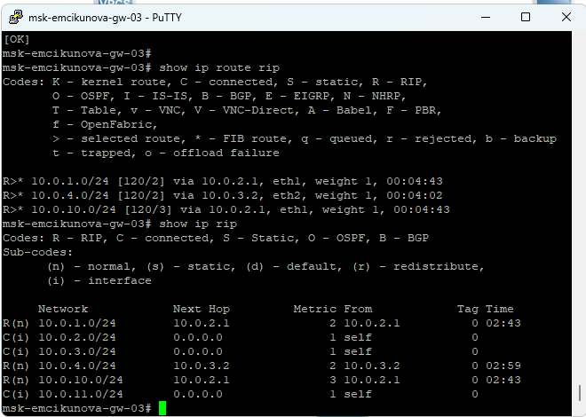{ #fig-030 width=70% }

Дополнительно выполняю команду `show ip rip status` на маршрутизаторе `msk-emcikunova-gw-03`.

В выводе отображаются интервалы обновления RIP, параметры отправки и приёма второй версии протокола, а также список используемых интерфейсов `eth0`, `eth1` и `eth2`.

В качестве источников маршрутной информации указаны адреса `10.0.2.1` и `10.0.3.2`, соответствующие соседним маршрутизаторам `gw-02` и `gw-04`.

Убеждаюсь, что `gw-03` получает обновления от двух соседних маршрутизаторов и имеет сведения о доступных IPv4-подсетях сети (см. рис. [@fig-031]).

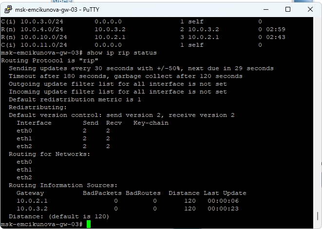{ #fig-031 width=70% }

### Проверка доступности устройств и определение маршрутов IPv4

Перехожу к оконечному устройству `PC1-emcikunova` и проверяю доступность компьютера `PC2-emcikunova`, находящегося в удалённой подсети `10.0.11.0/24`.

Выполняю команду `ping 10.0.11.10`. В ответ получаю пять сообщений от адреса `10.0.11.10`. Значение `ttl=61` и наличие времени ответа для каждого пакета свидетельствуют об успешном прохождении ICMP-пакетов через несколько маршрутизаторов.

Для определения маршрута передачи пакетов выполняю команду `trace 10.0.11.10 -P 6`. Параметр `-P 6` указывает использование TCP при выполнении трассировки.

В выводе отображается последовательность переходов:

`10.0.10.1` — маршрутизатор `gw-01`;

`10.0.1.2` — маршрутизатор `gw-02`;

`10.0.2.2` — маршрутизатор `gw-03`;

`10.0.11.10` — оконечное устройство `PC2`.

Убеждаюсь, что первоначально пакеты проходят через верхнюю ветвь кольцевой топологии: `PC1 — gw-01 — gw-02 — gw-03 — PC2` (см. рис. [@fig-032]).

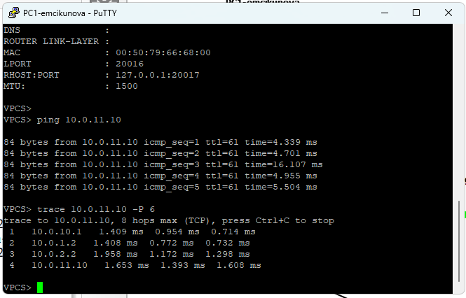{ #fig-032 width=70% }

Для дополнительного анализа выполняю на маршрутизаторе `msk-emcikunova-gw-01` команду `show ip rip`.

В таблице для сети `10.0.11.0/24` отображается следующий переход `10.0.1.2` и метрика `3`. Для сети `10.0.2.0/24` используется тот же следующий переход с метрикой `2`.

Полученные значения согласуются с результатами трассировки с оконечного устройства `PC1`. Убеждаюсь, что маршрутизатор выбрал путь через `gw-02` на основании информации, полученной по RIPv2 (см. рис. [@fig-033]).

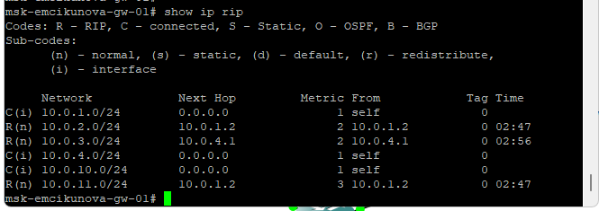{ #fig-033 width=70% }

### Исследование перестроения маршрутов при отключении интерфейса

Для исследования поведения протокола RIP при нарушении соединения отключаю интерфейс `eth0` на маршрутизаторе `msk-emcikunova-gw-02`.

Перехожу в режим конфигурирования командой `configure terminal`, выбираю интерфейс командой `interface eth0` и выполняю `shutdown`.

После отключения интерфейса соединение между маршрутизаторами `gw-01` и `gw-02` перестаёт использоваться для передачи пакетов. Сохраняю изменения командой `write memory`, получая подтверждение `[OK]` (см. рис. [@fig-034]).

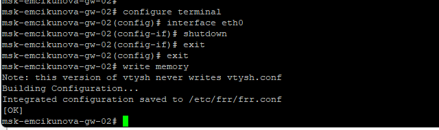{ #fig-034 width=70% }

Возвращаюсь к маршрутизатору `msk-emcikunova-gw-01` и проверяю изменение маршрутной информации командами `show ip rip` и `show ip route rip`.

В таблице RIP для сети `10.0.11.0/24` теперь отображается следующий переход `10.0.4.1`, соответствующий маршрутизатору `gw-04`. Для достижения сети используется интерфейс `eth2`, а метрика составляет `3`.

Аналогично изменяется маршрут к сети `10.0.2.0/24`, для которой отображается следующий переход `10.0.4.1` с метрикой `3`. Сеть `10.0.3.0/24` становится доступной через `gw-04` с метрикой `2`.

В выводе `show ip route rip` присутствует запись `10.0.11.0/24 [120/3] via 10.0.4.1, eth2`. Это подтверждает переход на альтернативный путь после отключения соединения с `gw-02` (см. рис. [@fig-035]).

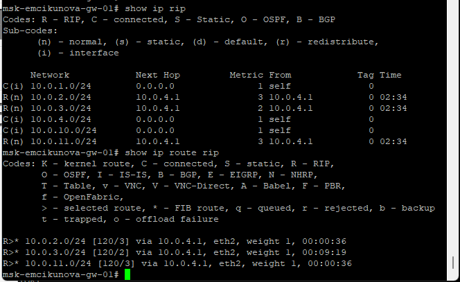{ #fig-035 width=70% }

Для дополнительной проверки выполняю на маршрутизаторе `msk-emcikunova-gw-01` команды `show ip route rip` и `show ip rip status`.

В таблице маршрутизации отображаются маршруты к сетям `10.0.2.0/24`, `10.0.3.0/24` и `10.0.11.0/24` через адрес `10.0.4.1` и интерфейс `eth2`.

В разделе `Routing Information Sources` команды `show ip rip status` остаётся источник маршрутной информации `10.0.4.1`. Это свидетельствует о получении актуальных обновлений через маршрутизатор `gw-04`.

Убеждаюсь, что после недоступности первоначального соединения протокол RIP использует оставшийся путь через нижнюю часть кольцевой топологии (см. рис. [@fig-036]).

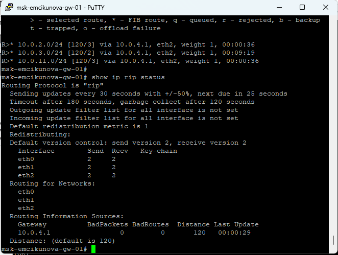{ #fig-036 width=70% }

Перехожу к компьютеру `PC1-emcikunova` и повторно выполняю команду `ping 10.0.11.10`.

Компьютер получает ответы от удалённого устройства `PC2`, что подтверждает сохранение связности между оконечными сегментами после изменения маршрута.

Для определения нового пути выполняю `trace 10.0.11.10 -P 6`. В трассировке отображаются переходы `10.0.10.1`, `10.0.4.1`, `10.0.3.1` и `10.0.11.10`.

Сопоставляю адреса с топологией сети и определяю маршрут `PC1 — gw-01 — gw-04 — gw-03 — PC2`.

Результат подтверждает возможность перенаправления пакетов через альтернативное соединение без изменения сетевых параметров оконечных устройств. Точное время перестроения маршрута по данному снимку не определяется, поскольку момент отключения и момент восстановления связности не представлены как единый временной интервал (см. рис. [@fig-037]).

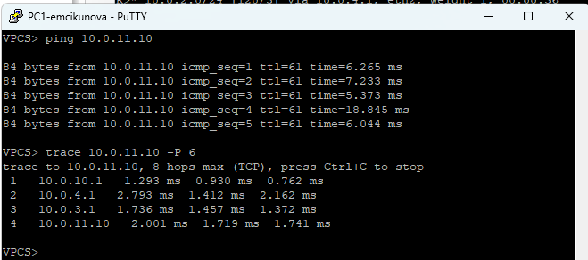{ #fig-037 width=70% }

После проверки альтернативного маршрута восстанавливаю соединение между маршрутизаторами `gw-01` и `gw-02`.

На маршрутизаторе `msk-emcikunova-gw-02` выполняю `configure terminal`, перехожу к интерфейсу `eth0` и использую команду `no shutdown`.

Команда отменяет административное отключение интерфейса, разрешая его дальнейшую работу. После завершения настройки выполняю `write memory` и получаю подтверждение сохранения конфигурации (см. рис. [@fig-038]).

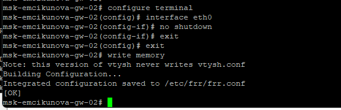{ #fig-038 width=70% }

Возвращаюсь на маршрутизатор `msk-emcikunova-gw-01` и проверяю маршрутную информацию командой `show ip rip`.

В момент проверки для сети `10.0.11.0/24` по-прежнему отображается следующий переход `10.0.4.1` с метрикой `3`. Аналогичный следующий переход используется для сетей `10.0.2.0/24` и `10.0.3.0/24`.

Это показывает, что повторное включение интерфейса не обязательно приводит к немедленному изменению установленного маршрута. Для изменения маршрутной информации маршрутизатор должен получить и обработать обновления от соседних устройств. Кроме того, при равных метриках возможно сохранение ранее выбранного пути (см. рис. [@fig-039]).

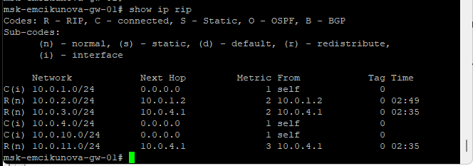{ #fig-039 width=70% }

На компьютере `PC1-emcikunova` повторно проверяю доступность `PC2` командой `ping 10.0.11.10`.

Получаю пять ответов от адреса `10.0.11.10`, что свидетельствует о работоспособности соединения между локальными сетями.

Затем выполняю команду `trace 10.0.11.10 -P 6`. В выводе отображается путь через адреса `10.0.10.1`, `10.0.4.1`, `10.0.3.1` и `10.0.11.10`.

На момент проверки трафик продолжает передаваться через маршрутизатор `gw-04`. Убеждаюсь, что после восстановления интерфейса связность между оконечными устройствами сохраняется, хотя выбранный маршрут остаётся через нижнюю ветвь кольца (см. рис. [@fig-040]).

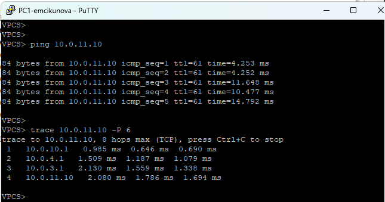{ #fig-040 width=70% }

### Анализ трафика протокола RIPv2 в Wireshark

Перехожу к анализу пакетов, захваченных на соединении между коммутатором `msk-emcikunova-sw-01` и маршрутизатором `msk-emcikunova-gw-01`.

В Wireshark выбираю пакет протокола `RIPv2`. В списке пакетов отображается сообщение `Response`, отправленное с адреса `10.0.10.1` на многоадресный адрес `224.0.0.9`.

В заголовке UDP указаны исходный и конечный порты `520`, используемые протоколом RIP. В поле `Routing Information Protocol` отображаются `Command: Response (2)` и `Version: RIPv2 (2)`.

В содержимом сообщения находятся записи об известных сетях. Для подсети `10.0.1.0` указана маска `255.255.255.0` и метрика `1`. Для сети `10.0.2.0` отображается метрика `2`, для `10.0.3.0` — `2`, а для `10.0.11.0` — `3`.

Каждая маршрутная запись содержит адрес сети, маску подсети, поле следующего перехода и метрику. Наблюдаю, как маршрутизатор распространяет сведения о доступных IPv4-сетях в сообщении RIP.

Помимо пакетов маршрутизации в захвате присутствуют сообщения ICMP Echo Request и Echo Reply, сформированные при проверке доступности между оконечными устройствами (см. рис. [@fig-041]).

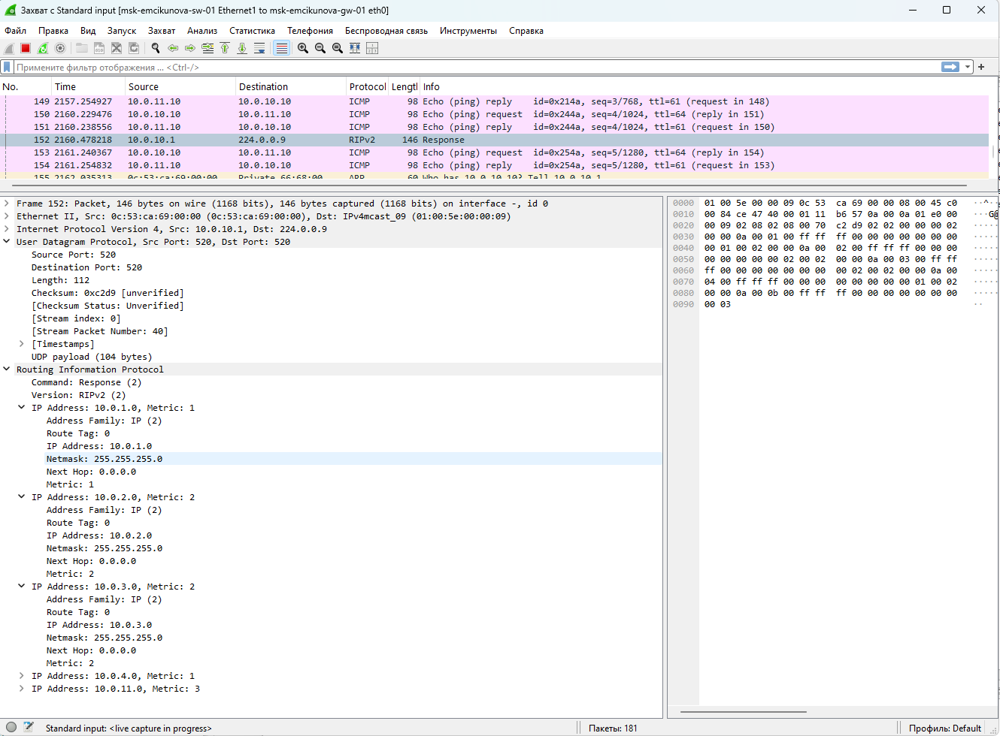{ #fig-041 width=70% }

Далее анализирую трафик, захваченный между маршрутизатором `msk-emcikunova-gw-03` и коммутатором `msk-emcikunova-sw-02`.

В списке пакетов выбираю сообщение `RIPv2 Response` с исходным адресом `10.0.11.1` и адресом назначения `224.0.0.9`.

В заголовке UDP вновь отображаются порты `520`, а в содержимом RIP — версия протокола `2` и маршрутные записи.

Для сети `10.0.1.0` указана метрика `2`, для непосредственно подключённой сети `10.0.2.0` — `1`, для сети `10.0.3.0` — `1`, а для сети `10.0.10.0` — `3`.

Сравниваю содержимое пакетов маршрутизаторов `gw-01` и `gw-03`. Отличия в метриках объясняются разным расстоянием от каждого маршрутизатора до анонсируемых подсетей.

В захваченном трафике также присутствуют ICMP-пакеты проверки связности и сообщения ICMPv6 Router Advertisement. Убеждаюсь, что захват трафика позволяет одновременно исследовать обмен маршрутной информацией и сетевые сообщения оконечных устройств (см. рис. [@fig-042]).

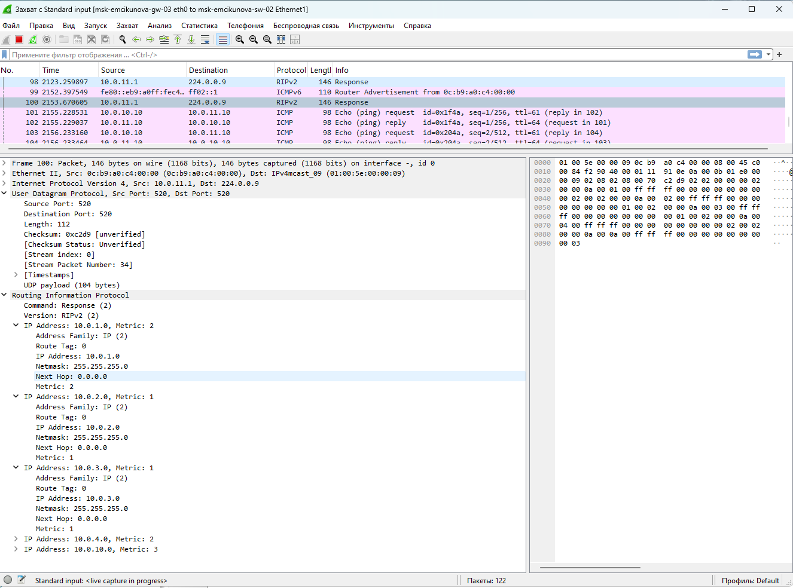{ #fig-042 width=70% }

### Настройка динамической маршрутизации IPv6 по протоколу RIPng

Перехожу к настройке маршрутизации IPv6. Для распространения сведений об IPv6-подсетях использую протокол RIPng, предназначенный для работы с адресами IPv6.

На маршрутизаторе `msk-emcikunova-gw-01` выполняю команду `configure terminal`, после чего перехожу в режим настройки протокола командой `router ripng`.

Включаю протокол на интерфейсах `eth0`, `eth1` и `eth2` командами `network eth0`, `network eth1` и `network eth2`.

После завершения конфигурирования выполняю `write memory`. В терминале появляется сообщение `Integrated configuration saved to /etc/frr/frr.conf` и подтверждение `[OK]`.

В результате на маршрутизаторе включён обмен информацией о доступных IPv6-подсетях посредством RIPng (см. рис. [@fig-043]).

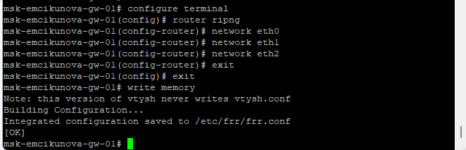{ #fig-043 width=70% }

На маршрутизаторе `msk-emcikunova-gw-02` выполняю `configure terminal` и `router ripng`.

Добавляю в процесс RIPng интерфейсы `eth0` и `eth1`, которые соединяют устройство с маршрутизаторами `gw-01` и `gw-03`.

Сохраняю изменения командой `write memory`. Сообщение `[OK]` подтверждает успешное сохранение конфигурации (см. рис. [@fig-044]).

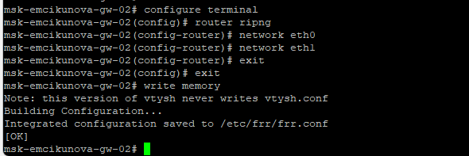{ #fig-044 width=70% }

Далее настраиваю RIPng на маршрутизаторе `msk-emcikunova-gw-03`.

В режиме `router ripng` выполняю команды `network eth0`, `network eth1` и `network eth2`, включая в процесс маршрутизации локальную сеть `2001:11::/64` и транзитные соединения с маршрутизаторами `gw-02` и `gw-04`.

Завершаю настройку и сохраняю конфигурацию командой `write memory` (см. рис. [@fig-045]).

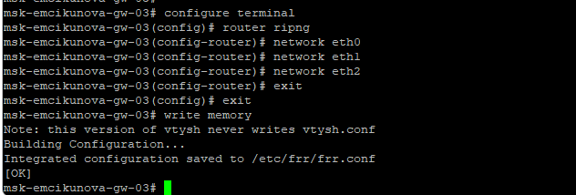{ #fig-045 width=70% }

Настраиваю RIPng на последнем маршрутизаторе `msk-emcikunova-gw-04`.

Выполняю команды `configure terminal`, `router ripng`, `network eth0` и `network eth1`.

После включения протокола на обоих интерфейсах сохраняю конфигурацию командой `write memory`. В результате все четыре маршрутизатора участвуют в распространении маршрутной информации IPv6 (см. рис. [@fig-046]).

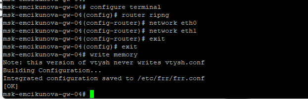{ #fig-046 width=70% }

### Проверка доступности IPv6-сетей и маршрутов RIPng

Перехожу к устройству `PC1-emcikunova` и выполняю команду `ping 2001:11::a` для проверки доступности IPv6-адреса компьютера `PC2`.

В ответ получаю пять ICMPv6-сообщений от адреса `2001:11::a`. В выводе отображается `ttl=58`, а время ответа составляет несколько миллисекунд.

Для определения маршрута выполняю команду `trace 2001:11::a`. В трассировке отображаются следующие переходы:

`2001:10::1` — маршрутизатор `gw-01`;

`2001:1::2` — маршрутизатор `gw-02`;

`2001:2::2` — маршрутизатор `gw-03`;

`2001:11::a` — оконечное устройство `PC2`.

Полученный путь соответствует верхней ветви кольцевой топологии. Убеждаюсь, что между локальными IPv6-сетями настроена сквозная маршрутизация и пакеты успешно доставляются через промежуточные маршрутизаторы (см. рис. [@fig-047]).

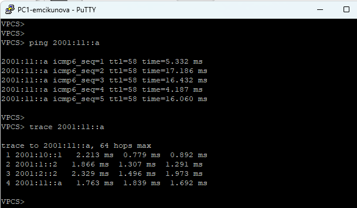{ #fig-047 width=70% }

Для проверки таблицы IPv6-маршрутизации на маршрутизаторе `msk-emcikunova-gw-01` выполняю команду `show ipv6 ripng`.

В выводе отображаются непосредственно подключённые сети, обозначенные `C(i)`, и маршруты, полученные по RIPng, обозначенные `R(n)`.

К непосредственно подключённым относятся подсети `2001:1::/64`, `2001:4::/64` и `2001:10::/64`. Для них указана метрика `1`.

Удалённая сеть `2001:2::/64` доступна через интерфейс `eth1` с метрикой `2`. Сеть `2001:3::/64` доступна через интерфейс `eth2` с метрикой `2`.

Для сети `2001:11::/64`, в которой находится `PC2`, указан маршрут через интерфейс `eth1` с метрикой `3`. В качестве следующего перехода используется локальный IPv6-адрес соседнего маршрутизатора, начинающийся с `fe80::`.

Сопоставляю информацию с выполненной трассировкой и убеждаюсь, что RIPng определил путь до удалённой сети через маршрутизатор `gw-02` (см. рис. [@fig-048]).

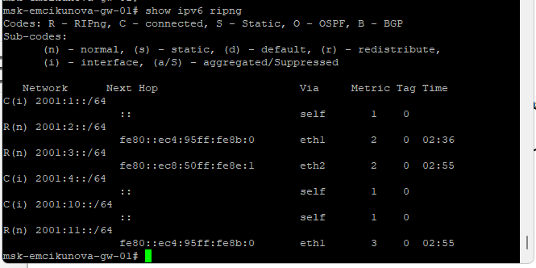{ #fig-048 width=70% }

### Исследование изменения маршрутов RIPng при отключении интерфейса

Для проверки работы RIPng при отказе соединения повторно отключаю интерфейс `eth0` маршрутизатора `msk-emcikunova-gw-02`.

Перехожу в режим конфигурирования командой `configure terminal`, выбираю интерфейс `eth0` и выполняю `shutdown`.

После этого сохраняю изменения командой `write memory`. В результате соединение между `gw-01` и `gw-02` становится недоступным и для обмена IPv6-пакетами (см. рис. [@fig-049]).

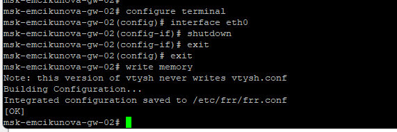{ #fig-049 width=70% }

Возвращаюсь к маршрутизатору `msk-emcikunova-gw-01` и выполняю команду `show ipv6 ripng`.

В таблице маршрутов наблюдаю изменение следующего перехода для удалённых IPv6-сетей.

Сеть `2001:11::/64` теперь доступна через интерфейс `eth2` с метрикой `3`. В качестве следующего перехода указан локальный IPv6-адрес маршрутизатора `gw-04`.

Для сети `2001:3::/64` также используется интерфейс `eth2`, а метрика составляет `2`. Сеть `2001:2::/64` достигается через альтернативную ветвь с метрикой `3`.

Изменения подтверждают, что RIPng перестроил маршруты после отключения соединения между `gw-01` и `gw-02` (см. рис. [@fig-050]).

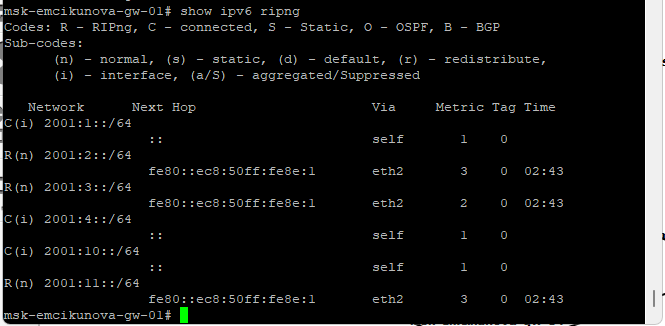{ #fig-050 width=70% }

На устройстве `PC1-emcikunova` повторно выполняю команду `ping 2001:11::a`.

Получаю пять ответов от удалённого IPv6-адреса, что подтверждает сохранение доступности компьютера `PC2` после отключения первоначального маршрута.

Для определения пути прохождения пакетов выполняю `trace 2001:11::a`.

В трассировке отображаются адреса `2001:10::1`, `2001:4::1`, `2001:3::1` и `2001:11::a`.

Последовательность переходов соответствует пути `PC1 — gw-01 — gw-04 — gw-03 — PC2`.

Убеждаюсь, что RIPng обеспечивает перенаправление IPv6-трафика через альтернативную ветвь кольцевой топологии. Точное время восстановления маршрута по одному результату трассировки определить невозможно (см. рис. [@fig-051]).

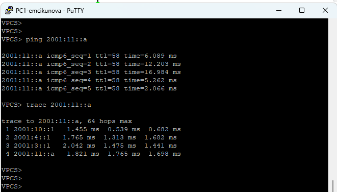{ #fig-051 width=70% }

После проверки альтернативного пути возвращаюсь на маршрутизатор `msk-emcikunova-gw-02` и восстанавливаю работу интерфейса `eth0`.

Выполняю команды `configure terminal`, `interface eth0` и `no shutdown`.

После выхода из режима конфигурирования сохраняю настройки командой `write memory`. Получаю сообщение `Integrated configuration saved to /etc/frr/frr.conf` и подтверждение `[OK]` (см. рис. [@fig-052]).

{ #fig-052 width=70% }

На маршрутизаторе `msk-emcikunova-gw-01` повторно выполняю команду `show ipv6 ripng`.

В таблице появляется маршрут к сети `2001:2::/64` через интерфейс `eth1` с метрикой `2`, что указывает на получение маршрутной информации по восстановленному соединению с `gw-02`.

При этом для сети `2001:11::/64` по-прежнему отображается следующий переход через интерфейс `eth2` и метрика `3`. Следовательно, в момент проверки для доставки пакетов к `PC2` продолжает использоваться маршрут через `gw-04`.

Проверяю, что RIPng обновляет информацию о доступности сетей после включения интерфейса, а выбранный путь может сохраняться при наличии альтернативных маршрутов с одинаковой метрикой (см. рис. [@fig-053]).

{ #fig-053 width=70% }

На оконечном устройстве `PC1-emcikunova` выполняю заключительную проверку IPv6-соединения командой `ping 2001:11::a`.

Компьютер получает пять ответов от адреса `2001:11::a`. Затем выполняю `trace 2001:11::a`.

В результате трассировки отображается последовательность `2001:10::1`, `2001:4::1`, `2001:3::1`, `2001:11::a`.

Убеждаюсь, что после восстановления интерфейса `gw-02` IPv6-соединение между компьютерами остаётся работоспособным. На момент выполнения проверки пакеты продолжают передаваться через маршрутизатор `gw-04` (см. рис. [@fig-054]).

{ #fig-054 width=70% }

### Анализ служебного трафика RIPng в Wireshark

Перехожу в Wireshark и исследую IPv6-трафик, захваченный на соединении между коммутатором `msk-emcikunova-sw-01` и маршрутизатором `msk-emcikunova-gw-01`.

В списке пакетов нахожу сообщения протокола `RIPng`. Для них используется многоадресный IPv6-адрес назначения `ff02::9`, предназначенный для обмена маршрутной информацией между маршрутизаторами RIPng.

В заголовке UDP указаны исходный и конечный порты `521`. В содержимом пакета отображаются поля `Command: Response (2)` и `Version: 1`.

В разделе маршрутных записей `Route Table Entry` отображаются IPv6-префиксы, длины префиксов и метрики.

В выбранном сообщении маршрутизатор анонсирует сети `2001:1::/64`, `2001:4::/64` и `2001:10::/64`. Для каждой записи указана длина префикса `64` и метрика `1`.

В отличие от RIPv2, RIPng передаёт сведения об IPv6-префиксах, а взаимодействие между маршрутизаторами осуществляется с использованием локальных IPv6-адресов.

В списке пакетов также присутствуют сообщения RIPv2, что подтверждает одновременную работу двух протоколов динамической маршрутизации в сети с двойным стеком IPv4 и IPv6 (см. рис. [@fig-055]).

{ #fig-055 width=70% }

Далее анализирую захват трафика между маршрутизатором `msk-emcikunova-gw-03` и коммутатором `msk-emcikunova-sw-02`.

В списке пакетов выбираю сообщение `RIPng Response`, отправленное с локального IPv6-адреса маршрутизатора на многоадресный адрес `ff02::9`.

В заголовке UDP отображаются порты `521`, а в содержимом пакета — версия RIPng `1` и сведения об IPv6-сетях.

Для префикса `2001:1::/64` указана метрика `2`, для `2001:2::/64` — `1`, для `2001:3::/64` — `1`. Также присутствуют записи о сетях `2001:4::/64`, `2001:10::/64` и `2001:11::/64` с соответствующими метриками.

В захваченном трафике одновременно присутствуют пакеты RIPv2, RIPng и ICMPv6. Среди ICMPv6-сообщений наблюдаются Neighbor Solicitation и Neighbor Advertisement, используемые протоколом обнаружения соседей IPv6.

Сопоставляю содержимое сообщений маршрутизаторов и убеждаюсь, что RIPng распространяет информацию об IPv6-сетях, позволяя устройствам строить и обновлять таблицы маршрутизации (см. рис. [@fig-056]).

{ #fig-056 width=70% }

## Задание для самостоятельного выполнения

### Документирование сети и планирование адресации

Перехожу к самостоятельной части лабораторной работы. В соответствии с заданием необходимо построить сеть с четырьмя маршрутизаторами, двумя коммутаторами и двумя оконечными устройствами, настроить двойной стек IPv4 и IPv6, включить динамическую маршрутизацию RIPv2 и RIPng и проверить доступность удалённых сетей.

В отличие от предыдущей топологии маршрутизатор `gw-01` подключён к маршрутизаторам `gw-03` и `gw-04`, а маршрутизатор `gw-02` — к `gw-03` и `gw-04`.

Для оконечных устройств использую адресные пространства `10.10.1.96/27` и `10.10.1.64/28`. Для соединений между маршрутизаторами применяю IPv4-подсети с префиксом `/30`, каждая из которых содержит два пригодных для назначения интерфейсам адреса.

Для IPv6 использую префиксы вида `2001:db8:1:x::/64`.

На основании топологии и фактически используемых соединений составляю таблицу сетей.

| Сегмент сети | Сеть IPv4 | Сеть IPv6 |
|---|---|---|
| PC1 — gw-01 | `10.10.1.96/27` | `2001:db8:1:1::/64` |
| PC2 — gw-02 | `10.10.1.64/28` | `2001:db8:1:6::/64` |
| gw-01 — gw-03 | `10.10.1.4/30` | `2001:db8:1:2::/64` |
| gw-01 — gw-04 | `10.10.1.8/30` | `2001:db8:1:3::/64` |
| gw-03 — gw-02 | `10.10.1.16/30` | `2001:db8:1:4::/64` |
| gw-04 — gw-02 | `10.10.1.32/30` | `2001:db8:1:5::/64` |

Распределяю адреса между сетевыми интерфейсами маршрутизаторов и оконечными устройствами.

| Устройство | Интерфейс | IPv4-адрес | IPv6-адрес |
|---|---|---|---|
| gw-01 | eth0 | `10.10.1.97/27` | `2001:db8:1:1::1/64` |
| gw-01 | eth1 | `10.10.1.5/30` | `2001:db8:1:2::1/64` |
| gw-01 | eth2 | `10.10.1.9/30` | `2001:db8:1:3::1/64` |
| gw-02 | eth0 | `10.10.1.65/28` | `2001:db8:1:6::1/64` |
| gw-02 | eth1 | `10.10.1.18/30` | `2001:db8:1:4::2/64` |
| gw-02 | eth2 | `10.10.1.34/30` | `2001:db8:1:5::2/64` |
| gw-03 | eth0 | `10.10.1.6/30` | `2001:db8:1:2::2/64` |
| gw-03 | eth1 | `10.10.1.17/30` | `2001:db8:1:4::1/64` |
| gw-04 | eth0 | `10.10.1.10/30` | `2001:db8:1:3::2/64` |
| gw-04 | eth1 | `10.10.1.33/30` | `2001:db8:1:5::1/64` |
| PC1 | NIC | `10.10.1.98/27` | `2001:db8:1:1::a/64` |
| PC2 | NIC | `10.10.1.66/28` | `2001:db8:1:6::a/64` |

Для компьютера `PC1` задаю IPv4-шлюз по умолчанию `10.10.1.97`, а для `PC2` — `10.10.1.65`.

Создаю схему L1, на которой отображаю физическую структуру сети, используемые интерфейсы и соединения устройств.

{ #fig-l1-task width=70% }

Затем разрабатываю схему L3, указывая IPv4- и IPv6-подсети локальных сегментов и межмаршрутизаторных соединений.

{ #fig-l3-task width=70% }

### Создание топологии самостоятельного задания в GNS3

В GNS3 создаю топологию в соответствии с разработанными схемами. В рабочей области размещаю маршрутизаторы `msk-emcikunova-gw-01`, `msk-emcikunova-gw-02`, `msk-emcikunova-gw-03` и `msk-emcikunova-gw-04`, коммутаторы `msk-emcikunova-sw-01` и `msk-emcikunova-sw-02`, а также компьютеры `PC1-emcikunova` и `PC2-emcikunova`.

Подключаю `PC1` к маршрутизатору `gw-01` через коммутатор `sw-01`, а `PC2` — к маршрутизатору `gw-02` через коммутатор `sw-02`.

Между маршрутизаторами создаю соединения `gw-01 — gw-03`, `gw-03 — gw-02`, `gw-01 — gw-04` и `gw-04 — gw-02`.

Включаю устройства и проверяю состояние соединений. На схеме GNS3 отображаются активные соединения с зелёными индикаторами, подтверждающими работу интерфейсов (см. рис. [@fig-057]).

{ #fig-057 width=70% }

### Настройка оконечных устройств самостоятельного задания

Перехожу к компьютеру `PC1-emcikunova`. Назначаю ему IPv4-адрес `10.10.1.98/27` со шлюзом по умолчанию `10.10.1.97`.

Для IPv6 задаю глобальный адрес `2001:db8:1:1::a/64`, после чего сохраняю сетевую конфигурацию.

Проверяю параметры командами `show ip` и `show ipv6`.

В выводе отображаются IPv4-адрес `10.10.1.98/27`, шлюз `10.10.1.97`, глобальный IPv6-адрес `2001:db8:1:1::a/64` и локальный IPv6-адрес `fe80::250:79ff:fe66:6800/64`.

Убеждаюсь, что компьютер получил адреса из предусмотренных заданием подсетей и настроен для использования двойного стека IPv4 и IPv6 (см. рис. [@fig-058]).

{ #fig-058 width=70% }

Аналогично настраиваю устройство `PC2-emcikunova`.

Назначаю IPv4-адрес `10.10.1.66/28` и шлюз по умолчанию `10.10.1.65`. Для IPv6 устанавливаю адрес `2001:db8:1:6::a/64`.

После сохранения конфигурации выполняю команды `show ip` и `show ipv6`.

В выводе отображаются IPv4-адрес `10.10.1.66/28`, шлюз `10.10.1.65`, глобальный IPv6-адрес `2001:db8:1:6::a/64` и локальный IPv6-адрес `fe80::250:79ff:fe66:6801/64`.

Проверяю правильность настроенных параметров и убеждаюсь, что компьютеры находятся в разных сетях, для взаимодействия между которыми необходима маршрутизация (см. рис. [@fig-059]).

{ #fig-059 width=70% }

### Настройка маршрутизаторов и динамической маршрутизации в самостоятельном задании

Перехожу к маршрутизатору `msk-emcikunova-gw-01`. Выполняю команду `configure terminal` и изменяю системное имя командой `hostname msk-emcikunova-gw-01`.

Для включения маршрутизации IPv6 выполняю `ipv6 forwarding`.

На интерфейсе `eth0` назначаю IPv4-адрес `10.10.1.97/27` и IPv6-адрес `2001:db8:1:1::1/64`. Настраиваю отправку IPv6 Router Advertisement командами `no ipv6 nd suppress-ra` и `ipv6 nd prefix 2001:db8:1:1::/64`.

На интерфейсе `eth1`, соединённом с `gw-03`, задаю адреса `10.10.1.5/30` и `2001:db8:1:2::1/64`.

На интерфейсе `eth2`, соединённом с `gw-04`, устанавливаю адреса `10.10.1.9/30` и `2001:db8:1:3::1/64`.

После настройки каждого интерфейса выполняю `no shutdown`.

Далее включаю динамическую IPv4-маршрутизацию командами `router rip` и `version 2`. Добавляю интерфейсы `eth0`, `eth1` и `eth2` командами `network`.

Для IPv6 перехожу в режим `router ripng` и также указываю интерфейсы `eth0`, `eth1` и `eth2`.

Завершаю конфигурирование и выполняю `write memory`. Сообщение `Integrated configuration saved to /etc/frr/frr.conf` подтверждает успешное сохранение настроек (см. рис. [@fig-060]).

{ #fig-060 width=70% }

Для проверки настроек маршрутизатора `msk-emcikunova-gw-01` выполняю команду `show running-config`.

В текущей конфигурации отображаются IPv4- и IPv6-адреса всех трёх интерфейсов, а также параметры анонсирования IPv6-префикса для локального сегмента `PC1`.

В разделе `router rip` присутствуют команды `network eth0`, `network eth1`, `network eth2` и `version 2`.

В разделе `router ripng` также указаны все три интерфейса маршрутизатора. Убеждаюсь, что на устройстве одновременно включены протоколы динамической маршрутизации для IPv4 и IPv6 (см. рис. [@fig-061]).

{ #fig-061 width=70% }

Перехожу к маршрутизатору `msk-emcikunova-gw-02`. В режиме конфигурирования устанавливаю системное имя и включаю IPv6-пересылку командой `ipv6 forwarding`.

На интерфейсе `eth0`, соединённом с локальной сетью `PC2`, назначаю IPv4-адрес `10.10.1.65/28` и IPv6-адрес `2001:db8:1:6::1/64`.

Для передачи оконечному устройству информации о маршрутизаторе разрешаю отправку Router Advertisement командой `no ipv6 nd suppress-ra` и задаю префикс командой `ipv6 nd prefix 2001:db8:1:6::/64`.

На интерфейсе `eth1` задаю адреса `10.10.1.18/30` и `2001:db8:1:4::2/64`, а на интерфейсе `eth2` — `10.10.1.34/30` и `2001:db8:1:5::2/64`.

Включаю все интерфейсы командой `no shutdown`.

Затем настраиваю RIPv2 командами `router rip`, `version 2` и `network` для интерфейсов `eth0`, `eth1`, `eth2`.

Аналогично включаю RIPng командой `router ripng`, добавляя все три интерфейса в процесс IPv6-маршрутизации.

Сохраняю конфигурацию командой `write memory` (см. рис. [@fig-062]).

{ #fig-062 width=70% }

Для проверки выполняю на маршрутизаторе `msk-emcikunova-gw-02` команду `show running-config`.

В выводе отображаются адреса `10.10.1.65/28`, `10.10.1.18/30`, `10.10.1.34/30` и соответствующие IPv6-адреса.

В конфигурации присутствуют разделы `router rip` и `router ripng`, содержащие перечисление всех используемых интерфейсов.

Убеждаюсь, что маршрутизатор настроен для обслуживания локальной сети `PC2` и обмена маршрутной информацией с маршрутизаторами `gw-03` и `gw-04` (см. рис. [@fig-063]).

{ #fig-063 width=70% }

Перехожу к маршрутизатору `msk-emcikunova-gw-03`, который используется для соединения `gw-01` и `gw-02` через верхнюю ветвь кольцевой топологии.

Выполняю `configure terminal`, устанавливаю системное имя и включаю IPv6-маршрутизацию командой `ipv6 forwarding`.

На интерфейсе `eth0`, подключённом к `gw-01`, назначаю IPv4-адрес `10.10.1.6/30` и IPv6-адрес `2001:db8:1:2::2/64`.

На интерфейсе `eth1`, соединённом с `gw-02`, устанавливаю IPv4-адрес `10.10.1.17/30` и IPv6-адрес `2001:db8:1:4::1/64`.

Включаю интерфейсы командой `no shutdown`.

Для настройки динамической маршрутизации IPv4 выполняю `router rip`, `version 2`, `network eth0` и `network eth1`.

Для IPv6 выполняю `router ripng`, после чего добавляю интерфейсы `eth0` и `eth1`.

Сохраняю конфигурацию командой `write memory`. Получаю подтверждение успешного сохранения изменений (см. рис. [@fig-064]).

{ #fig-064 width=70% }

Выполняю команду `show running-config` и проверяю текущую конфигурацию маршрутизатора `msk-emcikunova-gw-03`.

В выводе присутствуют адреса `10.10.1.6/30` и `2001:db8:1:2::2/64` на интерфейсе `eth0`, а также `10.10.1.17/30` и `2001:db8:1:4::1/64` на интерфейсе `eth1`.

В разделе `router rip` указана версия `2`, а в разделах RIPv2 и RIPng присутствуют интерфейсы `eth0` и `eth1`.

Убеждаюсь, что параметры маршрутизатора соответствуют разработанной таблице адресации (см. рис. [@fig-065]).

{ #fig-065 width=70% }

Завершаю настройку маршрутизатора `msk-emcikunova-gw-04`, обеспечивающего альтернативный путь между маршрутизаторами `gw-01` и `gw-02`.

В режиме глобальной конфигурации задаю имя устройства и выполняю `ipv6 forwarding`.

На интерфейсе `eth0` назначаю IPv4-адрес `10.10.1.10/30` и IPv6-адрес `2001:db8:1:3::2/64`.

На интерфейсе `eth1` задаю IPv4-адрес `10.10.1.33/30` и IPv6-адрес `2001:db8:1:5::1/64`.

Оба интерфейса активирую командой `no shutdown`.

Затем включаю маршрутизацию RIPv2 командами `router rip`, `version 2`, `network eth0` и `network eth1`.

Для IPv6 активирую `router ripng` и добавляю интерфейсы `eth0` и `eth1`.

Выполняю `write memory`, получая подтверждение сохранения настроек в файле `/etc/frr/frr.conf` (см. рис. [@fig-066]).

{ #fig-066 width=70% }

Проверяю текущую конфигурацию маршрутизатора `msk-emcikunova-gw-04` командой `show running-config`.

В выводе отображаются IPv4- и IPv6-адреса интерфейсов `eth0` и `eth1`, а также настройки процессов `router rip` и `router ripng`.

Убеждаюсь, что на маршрутизаторе одновременно работают два протокола маршрутизации и включены оба сетевых интерфейса.

После завершения настройки всех четырёх маршрутизаторов перехожу к проверке доступности между локальными сетями (см. рис. [@fig-067]).

{ #fig-067 width=70% }

### Проверка соединений между оконечными устройствами

Перехожу к компьютеру `PC1-emcikunova` и проверяю доступность удалённого IPv4-адреса `10.10.1.66` командой `ping 10.10.1.66`.

В терминале получаю пять ответов от удалённого устройства. Время ответа составляет от нескольких до нескольких десятков миллисекунд, значение `ttl=61` подтверждает прохождение пакетов через промежуточные маршрутизаторы.

Для определения пути выполняю команду `trace 10.10.1.66 -P 6`.

В выводе отображаются переходы `10.10.1.97`, `10.10.1.6`, `10.10.1.18` и `10.10.1.66`. Это соответствует маршруту `PC1 — gw-01 — gw-03 — gw-02 — PC2`.

Затем проверяю IPv6-соединение командой `ping 2001:db8:1:6::a`. Получаю пять ответов от адреса `2001:db8:1:6::a`, что подтверждает доступность удалённой IPv6-сети.

Для проверки пути прохождения IPv6-пакетов выполняю `trace 2001:db8:1:6::a`.

В трассировке отображаются адреса `2001:db8:1:1::1`, `2001:db8:1:2::2`, `2001:db8:1:4::2` и `2001:db8:1:6::a`.

Убеждаюсь, что маршрутизация IPv4 и IPv6 работает, а пакеты обеих версий IP достигают удалённого компьютера через маршрутизатор `gw-03` (см. рис. [@fig-068]).

{ #fig-068 width=70% }

Для проверки двусторонней доступности перехожу к компьютеру `PC2-emcikunova`.

Выполняю команду `ping 10.10.1.98` для проверки IPv4-соединения с устройством `PC1`. Получаю пять успешных ответов от адреса `10.10.1.98`.

Затем выполняю `trace 10.10.1.98 -P 6`.

В выводе отображаются переходы `10.10.1.65`, `10.10.1.17`, `10.10.1.5` и `10.10.1.98`. По полученным адресам определяю маршрут `PC2 — gw-02 — gw-03 — gw-01 — PC1`.

Для проверки IPv6 выполняю команду `ping 2001:db8:1:1::a`. Компьютер получает пять ответов от удалённого адреса.

Командой `trace 2001:db8:1:1::a` определяю маршрут через адреса `2001:db8:1:6::1`, `2001:db8:1:4::1`, `2001:db8:1:2::1` и `2001:db8:1:1::a`.

Результаты подтверждают наличие двусторонней связи между оконечными устройствами по IPv4 и IPv6 (см. рис. [@fig-069]).

{ #fig-069 width=70% }

### Проверка таблиц маршрутизации IPv4 и IPv6

После проверки соединений перехожу к анализу таблиц маршрутизации на каждом маршрутизаторе.

На маршрутизаторе `msk-emcikunova-gw-01` выполняю команды `show ip route` и `show ipv6 route`.

В таблице IPv4 присутствуют непосредственно подключённые сети `10.10.1.4/30`, `10.10.1.8/30` и `10.10.1.96/27`.

Для удалённой сети `10.10.1.64/28`, в которой находится `PC2`, отображается маршрут RIP через следующий переход `10.10.1.6`. В записи присутствует значение `[120/3]`, указывающее административную дистанцию `120` и метрику `3`.

В таблице IPv6 отображаются непосредственно подключённые сети `2001:db8:1:1::/64`, `2001:db8:1:2::/64` и `2001:db8:1:3::/64`.

Для сети `2001:db8:1:6::/64` используется маршрут RIPng через локальный IPv6-адрес соседнего маршрутизатора и интерфейс `eth1`.

Убеждаюсь, что `gw-01` получает маршрутную информацию об удалённых IPv4- и IPv6-сетях (см. рис. [@fig-070]).

{ #fig-070 width=70% }

Для детальной проверки метрик выполняю команды `show ip rip` и `show ipv6 ripng` на маршрутизаторе `msk-emcikunova-gw-01`.

В выводе `show ip rip` для сети `10.10.1.64/28` отображается следующий переход `10.10.1.6` с метрикой `3`. Для сети `10.10.1.16/30` указан тот же следующий переход с метрикой `2`.

В таблице RIPng для IPv6-сети `2001:db8:1:6::/64` отображается маршрут через интерфейс `eth1` с метрикой `3`.

Дополнительно присутствуют маршруты к сетям `2001:db8:1:4::/64` и `2001:db8:1:5::/64`, полученные от соседних маршрутизаторов.

Сопоставляю метрики с количеством переходов в топологии и убеждаюсь, что маршрутизатор располагает актуальной маршрутной информацией для обеих версий IP (см. рис. [@fig-071]).

{ #fig-071 width=70% }

Перехожу к маршрутизатору `msk-emcikunova-gw-02` и выполняю команды `show ip route` и `show ipv6 route`.

В таблице IPv4 присутствуют непосредственно подключённые подсети `10.10.1.16/30`, `10.10.1.32/30` и `10.10.1.64/28`.

Для сети `10.10.1.96/27`, в которой находится устройство `PC1`, отображается динамический маршрут через следующий переход `10.10.1.17` с метрикой `3`.

Маршрутизатор также содержит динамические маршруты к транзитным сетям `10.10.1.4/30` и `10.10.1.8/30`.

В таблице IPv6 отображаются непосредственно подключённые сети `2001:db8:1:4::/64`, `2001:db8:1:5::/64` и `2001:db8:1:6::/64`.

Для удалённой локальной сети `2001:db8:1:1::/64` имеется маршрут RIPng через интерфейс `eth1`.

Убеждаюсь, что маршрутизатор `gw-02` получил сведения о сети `PC1` и связанных с ней транзитных сегментах (см. рис. [@fig-072]).

{ #fig-072 width=70% }

Для проверки метрик на маршрутизаторе `msk-emcikunova-gw-02` выполняю `show ip rip` и `show ipv6 ripng`.

В таблице RIP для сети `10.10.1.96/27` отображается следующий переход `10.10.1.17` с метрикой `3`.

Для сети `10.10.1.4/30` используется тот же следующий переход с метрикой `2`, а для сети `10.10.1.8/30` — переход `10.10.1.33` с метрикой `2`.

В таблице RIPng отображается маршрут к IPv6-сети `2001:db8:1:1::/64` с метрикой `3` через интерфейс `eth1`. Также присутствуют маршруты к сетям `2001:db8:1:2::/64` и `2001:db8:1:3::/64`.

Проверяю соответствие полученной маршрутной информации топологии моделируемой сети (см. рис. [@fig-073]).

{ #fig-073 width=70% }

Перехожу к маршрутизатору `msk-emcikunova-gw-03` и выполняю команды `show ip route` и `show ipv6 route`.

В таблице IPv4 непосредственно подключены сети `10.10.1.4/30` и `10.10.1.16/30`.

Для локальной сети `10.10.1.96/27` используется следующий переход `10.10.1.5`, соответствующий маршрутизатору `gw-01`. Для сети `10.10.1.64/28` используется следующий переход `10.10.1.18`, соответствующий маршрутизатору `gw-02`.

В таблице IPv6 отображаются непосредственно подключённые сети `2001:db8:1:2::/64` и `2001:db8:1:4::/64`.

Удалённые сети `2001:db8:1:1::/64` и `2001:db8:1:6::/64` достигаются через соседние маршрутизаторы с использованием RIPng.

Убеждаюсь, что `gw-03` может передавать пакеты к обеим локальным сетям и выполняет роль промежуточного маршрутизатора (см. рис. [@fig-074]).

{ #fig-074 width=70% }

Для проверки метрик маршрутов выполняю на маршрутизаторе `msk-emcikunova-gw-03` команды `show ip rip` и `show ipv6 ripng`.

В таблице RIPv2 маршрут к сети `10.10.1.96/27` проходит через адрес `10.10.1.5` с метрикой `2`. Для сети `10.10.1.64/28` используется переход `10.10.1.18` с метрикой `2`.

В таблице RIPng для сети `2001:db8:1:1::/64` используется интерфейс `eth0` с метрикой `2`, а для сети `2001:db8:1:6::/64` — интерфейс `eth1` с метрикой `2`.

Для промежуточных сетей также отображаются маршрутные записи с соответствующими метриками.

Убеждаюсь, что маршрутизатор корректно получает информацию о сетях с обеих сторон соединения и может передавать трафик между `gw-01` и `gw-02` (см. рис. [@fig-075]).

{ #fig-075 width=70% }

На маршрутизаторе `msk-emcikunova-gw-04` выполняю команды `show ip route` и `show ipv6 route`.

В таблице IPv4 присутствуют непосредственно подключённые подсети `10.10.1.8/30` и `10.10.1.32/30`.

Маршрут к сети `10.10.1.96/27` проходит через следующий переход `10.10.1.9`, соответствующий маршрутизатору `gw-01`, а маршрут к сети `10.10.1.64/28` — через `10.10.1.34`, соответствующий маршрутизатору `gw-02`.

В IPv6-таблице отображаются непосредственно подключённые сети `2001:db8:1:3::/64` и `2001:db8:1:5::/64`.

Для сетей `2001:db8:1:1::/64` и `2001:db8:1:6::/64` присутствуют маршруты RIPng через соседние маршрутизаторы.

Полученные результаты подтверждают, что через `gw-04` существует альтернативный путь передачи IPv4- и IPv6-пакетов между локальными сетями (см. рис. [@fig-076]).

{ #fig-076 width=70% }

Для заключительной проверки динамической маршрутизации выполняю на маршрутизаторе `msk-emcikunova-gw-04` команды `show ip rip` и `show ipv6 ripng`.

В таблице RIPv2 для сети `10.10.1.96/27` отображается следующий переход `10.10.1.9` с метрикой `2`, а для сети `10.10.1.64/28` — следующий переход `10.10.1.34` с метрикой `2`.

В таблице RIPng присутствуют маршруты к IPv6-сетям оконечных устройств и промежуточным соединениям.

Для сети `2001:db8:1:1::/64` используется маршрут через интерфейс `eth0`, а для сети `2001:db8:1:6::/64` — через интерфейс `eth1`. Метрика обоих маршрутов составляет `2`.

Сопоставляю значения с разработанной схемой L3 и результатами проверок на остальных маршрутизаторах.

Убеждаюсь, что все четыре маршрутизатора получили сведения о локальных и удалённых подсетях IPv4 и IPv6. Протоколы RIPv2 и RIPng обеспечивают маршрутизацию между оконечными устройствами и поддерживают возможность использования альтернативных соединений (см. рис. [@fig-077]).

{ #fig-077 width=70% }

# Вывод

В ходе лабораторной работы была создана и настроена сеть в GNS3 для исследования динамической маршрутизации по протоколам RIPv2 и RIPng. На четырёх маршрутизаторах FRRouting выполнена настройка IPv4- и IPv6-адресации, включена маршрутизация по протоколам RIPv2 и RIPng для автоматического обмена информацией о доступных сетях. На оконечных устройствах VPCS проверены настройки IPv4- и IPv6-адресов, доступность удалённых узлов с помощью команды `ping` и пути прохождения пакетов с использованием команды `trace`. С помощью команд `show ip route rip`, `show ip rip`, `show ip rip status` и `show ipv6 ripng` исследованы таблицы маршрутизации, метрики и источники маршрутной информации. Проведено исследование изменения маршрутов при отключении и повторном включении сетевого интерфейса одного из маршрутизаторов. В Wireshark выполнен анализ служебных пакетов RIPv2 и RIPng, содержащих сведения о сетевых префиксах, метриках и доступных маршрутах. В самостоятельной части работы настроена дополнительная сеть с двойным стеком IPv4 и IPv6, проверены соединения между оконечными устройствами и таблицы маршрутизации. Результаты проверок подтвердили работоспособность динамической маршрутизации, успешный обмен маршрутной информацией между маршрутизаторами и возможность автоматического переключения на альтернативный маршрут при нарушении сетевого соединения.

# Список литературы

1. [Королькова А. В., Кулябов Д. С. Сетевые технологии. Лабораторные работы: учебное пособие. — М.: РУДН, 2014. — 106 с.](https://repository.rudn.ru/ru/records/manual/record/56143/)

2. [GNS3 Documentation. Getting Started with GNS3 — официальная документация по созданию сетевых топологий, настройке виртуальных устройств и моделированию компьютерных сетей в GNS3](https://docs.gns3.com/docs)

3. [FRRouting Documentation. RIP — настройка динамической маршрутизации RIPv2, сетевых интерфейсов, метрик, таблиц маршрутизации и параметров обмена маршрутной информацией](https://docs.frrouting.org/en/latest/ripd.html)

4. [FRRouting Documentation. RIPng — настройка динамической маршрутизации IPv6, управление процессом RIPng, маршрутизируемыми префиксами и проверка таблиц IPv6-маршрутизации](https://docs.frrouting.org/en/latest/ripngd.html)

5. [Malkin G. RFC 2453. RIP Version 2. — Internet Engineering Task Force (IETF), 1998 — спецификация протокола RIPv2, формата сообщений, метрик и механизмов обновления маршрутов](https://www.rfc-editor.org/info/rfc2453/)

6. [Malkin G., Minnear R. RFC 2080. RIPng for IPv6. — Internet Engineering Task Force (IETF), 1997 — спецификация протокола RIPng для IPv6, алгоритмов маршрутизации и обмена маршрутной информацией](https://www.rfc-editor.org/info/rfc2080/)

7. [Wireshark Documentation. Display Filter Reference: Routing Information Protocol — анализ пакетов RIPv2, маршрутных записей, IP-адресов, масок подсетей и метрик в Wireshark](https://www.wireshark.org/docs/dfref/r/rip.html)

8. [Wireshark Documentation. Display Filter Reference: RIPng — анализ пакетов RIPng, IPv6-префиксов, длины префиксов, маршрутных записей и метрик в Wireshark](https://www.wireshark.org/docs/dfref/r/ripng.html)

