---
## Author
author:
  name:  Цыкунова Екатерина Михайловна
  email: 1132246732@rudn.ru
  affiliation:
    - name: Российский университет дружбы народов
      country: Российская Федерация
      postal-code: 117198
      city: Москва
      address: ул. Миклухо-Маклая, д. 6

## Title
title: Лабораторная работа №7
subtitle: Адресация IPv4 и IPv6. Настройка маршрутизации по протоколу OSPF
license: CC BY
date: today
date-format: "YYYY-MM-DD"
---

# Цели и задачи работы

## Цель лабораторной работы

Изучение принципов динамической маршрутизации по протоколам OSPFv2 и OSPFv3 в сетях IPv4 и IPv6, настройка маршрутизаторов FRRouting и исследование изменения маршрутов при нарушении сетевых соединений в среде GNS3.

## Задачи лабораторной работы

- использовать ранее созданную топологию сети с настроенной IPv4- и IPv6-адресацией;
- настроить динамическую маршрутизацию по протоколам OSPFv2 и OSPFv3;
- проверить отношения соседства, таблицы маршрутизации и доступность удалённых сетей;
- исследовать изменение маршрутов при отключении и восстановлении сетевого интерфейса;
- проанализировать служебные пакеты OSPFv2 и OSPFv3 в Wireshark;
- выполнить самостоятельное задание с настройкой OSPF в дополнительной сети.

# Подготовка топологии сети

## Открываю ранее созданную топологию в GNS3

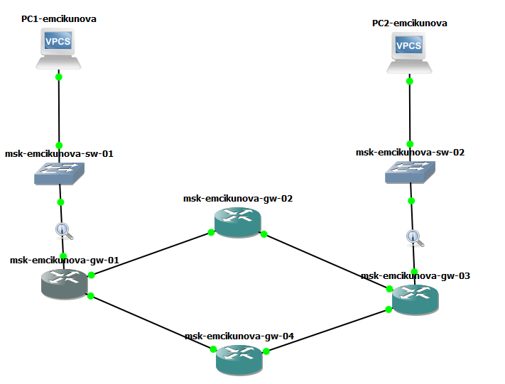{ #fig:001 width=80% height=70% }

## Использую ранее настроенную IPv4- и IPv6-адресацию

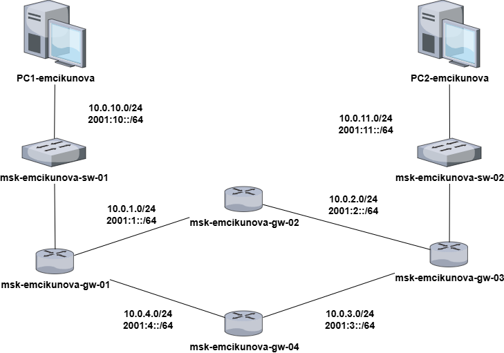{ #fig:002 width=80% height=70% }

# Настройка динамической маршрутизации OSPFv2

## Включаю протокол OSPFv2 на маршрутизаторах

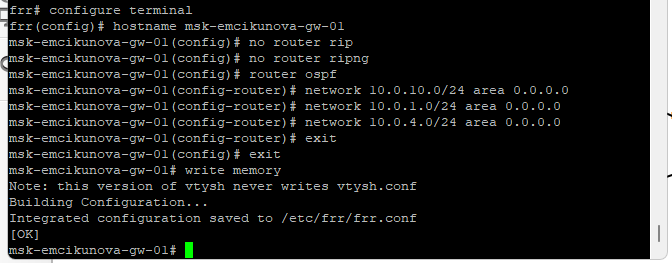{ #fig:003 width=80% height=70% }

## Проверяю соседство и таблицу маршрутизации OSPFv2

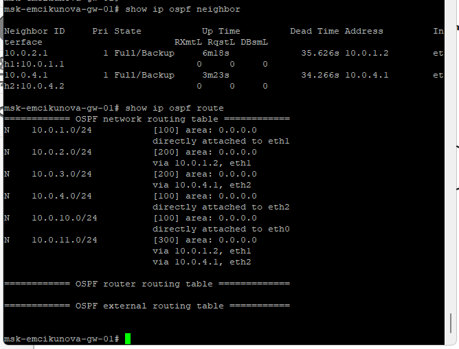{ #fig:004 width=80% height=70% }

## Проверяю IPv4-соединение и путь прохождения пакетов

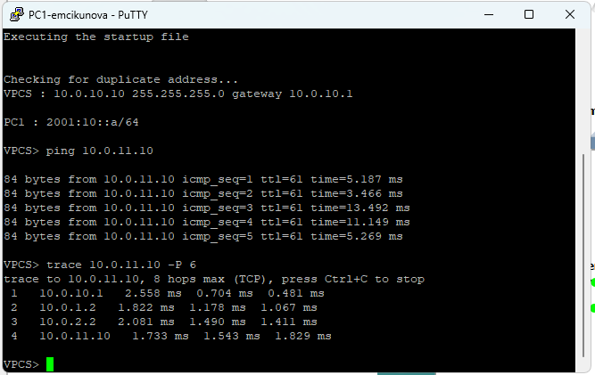{ #fig:005 width=80% height=70% }

# Исследование изменения маршрутов OSPFv2

## Отключаю интерфейс маршрутизатора gw-02

{ #fig:006 width=80% height=70% }

## Проверяю переключение на альтернативный IPv4-маршрут

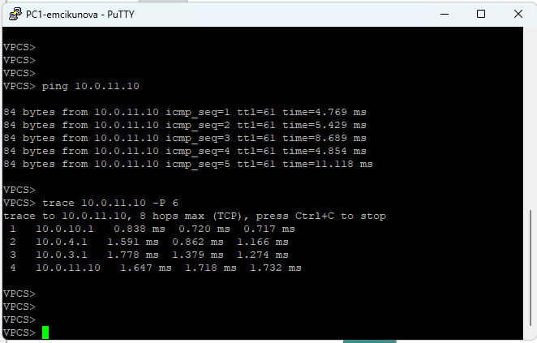{ #fig:007 width=80% height=70% }

# Анализ OSPFv2 в Wireshark

## Анализирую служебные сообщения OSPFv2 Hello

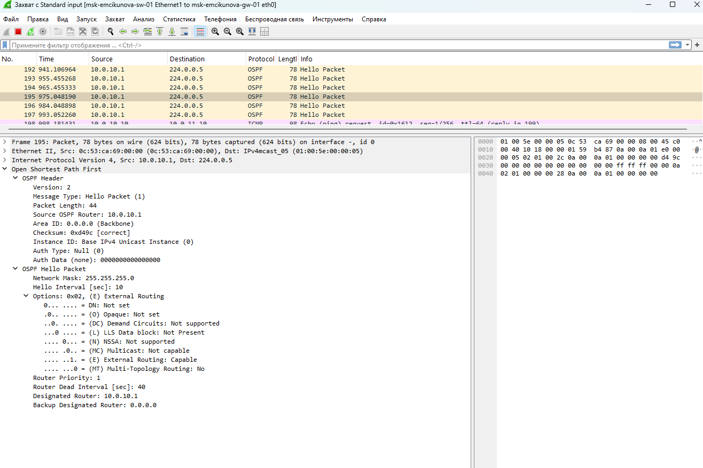{ #fig:008 width=90% height=70% }

# Настройка динамической маршрутизации OSPFv3

## Включаю протокол OSPFv3 на маршрутизаторах

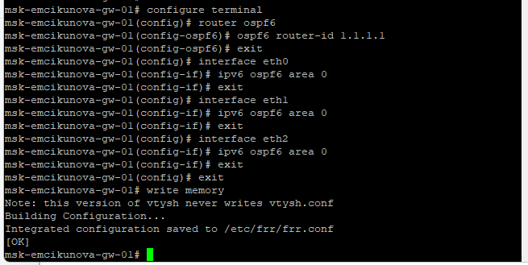{ #fig:009 width=80% height=70% }

## Проверяю соседство и таблицу маршрутизации OSPFv3

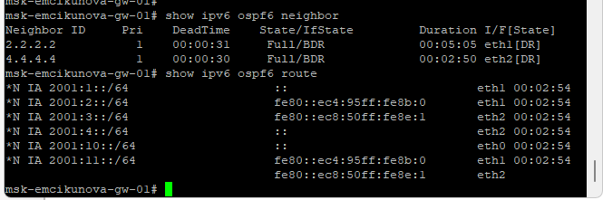{ #fig:010 width=80% height=70% }

## Проверяю IPv6-соединение и маршрут передачи пакетов

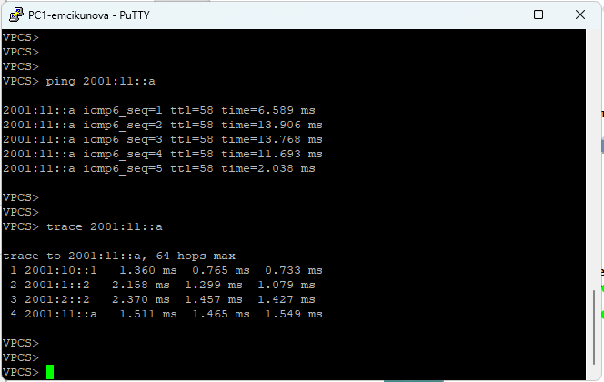{ #fig:011 width=80% height=70% }

# Исследование изменения маршрутов OSPFv3

## Отключаю интерфейс маршрутизатора gw-02

{ #fig:012 width=80% height=70% }

## Проверяю переключение на альтернативный IPv6-маршрут

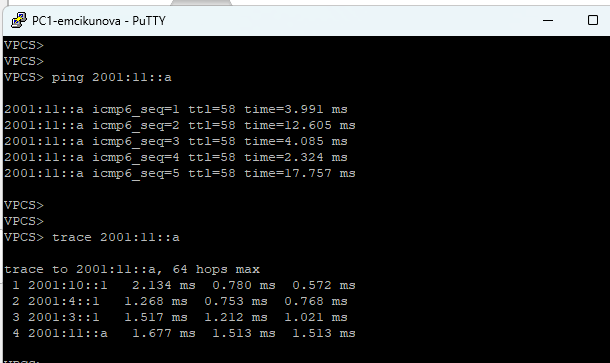{ #fig:013 width=80% height=70% }

# Анализ OSPFv3 в Wireshark

## Анализирую служебные сообщения OSPFv3 Hello

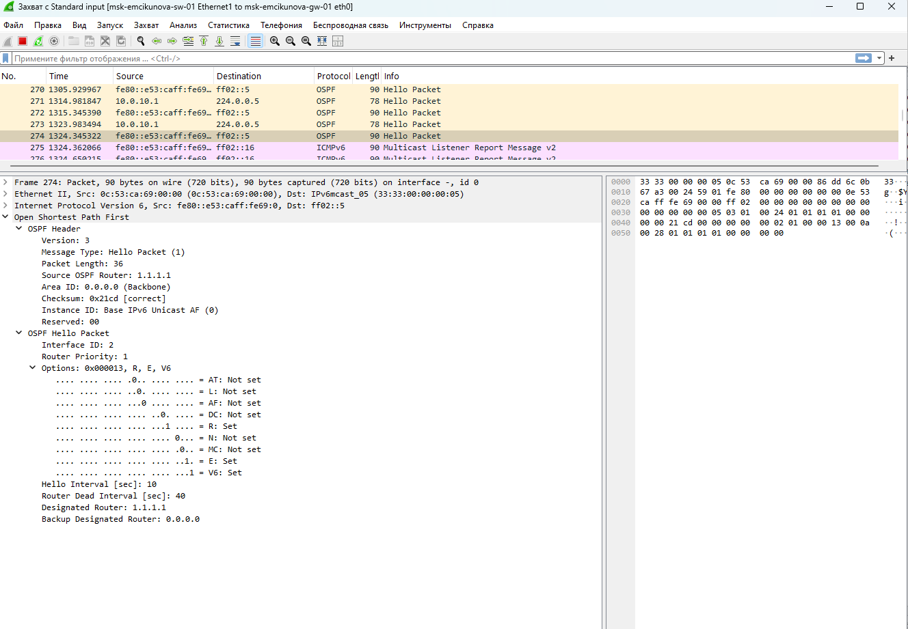{ #fig:014 width=90% height=70% }

# Самостоятельное задание

## Использую дополнительную топологию сети

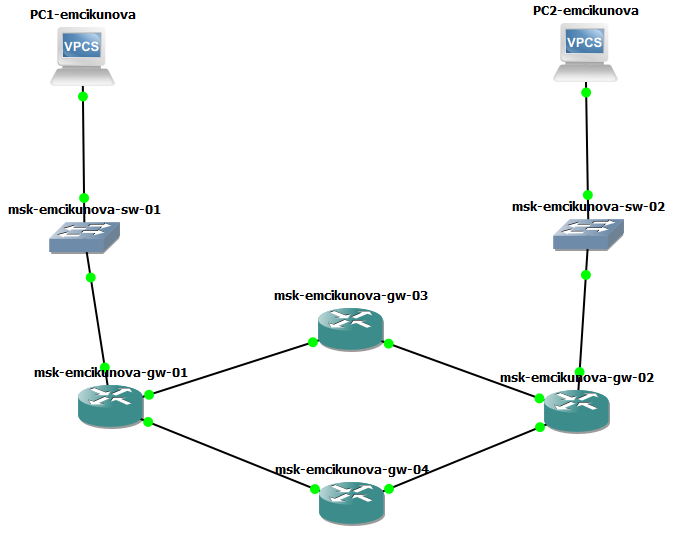{ #fig:015 width=80% height=70% }

## Настраиваю протоколы OSPFv2 и OSPFv3

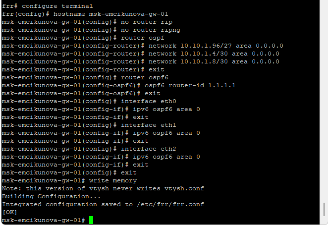{ #fig:016 width=80% height=70% }

## Проверяю соседство и таблицу маршрутизации OSPFv2

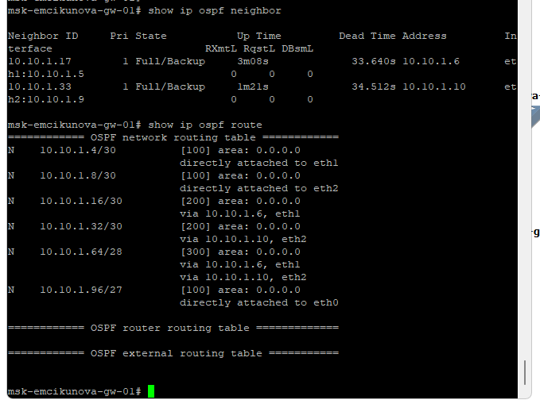{ #fig:017 width=80% height=70% }

## Проверяю соседство и таблицу маршрутизации OSPFv3

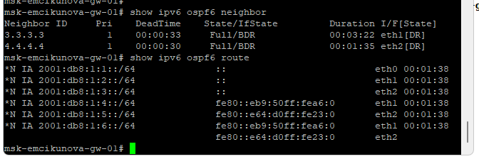{ #fig:018 width=80% height=70% }

## Проверяю соединения от PC1 до PC2 по IPv4 и IPv6

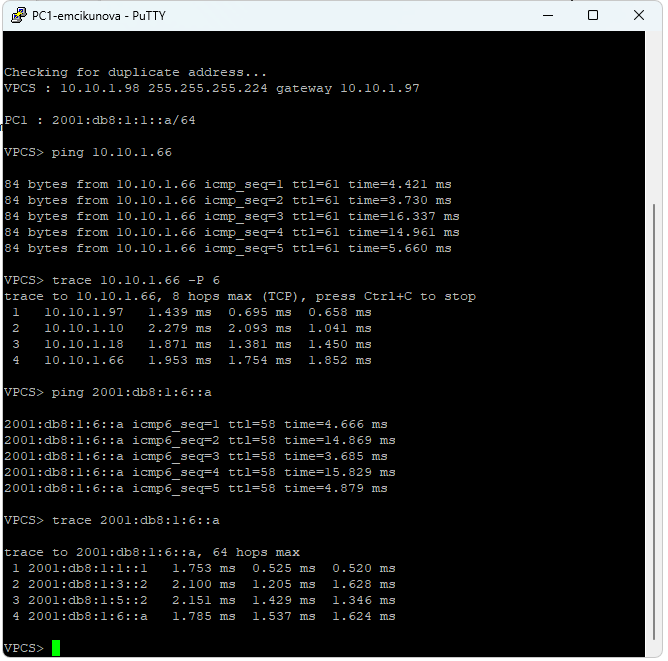{ #fig:019 width=80% height=70% }

## Проверяю соединения от PC2 до PC1 по IPv4 и IPv6

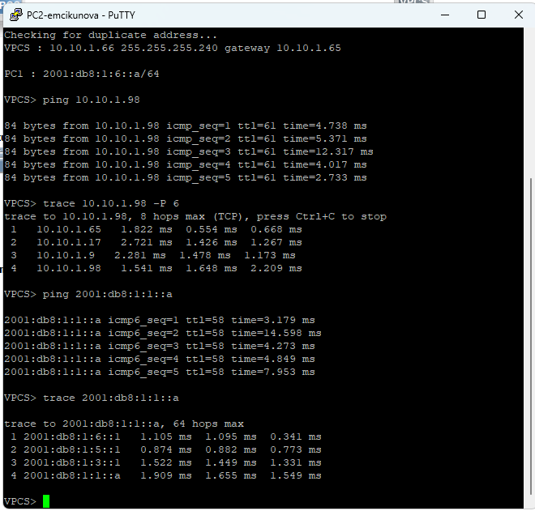{ #fig:020 width=80% height=70% }

# Вывод

## Результаты лабораторной работы

В GNS3 настроена динамическая маршрутизация по протоколам OSPFv2 и OSPFv3 на четырёх маршрутизаторах FRRouting с использованием ранее созданной сети с двойным стеком IPv4 и IPv6.

С помощью команд `show ip ospf neighbor`, `show ip ospf route`, `show ipv6 ospf6 neighbor` и `show ipv6 ospf6 route` проверены отношения соседства, таблицы маршрутизации и стоимость маршрутов. Командами `ping` и `trace` подтверждены доступность удалённых устройств и корректность прохождения пакетов.

При отключении сетевого интерфейса исследовано автоматическое переключение на альтернативный маршрут. В Wireshark проанализированы служебные сообщения OSPFv2 и OSPFv3 Hello, содержащие идентификаторы маршрутизаторов, сведения об областях маршрутизации и временные параметры протокола.

В самостоятельной части работы настроена дополнительная сеть с поддержкой OSPFv2 и OSPFv3. Проверены таблицы маршрутизации всех маршрутизаторов и соединения между оконечными устройствами по IPv4 и IPv6. Полученные результаты подтвердили работоспособность протоколов OSPF и возможность использования альтернативных маршрутов при нарушении сетевых соединений.