---
## Author
author:
  name:  Цыкунова Екатерина Михайловна
  email: 1132246732@rudn.ru
  affiliation:
    - name: Российский университет дружбы народов
      country: Российская Федерация
      postal-code: 117198
      city: Москва
      address: ул. Миклухо-Маклая, д. 6

## Title
title: "Отчёт по лабораторной работе №7"
subtitle: "Адресация IPv4 и IPv6. Настройка маршрутизации по протоколу OSPF"
license: "CC BY"
---

# Цель работы

Изучение принципов маршрутизации по протоколу OSPF в IPv4- и IPv6-сетях и принципов настройки сетевого оборудования.

# Выполнение лабораторной работы

## Адресация IPv4 и IPv6. Настройка маршрутизации по протоколу OSPF

### Настройка динамической маршрутизации в сетях IPv4 и IPv6

Для выполнения работы использую GNS3, маршрутизаторы FRRouting, коммутаторы Ethernet и оконечные устройства VPCS. Настраиваю OSPFv2 и OSPFv3, исследую маршруты и анализирую служебный трафик в Wireshark.

В качестве основы использую проект предыдущей лабораторной работы № 6 с уже настроенными IPv4- и IPv6-адресами.

### Документирование моделируемой сети

Сеть состоит из четырёх маршрутизаторов, двух коммутаторов и двух компьютеров. Маршрутизаторы образуют кольцевую топологию с двумя альтернативными путями между локальными сетями.

Использую таблицу адресов сетей из предыдущей лабораторной работы.

| Сегмент сети | Сеть IPv4 | Сеть IPv6 |
|---|---|---|
| PC1 — gw-01 | `10.0.10.0/24` | `2001:10::/64` |
| PC2 — gw-03 | `10.0.11.0/24` | `2001:11::/64` |
| gw-01 — gw-02 | `10.0.1.0/24` | `2001:1::/64` |
| gw-02 — gw-03 | `10.0.2.0/24` | `2001:2::/64` |
| gw-03 — gw-04 | `10.0.3.0/24` | `2001:3::/64` |
| gw-04 — gw-01 | `10.0.4.0/24` | `2001:4::/64` |

Адреса интерфейсов устройств также сохраняю без изменений.

| Устройство | Интерфейс | IPv4-адрес | IPv6-адрес | Следующее устройство |
|---|---|---|---|---|
| gw-01 | eth0 | `10.0.10.1/24` | `2001:10::1/64` | PC1 |
| gw-01 | eth1 | `10.0.1.1/24` | `2001:1::1/64` | gw-02 |
| gw-01 | eth2 | `10.0.4.2/24` | `2001:4::2/64` | gw-04 |
| gw-02 | eth0 | `10.0.1.2/24` | `2001:1::2/64` | gw-01 |
| gw-02 | eth1 | `10.0.2.1/24` | `2001:2::1/64` | gw-03 |
| gw-03 | eth0 | `10.0.11.1/24` | `2001:11::1/64` | PC2 |
| gw-03 | eth1 | `10.0.2.2/24` | `2001:2::2/64` | gw-02 |
| gw-03 | eth2 | `10.0.3.1/24` | `2001:3::1/64` | gw-04 |
| gw-04 | eth0 | `10.0.3.2/24` | `2001:3::2/64` | gw-03 |
| gw-04 | eth1 | `10.0.4.1/24` | `2001:4::1/64` | gw-01 |
| PC1 | NIC | `10.0.10.10/24` | `2001:10::a/64` | gw-01 |
| PC2 | NIC | `10.0.11.10/24` | `2001:11::a/64` | gw-03 |

Для `PC1` использую IPv4-шлюз `10.0.10.1`, для `PC2` — `10.0.11.1`.

Переношу из предыдущей работы схемы физической и логической топологии сети.

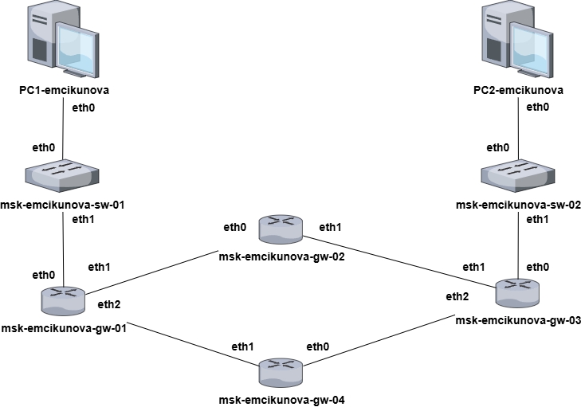{ #fig-l1 width=70% }

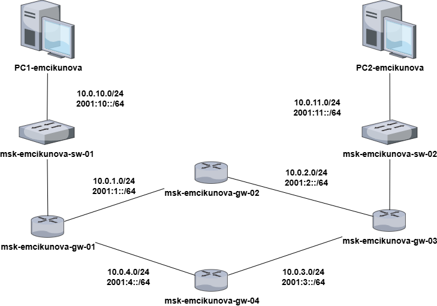{ #fig-l3 width=70% }

### Подготовка топологии в GNS3

Открываю предыдущий проект в GNS3. Проверяю наличие четырёх маршрутизаторов, двух коммутаторов и двух компьютеров. Все соединения активны, адресация настроена в предыдущей работе (см. рис. [@fig-001]).

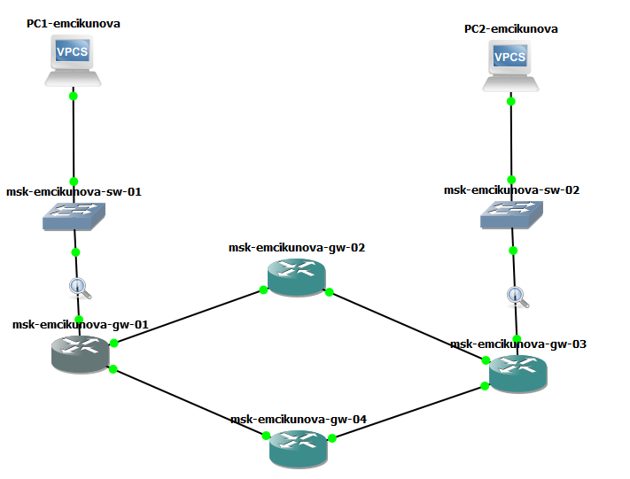{ #fig-001 width=70% }

### Настройка динамической маршрутизации OSPFv2

Начинаю настройку с маршрутизатора `msk-emcikunova-gw-01`. В режиме `configure terminal` удаляю процессы RIP командами `no router rip` и `no router ripng`.

Включаю OSPFv2 командой `router ospf` и добавляю сети `10.0.10.0/24`, `10.0.1.0/24` и `10.0.4.0/24` в область `0.0.0.0`. Сохраняю конфигурацию командой `write memory` (см. рис. [@fig-002]).

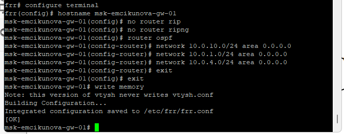{ #fig-002 width=70% }

На маршрутизаторе `gw-02` отключаю RIP и включаю OSPFv2. Добавляю сети `10.0.1.0/24` и `10.0.2.0/24` в область `0.0.0.0`, после чего сохраняю настройки (см. рис. [@fig-003]).

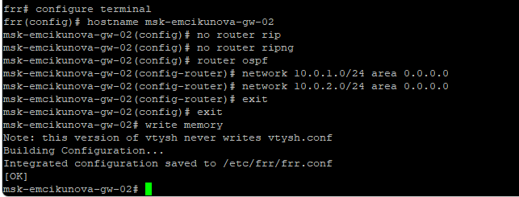{ #fig-003 width=70% }

Аналогично настраиваю `gw-03`. В процесс OSPF включаю сети `10.0.11.0/24`, `10.0.2.0/24` и `10.0.3.0/24`. Сохраняю конфигурацию (см. рис. [@fig-004]).

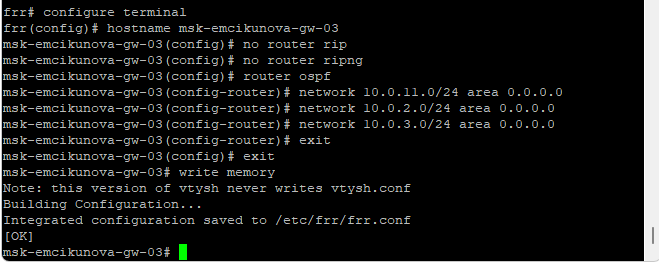{ #fig-004 width=70% }

На маршрутизаторе `gw-04` добавляю сети `10.0.3.0/24` и `10.0.4.0/24` в область `0.0.0.0`. После сохранения настроек OSPFv2 работает на всех четырёх маршрутизаторах (см. рис. [@fig-005]).

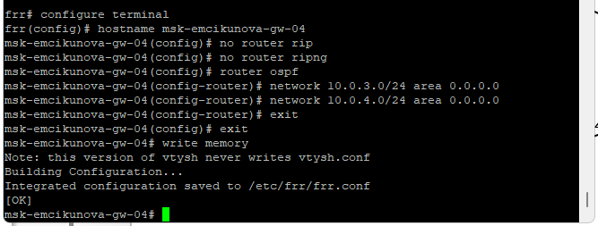{ #fig-005 width=70% }

### Проверка IPv4-маршрутизации

Перехожу к `PC1` и выполняю `ping 10.0.11.10`. Получаю пять успешных ответов от `PC2`.

Командой `trace 10.0.11.10 -P 6` определяю первоначальный маршрут: `PC1 — gw-01 — gw-02 — gw-03 — PC2` (см. рис. [@fig-006]).

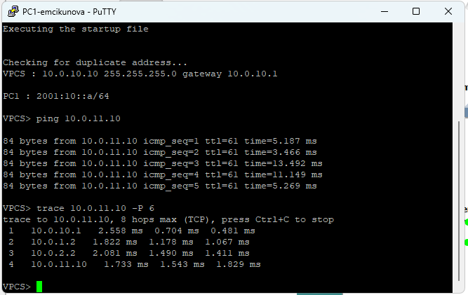{ #fig-006 width=70% }

На `gw-01` выполняю команды `show ip ospf neighbor` и `show ip ospf route`.

В таблице отображаются два соседа в состоянии `Full/Backup`. Для сети `10.0.11.0/24` доступны два маршрута одинаковой стоимости через `10.0.1.2` и `10.0.4.1` (см. рис. [@fig-007]).

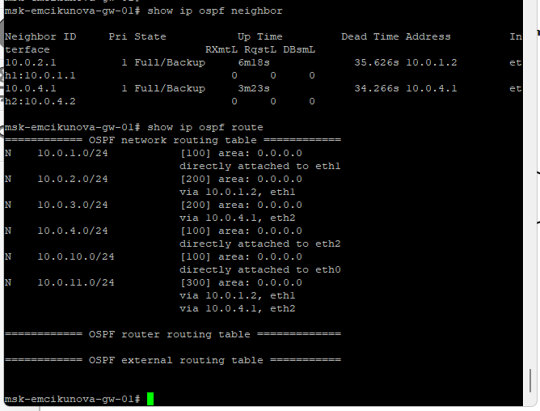{ #fig-007 width=70% }

### Исследование изменения IPv4-маршрутов

Для проверки перестроения маршрутов на `gw-02` отключаю интерфейс `eth0` командами `interface eth0` и `shutdown` (см. рис. [@fig-008]).

{ #fig-008 width=70% }

Повторно проверяю OSPF на `gw-01`. В таблице соседей остаётся только `gw-04`, а маршрут к сети `10.0.11.0/24` проходит через `10.0.4.1` (см. рис. [@fig-009]).

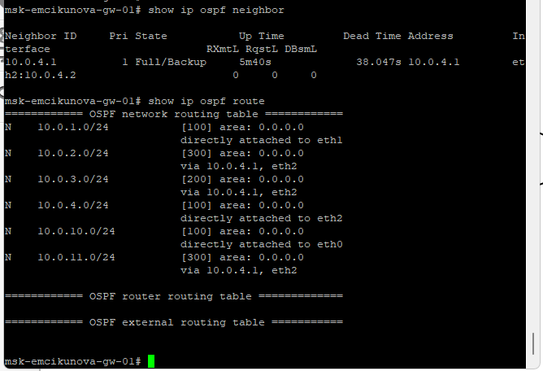{ #fig-009 width=70% }

На `PC1` снова выполняю `ping` и `trace` до `10.0.11.10`. Соединение сохраняется, а пакеты проходят через `gw-04`: `PC1 — gw-01 — gw-04 — gw-03 — PC2` (см. рис. [@fig-010]).

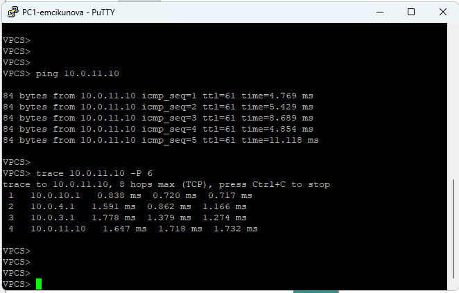{ #fig-010 width=70% }

Восстанавливаю интерфейс `eth0` на `gw-02` командой `no shutdown` и сохраняю конфигурацию (см. рис. [@fig-011]).

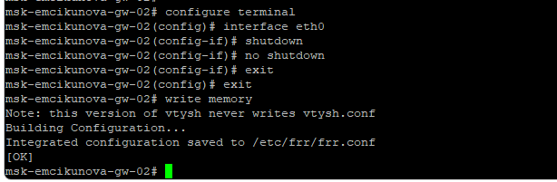{ #fig-011 width=70% }

На `gw-01` повторно выполняю `show ip ospf neighbor` и `show ip ospf route`. Оба соседа возвращаются в состояние `Full/Backup`, восстанавливаются два маршрута к удалённой сети (см. рис. [@fig-012]).

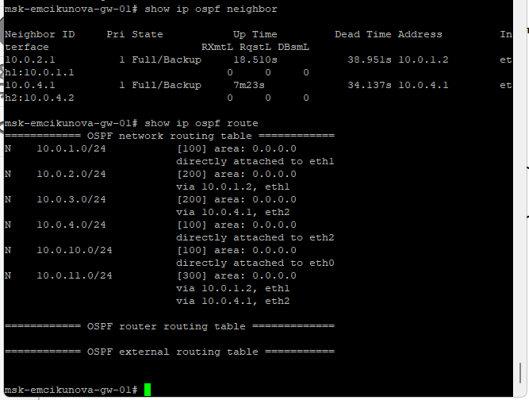{ #fig-012 width=70% }

Проверяю доступность `PC2`. Пакеты успешно передаются через `gw-04`, несмотря на восстановление соединения с `gw-02`, поскольку OSPF располагает маршрутами одинаковой стоимости (см. рис. [@fig-013]).

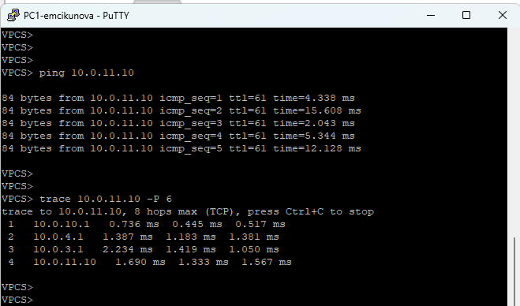{ #fig-013 width=70% }

### Анализ трафика OSPFv2 в Wireshark

Открываю захват трафика между `sw-01` и `gw-01`. В Wireshark исследую пакет OSPF Hello с адресом источника `10.0.10.1` и групповым адресом назначения `224.0.0.5`.

В заголовке отображаются версия OSPF `2`, область `0.0.0.0`, интервал Hello `10` секунд и Dead `40` секунд (см. рис. [@fig-014]).

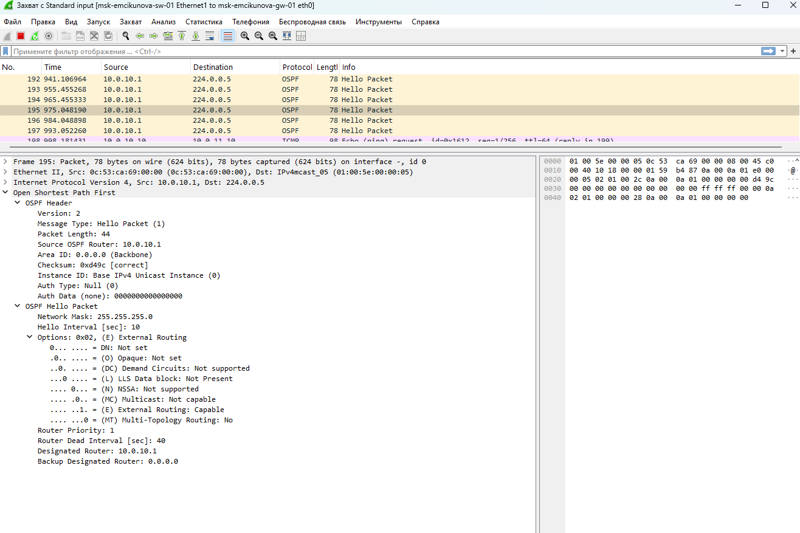{ #fig-014 width=70% }

Аналогично исследую трафик между `gw-03` и `sw-02`. Обнаруживаю сообщения OSPF Hello от `10.0.11.1` к `224.0.0.5`.

Сравниваю параметры пакетов и подтверждаю использование одинаковой области и временных интервалов OSPFv2 (см. рис. [@fig-015]).

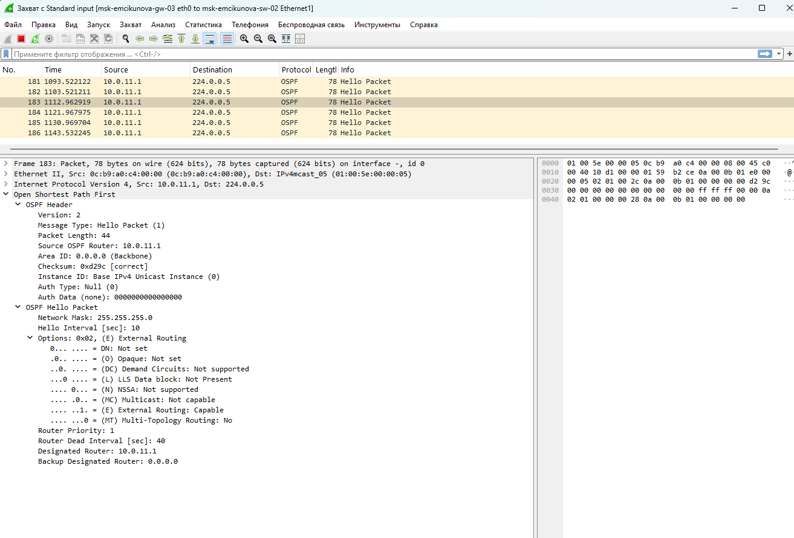{ #fig-015 width=70% }

### Настройка динамической маршрутизации OSPFv3

Перехожу к настройке OSPFv3 для IPv6.

На маршрутизаторе `gw-01` выполняю `router ospf6` и назначаю идентификатор командой `ospf6 router-id 1.1.1.1`.

На интерфейсах `eth0`, `eth1` и `eth2` выполняю `ipv6 ospf6 area 0`, после чего сохраняю конфигурацию (см. рис. [@fig-016]).

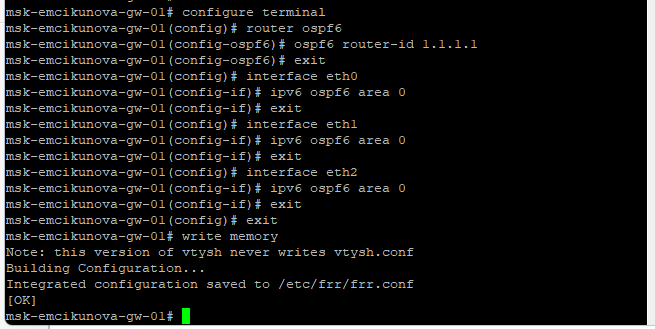{ #fig-016 width=70% }

На `gw-02` включаю OSPFv3, назначаю Router ID `2.2.2.2` и добавляю интерфейсы `eth0` и `eth1` в область `0` (см. рис. [@fig-017]).

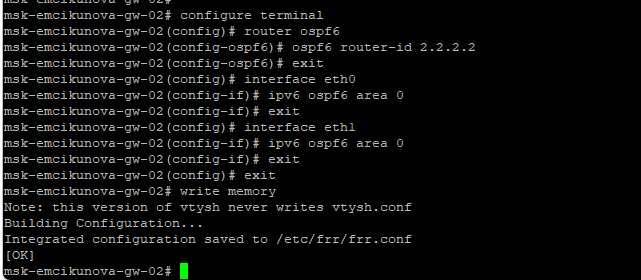{ #fig-017 width=70% }

На `gw-03` назначаю Router ID `3.3.3.3` и включаю OSPFv3 на интерфейсах `eth0`, `eth1` и `eth2` (см. рис. [@fig-018]).

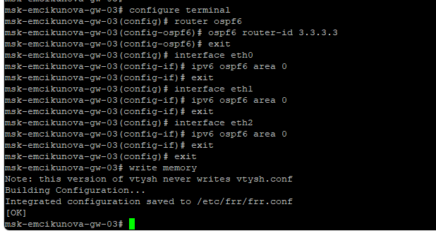{ #fig-018 width=70% }

На `gw-04` устанавливаю Router ID `4.4.4.4` и включаю OSPFv3 на интерфейсах `eth0` и `eth1`. Сохраняю настройки, завершая конфигурирование всех маршрутизаторов (см. рис. [@fig-019]).

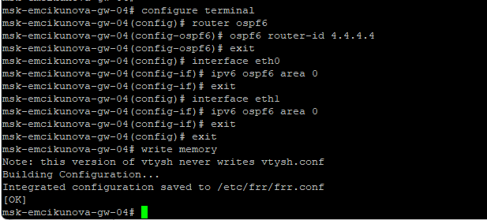{ #fig-019 width=70% }

### Проверка IPv6-маршрутизации

На `PC1` выполняю команду `ping 2001:11::a` и получаю пять успешных ответов.

Команда `trace 2001:11::a` показывает маршрут через `gw-01`, `gw-02` и `gw-03` до компьютера `PC2` (см. рис. [@fig-020]).

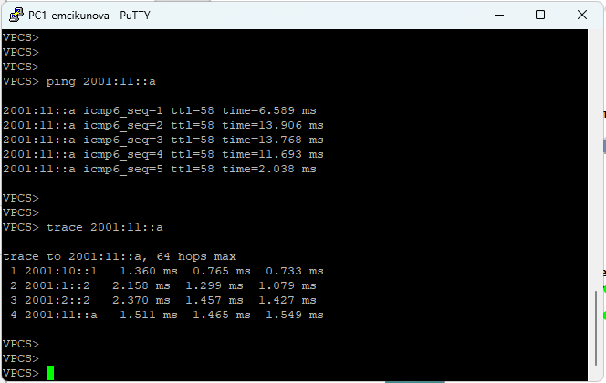{ #fig-020 width=70% }

На `gw-01` выполняю `show ipv6 ospf6 neighbor` и `show ipv6 ospf6 route`.

В таблице соседей присутствуют маршрутизаторы `2.2.2.2` и `4.4.4.4`. Таблица маршрутизации содержит все IPv6-подсети и альтернативные пути к сети `2001:11::/64` (см. рис. [@fig-021]).

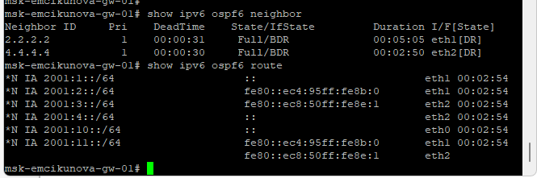{ #fig-021 width=70% }

### Исследование изменения IPv6-маршрутов

Для проверки отказоустойчивости OSPFv3 на маршрутизаторе `gw-02` повторно отключаю интерфейс `eth0` командой `shutdown` (см. рис. [@fig-022]).

{ #fig-022 width=70% }

На `gw-01` проверяю соседство и таблицу IPv6-маршрутов. Сосед `2.2.2.2` становится недоступен, а маршруты к удалённым сетям перестраиваются через `gw-04` (см. рис. [@fig-023]).

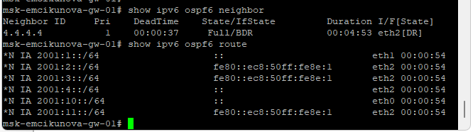{ #fig-023 width=70% }

На `PC1` выполняю `ping 2001:11::a` и `trace 2001:11::a`.

Получаю успешные ответы. Трассировка показывает альтернативный маршрут `PC1 — gw-01 — gw-04 — gw-03 — PC2` (см. рис. [@fig-024]).

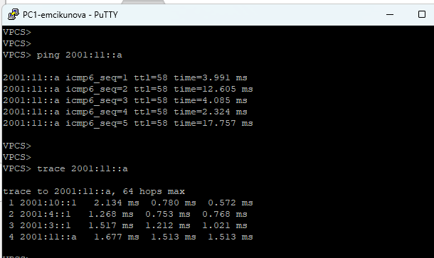{ #fig-024 width=70% }

На маршрутизаторе `gw-02` восстанавливаю интерфейс `eth0` командой `no shutdown` и сохраняю изменения (см. рис. [@fig-025]).

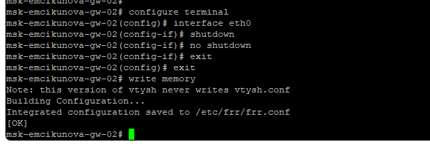{ #fig-025 width=70% }

Повторно проверяю OSPFv3 на `gw-01`. Оба соседа находятся в состоянии `Full/BDR`, а в таблице маршрутизации снова доступны обе ветви сети (см. рис. [@fig-026]).

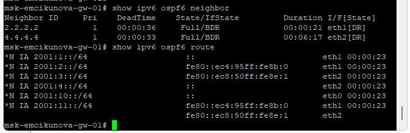{ #fig-026 width=70% }

На `PC1` проверяю доступность адреса `2001:11::a`. Соединение работает, а трассировка показывает путь через `gw-04`. OSPFv3 продолжает корректно маршрутизировать пакеты (см. рис. [@fig-027]).

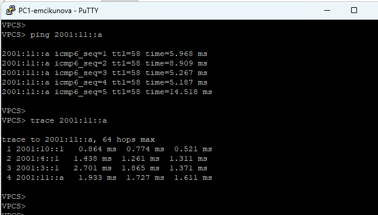{ #fig-027 width=70% }

### Анализ трафика OSPFv3 в Wireshark

Исследую захваченный трафик на соединении `sw-01 — gw-01`.

В Wireshark обнаруживаю сообщения OSPFv3 Hello, передаваемые на групповой адрес `ff02::5`.

В заголовке пакета отображаются версия OSPF `3`, Router ID `1.1.1.1`, область `0.0.0.0`, Hello Interval `10` и Dead Interval `40` секунд (см. рис. [@fig-028]).

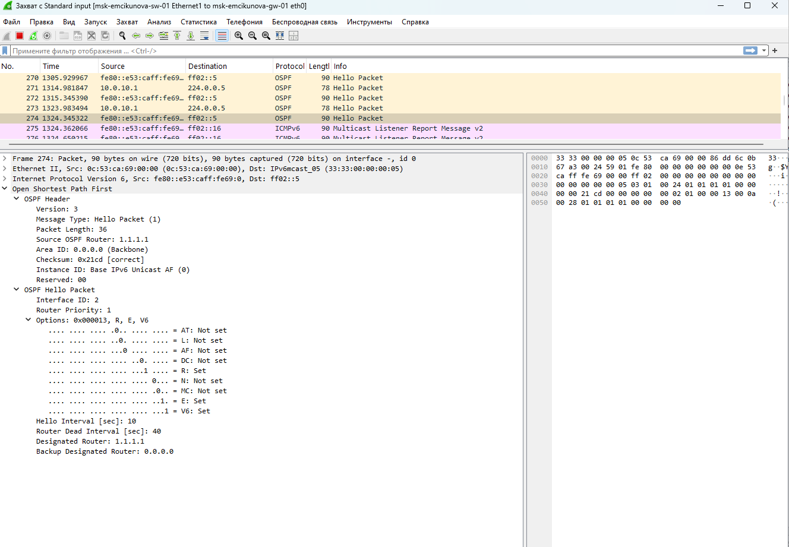{ #fig-028 width=70% }

Аналогично исследую трафик на соединении `gw-03 — sw-02`.

В сообщении Hello указан Router ID `3.3.3.3`. Источником служит локальный IPv6-адрес `fe80::/10`, а назначением — `ff02::5`.

Убеждаюсь, что OSPFv2 и OSPFv3 одновременно работают в сети с двойным стеком IPv4 и IPv6 (см. рис. [@fig-029]).

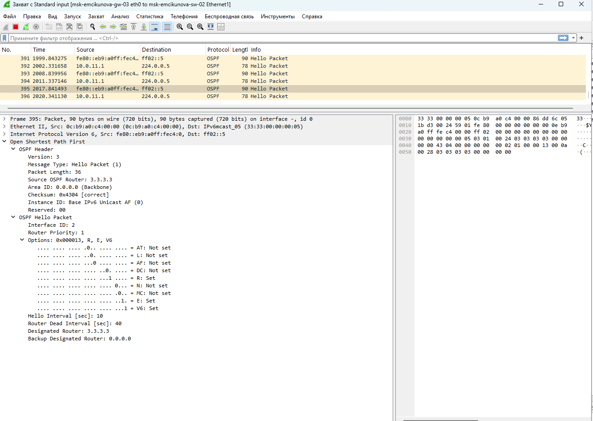{ #fig-029 width=70% }

## Задание для самостоятельного выполнения

### Документирование сети

Для самостоятельного задания использую топологию предыдущей лабораторной работы. Сеть состоит из четырёх маршрутизаторов, двух коммутаторов и двух компьютеров.

Между `PC1` и `PC2` доступны два пути через маршрутизаторы `gw-03` и `gw-04`.

Переношу таблицу адресов сетей.

| Сегмент сети | Сеть IPv4 | Сеть IPv6 |
|---|---|---|
| PC1 — gw-01 | `10.10.1.96/27` | `2001:db8:1:1::/64` |
| PC2 — gw-02 | `10.10.1.64/28` | `2001:db8:1:6::/64` |
| gw-01 — gw-03 | `10.10.1.4/30` | `2001:db8:1:2::/64` |
| gw-01 — gw-04 | `10.10.1.8/30` | `2001:db8:1:3::/64` |
| gw-03 — gw-02 | `10.10.1.16/30` | `2001:db8:1:4::/64` |
| gw-04 — gw-02 | `10.10.1.32/30` | `2001:db8:1:5::/64` |

Использую ранее назначенные адреса интерфейсов.

| Устройство | Интерфейс | IPv4-адрес | IPv6-адрес |
|---|---|---|---|
| gw-01 | eth0 | `10.10.1.97/27` | `2001:db8:1:1::1/64` |
| gw-01 | eth1 | `10.10.1.5/30` | `2001:db8:1:2::1/64` |
| gw-01 | eth2 | `10.10.1.9/30` | `2001:db8:1:3::1/64` |
| gw-02 | eth0 | `10.10.1.65/28` | `2001:db8:1:6::1/64` |
| gw-02 | eth1 | `10.10.1.18/30` | `2001:db8:1:4::2/64` |
| gw-02 | eth2 | `10.10.1.34/30` | `2001:db8:1:5::2/64` |
| gw-03 | eth0 | `10.10.1.6/30` | `2001:db8:1:2::2/64` |
| gw-03 | eth1 | `10.10.1.17/30` | `2001:db8:1:4::1/64` |
| gw-04 | eth0 | `10.10.1.10/30` | `2001:db8:1:3::2/64` |
| gw-04 | eth1 | `10.10.1.33/30` | `2001:db8:1:5::1/64` |
| PC1 | NIC | `10.10.1.98/27` | `2001:db8:1:1::a/64` |
| PC2 | NIC | `10.10.1.66/28` | `2001:db8:1:6::a/64` |

Для `PC1` использую шлюз `10.10.1.97`, для `PC2` — `10.10.1.65`.

Добавляю схемы L1 и L3, разработанные в предыдущей лабораторной работе.

{ #fig-l1-task width=70% }

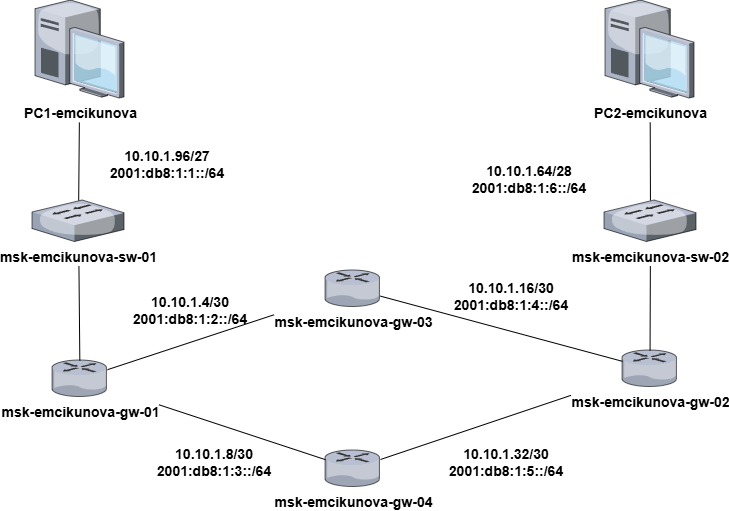{ #fig-l3-task width=70% }

### Подготовка топологии

Открываю проект самостоятельного задания в GNS3. Проверяю состояние соединений и наличие ранее настроенной IPv4- и IPv6-адресации.

Поскольку первоначальная конфигурация выполнена в лабораторной работе № 6, перехожу непосредственно к настройке OSPF (см. рис. [@fig-030]).

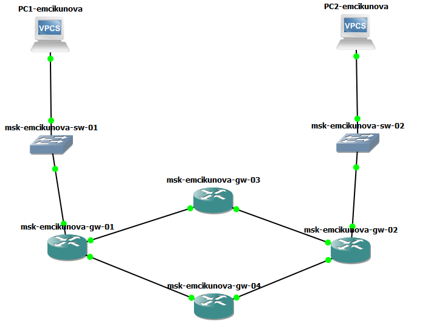{ #fig-030 width=70% }

### Настройка OSPFv2 и OSPFv3

На маршрутизаторе `gw-01` удаляю настройки RIP и включаю OSPFv2 командой `router ospf`.

В область `0.0.0.0` добавляю сети `10.10.1.96/27`, `10.10.1.4/30` и `10.10.1.8/30`.

Затем включаю OSPFv3 командой `router ospf6`, назначаю Router ID `1.1.1.1` и добавляю интерфейсы `eth0`, `eth1` и `eth2` в область `0` (см. рис. [@fig-031]).

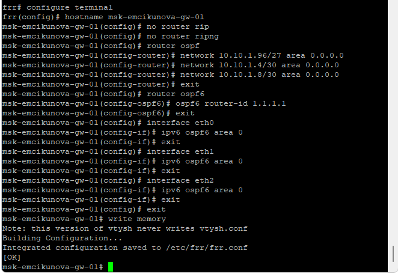{ #fig-031 width=70% }

На `gw-02` настраиваю OSPFv2 для сетей `10.10.1.64/28`, `10.10.1.16/30` и `10.10.1.32/30`.

Для OSPFv3 назначаю Router ID `2.2.2.2` и включаю протокол на интерфейсах `eth0`, `eth1` и `eth2`. Сохраняю конфигурацию командой `write memory` (см. рис. [@fig-032]).

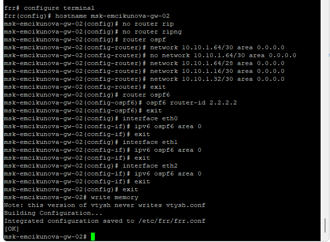{ #fig-032 width=70% }

На маршрутизаторе `gw-03` добавляю в OSPFv2 сети `10.10.1.4/30` и `10.10.1.16/30`.

Для OSPFv3 устанавливаю Router ID `3.3.3.3` и включаю интерфейсы `eth0` и `eth1` в область `0` (см. рис. [@fig-033]).

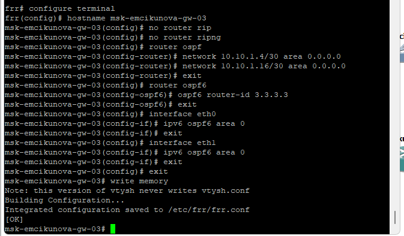{ #fig-033 width=70% }

На `gw-04` настраиваю OSPFv2 для сетей `10.10.1.8/30` и `10.10.1.32/30`.

В OSPFv3 назначаю Router ID `4.4.4.4` и добавляю интерфейсы `eth0` и `eth1` в область `0`. Сохраняю настройки, завершая конфигурирование (см. рис. [@fig-034]).

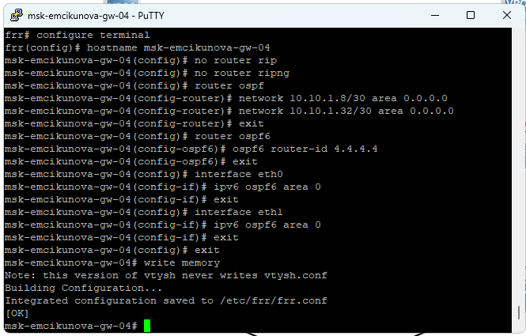{ #fig-034 width=70% }

### Проверка маршрутизации на gw-01

На `gw-01` выполняю `show ip ospf neighbor` и `show ip ospf route`.

В таблице присутствуют соседи `10.10.1.17` и `10.10.1.33` в состоянии `Full/Backup`.

Для сети `10.10.1.64/28` отображаются два маршрута одинаковой стоимости через `10.10.1.6` и `10.10.1.10` (см. рис. [@fig-035]).

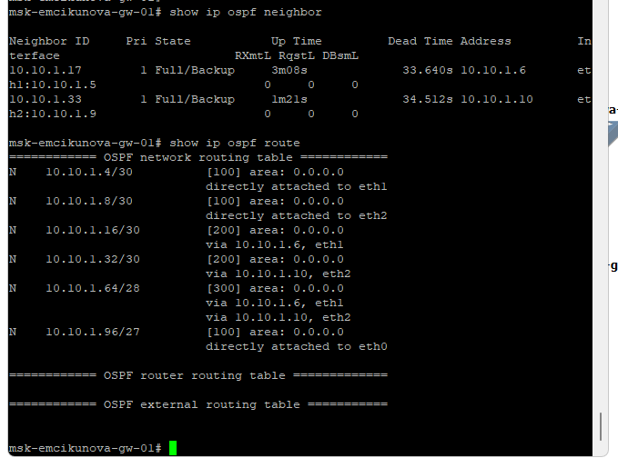{ #fig-035 width=70% }

Для проверки IPv6 выполняю `show ipv6 ospf6 neighbor` и `show ipv6 ospf6 route`.

Обнаруживаю соседей `3.3.3.3` и `4.4.4.4`. В таблице присутствуют все IPv6-подсети, включая альтернативные маршруты к сети `2001:db8:1:6::/64` (см. рис. [@fig-036]).

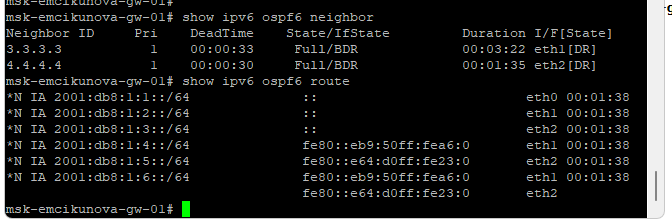{ #fig-036 width=70% }

### Проверка маршрутизации на gw-02

На `gw-02` выполняю `show ip ospf neighbor` и `show ip ospf route`.

Оба соседа находятся в состоянии `Full/Backup`. Для сети `10.10.1.96/27` доступны два маршрута через `10.10.1.17` и `10.10.1.33`, стоимость каждого составляет `300` (см. рис. [@fig-037]).

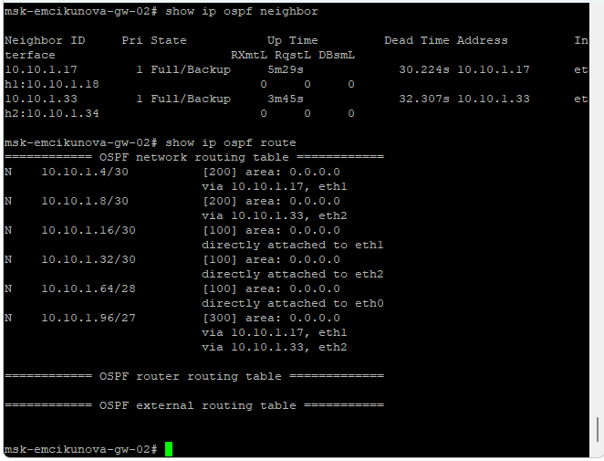{ #fig-037 width=70% }

Проверяю OSPFv3 командами `show ipv6 ospf6 neighbor` и `show ipv6 ospf6 route`.

Соседи `3.3.3.3` и `4.4.4.4` находятся в состоянии `Full/BDR`. В таблице присутствуют маршруты ко всем IPv6-сетям, включая `2001:db8:1:1::/64` (см. рис. [@fig-038]).

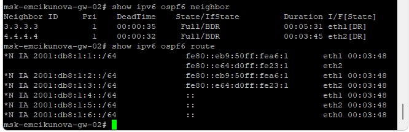{ #fig-038 width=70% }

### Проверка маршрутизации на gw-03

На `gw-03` проверяю OSPFv2 командами `show ip ospf neighbor` и `show ip ospf route`.

Соседи `10.10.1.97` и `10.10.1.65` находятся в состоянии `Full/DR`. Маршрут к сети `PC1` проходит через `10.10.1.5`, а к сети `PC2` — через `10.10.1.18` (см. рис. [@fig-039]).

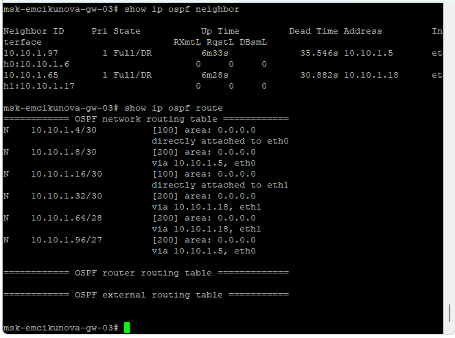{ #fig-039 width=70% }

Проверяю OSPFv3. В таблице соседей отображаются `1.1.1.1` и `2.2.2.2` в состоянии `Full/DR`.

В таблице маршрутизации присутствуют удалённые сети `2001:db8:1:1::/64` и `2001:db8:1:6::/64`, доступные через соответствующих соседей (см. рис. [@fig-040]).

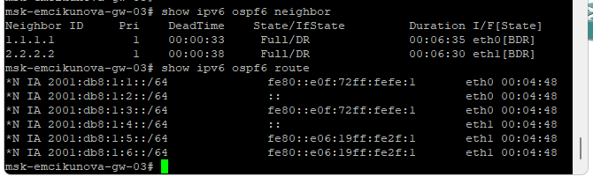{ #fig-040 width=70% }

### Проверка маршрутизации на gw-04

На `gw-04` выполняю команды `show ip ospf neighbor` и `show ip ospf route`.

Соседи `10.10.1.97` и `10.10.1.65` находятся в состоянии `Full/DR`.

Маршрут к сети `10.10.1.96/27` проходит через `10.10.1.9`, а к сети `10.10.1.64/28` — через `10.10.1.34` (см. рис. [@fig-041]).

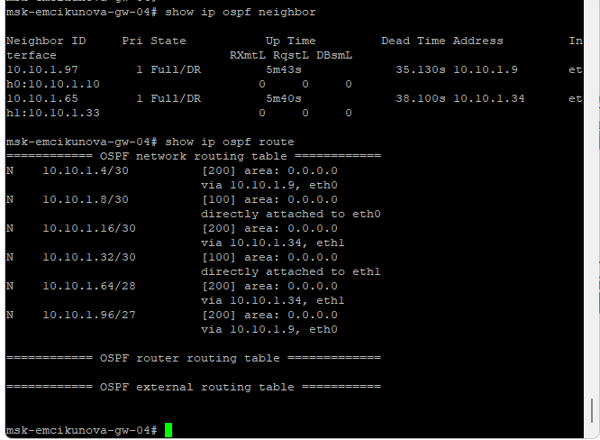{ #fig-041 width=70% }

Проверяю OSPFv3 на `gw-04`. В таблице соседей присутствуют `1.1.1.1` и `2.2.2.2` в состоянии `Full/DR`.

В таблице маршрутизации отображаются все IPv6-сети, включая удалённые локальные подсети `2001:db8:1:1::/64` и `2001:db8:1:6::/64` (см. рис. [@fig-042]).

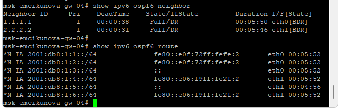{ #fig-042 width=70% }

### Проверка соединения между оконечными устройствами

Перехожу к `PC1` и выполняю `ping 10.10.1.66`, получая пять успешных ответов.

Команда `trace 10.10.1.66 -P 6` показывает маршрут через `gw-01`, `gw-04` и `gw-02`.

Затем выполняю `ping 2001:db8:1:6::a` и `trace 2001:db8:1:6::a`. IPv6-соединение также работает, пакеты проходят через `gw-04` (см. рис. [@fig-043]).

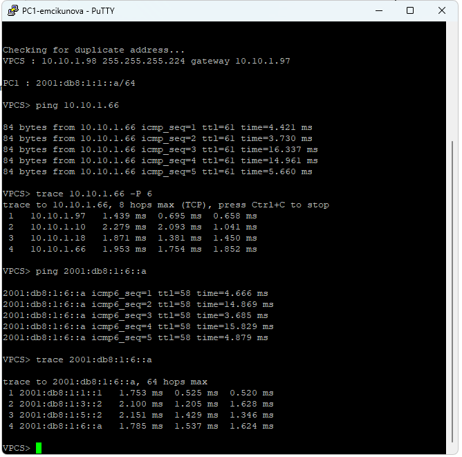{ #fig-043 width=70% }

Перехожу к `PC2` и выполняю `ping 10.10.1.98`. Получаю пять успешных ответов.

Трассировка IPv4 показывает маршрут через `gw-02`, `gw-03` и `gw-01`.

Затем проверяю IPv6 командами `ping 2001:db8:1:1::a` и `trace 2001:db8:1:1::a`. IPv6-пакеты проходят через `gw-02`, `gw-04` и `gw-01`.

Убеждаюсь, что OSPFv2 и OSPFv3 обеспечивают доступность оконечных устройств в обоих направлениях (см. рис. [@fig-044]).

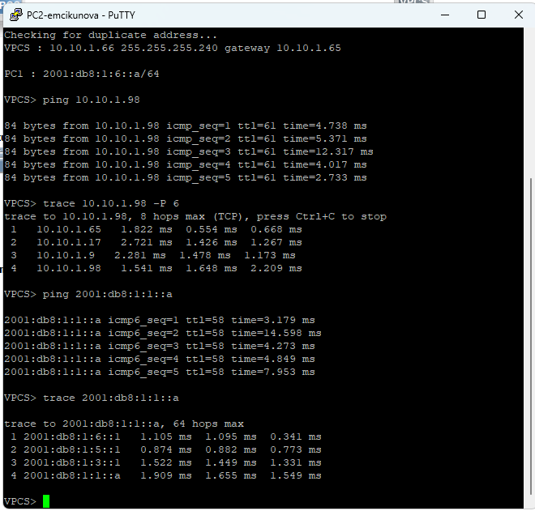{ #fig-044 width=70% }

# Вывод

В ходе лабораторной работы изучены принципы динамической маршрутизации по протоколу OSPF в сетях IPv4 и IPv6. На маршрутизаторах FRRouting настроены OSPFv2 и OSPFv3, проверены отношения соседства и таблицы маршрутизации. С помощью команд `ping` и `trace` подтверждена доступность удалённых устройств. При отключении сетевого интерфейса установлено, что OSPF автоматически перестраивает маршруты через альтернативные соединения. В Wireshark исследованы служебные сообщения OSPF Hello и их основные параметры. В самостоятельном задании настроена дополнительная сеть с двойным стеком IPv4 и IPv6, проверены маршруты всех четырёх маршрутизаторов и соединения между оконечными устройствами. Результаты подтвердили работоспособность OSPFv2 и OSPFv3 и возможность использования альтернативных путей передачи пакетов.

# Список литературы

1. [Королькова А. В., Кулябов Д. С. Сетевые технологии. Лабораторные работы: учебное пособие. — М.: РУДН, 2014.](https://repository.rudn.ru/ru/records/manual/record/56143/)

2. [GNS3 Documentation — официальная документация по моделированию компьютерных сетей](https://docs.gns3.com/docs)

3. [FRRouting Documentation. OSPFv2 — настройка маршрутизации IPv4](https://docs.frrouting.org/en/latest/ospfd.html)

4. [FRRouting Documentation. OSPFv3 — настройка маршрутизации IPv6](https://docs.frrouting.org/en/latest/ospf6d.html)

5. [RFC 2328. OSPF Version 2. — IETF, 1998](https://www.rfc-editor.org/info/rfc2328)

6. [RFC 5340. OSPF for IPv6. — IETF, 2008](https://www.rfc-editor.org/info/rfc5340)

7. [Wireshark Documentation. Display Filter Reference: OSPF](https://www.wireshark.org/docs/dfref/o/ospf.html)

# Вывод

В ходе лабораторной работы была настроена сеть в GNS3 для исследования динамической маршрутизации по протоколам OSPFv2 и OSPFv3. На четырёх маршрутизаторах FRRouting выполнена настройка протоколов OSPFv2 для IPv4 и OSPFv3 для IPv6, настроены области маршрутизации и идентификаторы маршрутизаторов. На оконечных устройствах VPCS проверена доступность удалённых узлов с помощью команды `ping` и определены пути прохождения пакетов с использованием команды `trace`. С помощью команд `show ip ospf neighbor`, `show ip ospf route`, `show ipv6 ospf6 neighbor` и `show ipv6 ospf6 route` исследованы отношения соседства, таблицы маршрутизации и стоимость маршрутов. Проведено исследование изменения маршрутов при отключении и повторном включении сетевого интерфейса одного из маршрутизаторов. В Wireshark выполнен анализ служебных пакетов OSPFv2 и OSPFv3, содержащих идентификаторы маршрутизаторов, сведения об областях маршрутизации и параметры сообщений Hello. В самостоятельной части работы настроена дополнительная сеть с двойным стеком IPv4 и IPv6, проверены таблицы маршрутизации всех маршрутизаторов и соединения между оконечными устройствами. Результаты проверок подтвердили работоспособность протоколов OSPFv2 и OSPFv3, успешное установление отношений соседства, обмен маршрутной информацией и возможность автоматического переключения на альтернативный маршрут при нарушении сетевого соединения.

# Список литературы

1. [Королькова А. В., Кулябов Д. С. Сетевые технологии. Лабораторные работы: учебное пособие. — М.: РУДН, 2014. — 106 с.](https://repository.rudn.ru/ru/records/manual/record/56143/)

2. [GNS3 Documentation. Getting Started with GNS3 — официальная документация по созданию сетевых топологий, настройке виртуальных устройств и моделированию компьютерных сетей в GNS3](https://docs.gns3.com/docs/getting-started/your-first-gns3-topology)

3. [FRRouting Documentation. OSPFv2 — официальная документация по настройке протокола OSPF для IPv4, управлению областями маршрутизации, отношениями соседства и таблицами маршрутов](https://docs.frrouting.org/en/latest/ospfd.html)

4. [FRRouting Documentation. OSPFv3 — официальная документация по настройке динамической маршрутизации IPv6, идентификаторов маршрутизаторов, сетевых интерфейсов и проверке маршрутов OSPFv3](https://docs.frrouting.org/en/latest/ospf6d.html)

5. [Moy J. RFC 2328. OSPF Version 2. — Internet Engineering Task Force (IETF), 1998 — спецификация протокола OSPFv2, алгоритма SPF, механизмов обнаружения соседей и обмена информацией о состоянии каналов](https://www.rfc-editor.org/info/rfc2328)

6. [Coltun R., Ferguson D., Moy J., Lindem A. RFC 5340. OSPF for IPv6. — Internet Engineering Task Force (IETF), 2008 — спецификация протокола OSPFv3, принципов маршрутизации IPv6 и формирования маршрутной информации](https://www.rfc-editor.org/info/rfc5340)

7. [Wireshark Documentation. Display Filter Reference: Open Shortest Path First — официальная документация по анализу служебных пакетов OSPFv2 и OSPFv3, сообщений Hello, идентификаторов маршрутизаторов и параметров областей маршрутизации](https://www.wireshark.org/docs/dfref/o/ospf.html)